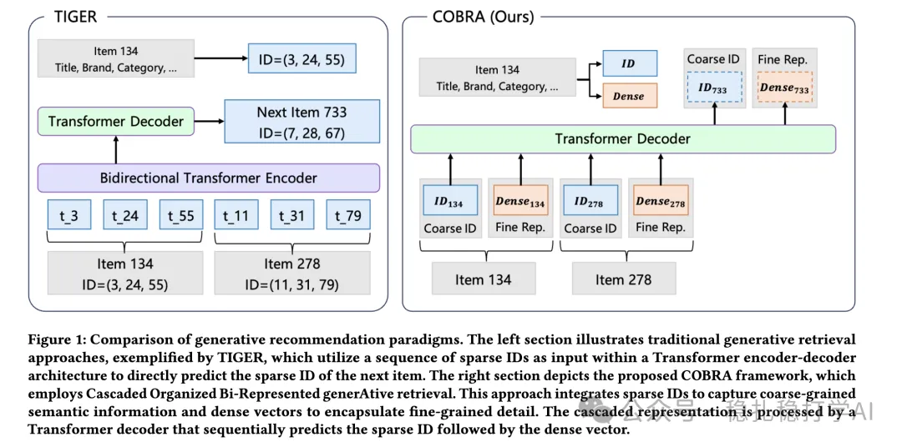

# Recommendation papers (2025.3.5): Baidu's cascaded generative recommendation, sparse ID first, then dense representation
> [中文版](2025-03-05-baidu-sparse-dense-generative.md)

> Source: WeChat post https://mp.weixin.qq.com/s?__biz=MzkzNDYyNjM1NA==&mid=2247484290&idx=1&sn=7febb51dd122338fb676f3d5f90e934c&scene=21#wechat_redirect, published 2025-03-05.
> Split from the roundup "Recommendation papers (2025.3.5): the spring breeze of large models keeps blowing, Baidu and Alibaba bring surprises"; same issue: [Baidu cascaded sparse + dense generative recommendation](../generative-recommendation/2025-03-05-baidu-sparse-dense-generative.full.en.md), [Alibaba LREA low-rank attention for long sequences](../behavior-sequence-modeling/2025-03-05-ali-lrea-low-rank-attention.full.en.md).

Sparse Meets Dense:Unified Generative Recommendations with Cascaded Sparse-Dense Representations

Link: https://arxiv.org/pdf/2503.02453

Company: Baidu

Area: generative recommendation

Overview:

This paper proposes a staged generative recommendation method that splits generation into two stages: first generate a sparse ID, then generate a dense representation.

(1) Stage one: based on user behavior and context, generate the sparse ID of a candidate item. The sparse ID is the item's discrete representation in a code space and carries explicit semantics, such as the item's category, brand or price range.

(2) Stage two: based on the sparse ID, generate the item's dense representation. The dense representation is the item's continuous vector in embedding space and captures fine-grained characteristics, such as appearance, function or user reviews.

This is a **coarse-to-fine** process: the model can first use the sparse ID to filter a candidate set that roughly matches the user's interests, then use the dense representation to rank it more finely.

Why is "sparse ID first, then dense representation" the innovation?

* The sparse-ID stage compresses the complex recommendation space into a small discrete set, so the model reasons over a smaller candidate set, which cuts compute cost significantly.
* Each stage's generator conditions on the previous stage's output, improving the quality of the recommendations step by step.
* The sparse-then-dense generation strategy not only lowers model complexity but also improves diversity. The candidate set produced by sparse-ID generation is already diverse, and dense-representation generation can keep that diversity.

Takeaways:

Does this look familiar? Isn't it a lot like the chain of thought that has been so hot lately? Through step-wise decomposition (sparse → dense), conditional dependence (the ID guides vector generation) and a coarse-to-fine strategy, it builds a "reasoning chain" inside a recommender system. This design improves both accuracy and diversity, and offers a new paradigm for generative recommendation. You could call it a clever borrowing and implementation of the "chain of thought" idea in recommendation.

Credibility: production

Recommendation: worth reading

