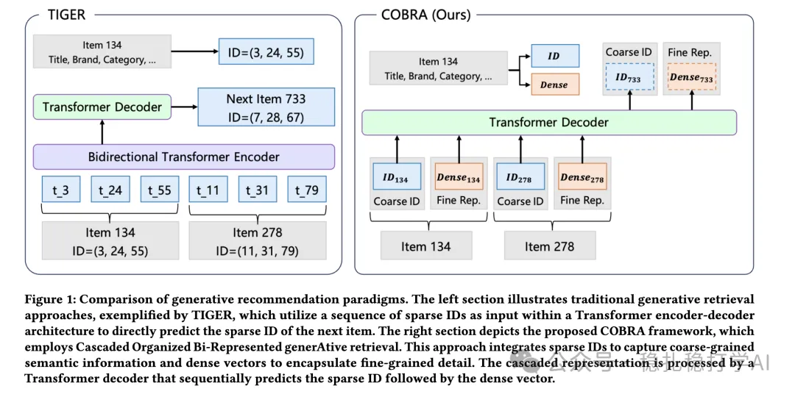

# 推荐算法(2025.3.5)：百度先稀疏ID后稠密表示的级联生成式推荐

> 原文：https://mp.weixin.qq.com/s?__biz=MzkzNDYyNjM1NA==&mid=2247484290&idx=1&sn=7febb51dd122338fb676f3d5f90e934c&scene=21#wechat_redirect
> 作者：算法工程师刘明星（稳扎稳打学AI）| 发表于 2025-03-05
> 本文拆自《推荐算法(2025.3.5)：大模型的春风吹呀吹，百度、阿里带来惊喜》，同期 2 篇：[百度稀疏+稠密级联生成式推荐](../generative-recommendation/2025-03-05-baidu-sparse-dense-generative.md)、[阿里低秩长序列注意力 LREA](../behavior-sequence-modeling/2025-03-05-ali-lrea-low-rank-attention.md)。

关注我，每天为你精挑细选最优质、最新鲜的推荐算法paper，陪你一起保持进步、不断精进！

> [English version](2025-03-05-baidu-sparse-dense-generative.full.en.md)

Sparse Meets Dense:Unified Generative Recommendations with Cascaded Sparse-Dense Representations

网址：https://arxiv.org/pdf/2503.02453

公司：百度

方向：生成式推荐

解读：

这篇paper提出了一种分阶段的生成式推荐方法，它将生成过程分成两阶段，先生成稀疏ID，再生成稠密表示。

（1）第一阶段：基于用户行为和上下文，生成候选商品的稀疏ID（Sparse ID）。稀疏ID是商品在编码空间中的离散表示，具有明确的语义，例如商品的类别、品牌或价格区间。

（2）第二阶段：基于稀疏ID，生成商品的稠密表示（Dense Representation）。稠密表示是商品在嵌入空间中的连续向量，捕捉商品的细粒度特征，例如外观、功能或用户评价。

这是一个**从粗到精（Coarse-to-Fine）**的过程，模型可以先通过稀疏ID筛选出大致符合用户兴趣的候选集，然后通过稠密表示进一步精细化排序。

为何先稀疏 ID 再稠密表示是创新点？

* 稀疏ID阶段将复杂的推荐空间压缩成一个小的离散集合，模型可以在较小的候选集中进行推理，显著减少了计算成本。
* 每个阶段的生成模型可以根据前一阶段的输出进行条件生成，逐步优化推荐结果的质量。
* 先稀疏后稠密的生成策略不仅降低了模型的复杂度，还提升了推荐的多样性。稀疏ID生成的候选集本身就具有多样性，而稠密表示的生成可以进一步保留这种多样性。

心得：

这种做法，大家看着是不是有点眼熟，是不是跟最近大火的思维链很像。它通过分步分解（稀疏 → 稠密）、条件依赖（ID 指导向量生成）和从粗到精的策略，构建了一个推荐系统中的“推理链条”。这种设计不仅提升了推荐的准确性和多样性，也为生成式推荐提供了一种新的范式，可以说是推荐领域对“思维链”思想的一种巧妙借鉴和实现。

可信度：生产

推荐等级：推荐看看

