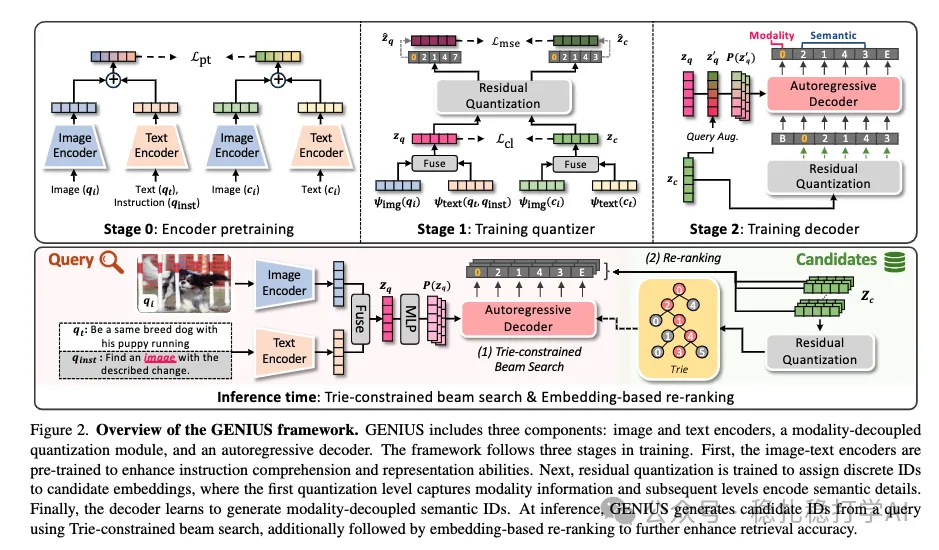

# Recommendation algorithms (2025.3.26): Amazon's universal multimodal retrieval approach

> [中文版](2025-03-26-amazon-genius.md)

1 GENIUS: A Generative Framework for Universal Multimodal Search

Link: https://arxiv.org/pdf/2503.19868

Company: Amazon

Area: multimodal retrieval + generative retrieval

Overview:

It achieves generative retrieval across multiple modalities, including text-to-text, text-to-image, image-to-text and so on.

The concrete method is to train several base networks, then use them to help train the generative network. The base networks are 1) image/text encoders, 2) a fusion network for the image and text embeddings, and 3) a quantization network for the fused embedding. 1) is easy to understand: it turns images and text into embeddings; 2) fuses the image and text embeddings into one embedding; 3) turns the embedding into discrete IDs.

The generative network's input is the embedding produced from the query's image/text (augmented by interpolation with the target; I won't go into it), and its output is discrete IDs. The IDs that the target gets from the quantization network in 3) above are used as the generative network's labels for supervision.

Innovations: the image-text fusion and alignment, the quantization network and the generative network. A very natural idea, worth a look.

Credibility: offline

Recommendation: worth a look

Figure 2: Overview of the GENIUS framework. GENIUS includes three components: image and text encoders, a modality-decoupled quantization module, and an autoregressive decoder. The framework follows three stages in training. First, the image-text encoders are pre-trained to enhance instruction comprehension and representation abilities. Next, residual quantization is trained to assign discrete IDs to candidate embeddings, where the first quantization level captures modality information and subsequent levels encode semantic details. Finally, the decoder learns to generate modality-decoupled semantic IDs. At inference, GENIUS generates candidate IDs from a query using Trie-constrained beam search, additionally followed by embedding-based re-ranking to further enhance retrieval accuracy.
