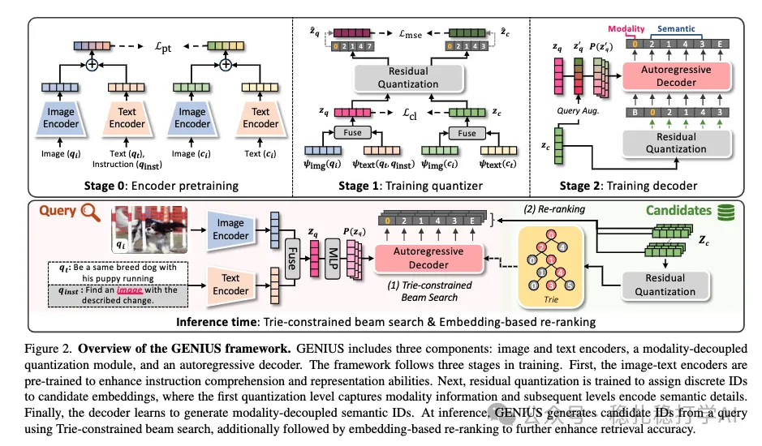

# 推荐算法(2025.3.26)：Amazon的通用多模态检索方案

> 原文：https://mp.weixin.qq.com/s?__biz=MzkzNDYyNjM1NA==&mid=2247484361&idx=1&sn=ef14cd71ae96be68b2b0c0268bff11f5&scene=21#wechat_redirect
> 作者：算法工程师刘明星（稳扎稳打学AI）| 发表于 2025-03-26

嘿，记得给“稳扎稳打学AI”添加星标

关注我，每天为你精挑细选最优质、最新鲜的推荐算法paper，陪你一起保持进步、不断精进！

📄 [本公众号paper推荐原则](https://mp.weixin.qq.com/s?__biz=MzkzNDYyNjM1NA==&mid=2247484097&idx=1&sn=18322c279290b555eb030e12953b7c7f&scene=21#wechat_redirect)

1 GENIUS: A Generative Framework for Universal Multimodal Search

网址：https://arxiv.org/pdf/2503.19868

公司：amazon

方向：多模态检索+生成式召回

解读：

实现了对多种模态的生成式召回检索，包括文本到文本、文本到图像、图像到文本等。

具体方法，就是训练多个基础网络，再通过这些网络帮助生成生成式网络的训练。基础网络包括1）图像/文本的encoder，2）图像和文本embed的fusion网络，3）融合embed的量化网络。其中，1）好理解，就是将图文转成embed；2）就是将图文embed融合为一个embed；3）就是将embed转成离散ID的。

生成式网络的输入是query图文生成的embed（通过target的插值增强，不展开了），输出离散的ID。target经过上面3）的量化网络生成的ID，作为生成式网络的label做监督。

创新点：就是对图文的融合和对齐、量化网络和生成网络。很natural的idea，值得看一看。

可信度：离线

推荐等级：推荐看看

Figure 2: Overview of the GENIUS framework. GENIUS includes three components: image and text encoders, a modality-decoupled quantization module, and an autoregressive decoder. The framework follows three stages in training. First, the image-text encoders are pre-trained to enhance instruction comprehension and representation abilities. Next, residual quantization is trained to assign discrete IDs to candidate embeddings, where the first quantization level captures modality information and subsequent levels encode semantic details. Finally, the decoder learns to generate modality-decoupled semantic IDs. At inference, GENIUS generates candidate IDs from a query using Trie-constrained beam search, additionally followed by embedding-based re-ranking to further enhance retrieval accuracy.

请帮忙点赞、转发，谢谢。您认为哪篇论文最有潜力应用到实际业务中？

## 欢迎干货投稿 \ 论文宣传 \ 合作交流

推荐您继续阅读：

■ [推荐算法(2025.3.25)：阿里在搜索推荐中的用户意图拆解](https://mp.weixin.qq.com/s?__biz=MzkzNDYyNjM1NA==&mid=2247484354&idx=1&sn=11dfdfe34964fac5bad347458c0a1427&scene=21#wechat_redirect)

■ [LLM赋能推荐算法：谷歌、百度、快手、小红书的最新多模态实践](https://mp.weixin.qq.com/s?__biz=MzkzNDYyNjM1NA==&mid=2247484347&idx=1&sn=392a5f87dc9864e4c07683dc99dd2dcd&scene=21#wechat_redirect)

■ [推荐算法(2025.3.17)：阿里的Transformer特征交叉方法改进](https://mp.weixin.qq.com/s?__biz=MzkzNDYyNjM1NA==&mid=2247484331&idx=1&sn=0275ea88d3ae2df4b4c46a37c390ba01&scene=21#wechat_redirect)

历史文章索引：https://docs.qq.com/sheet/DYXZTZ0tseHRyZGtt?tab=BB08J2

由于公众号试行乱序推送，您可能不再准时收到稳扎稳打学AI的推送。为了第一时间收到本号的干货内容， 请将本号设为星标，以及常点文末右下角的“在看”。

喜欢的话点个在看吧👇

个人观点，仅供参考
