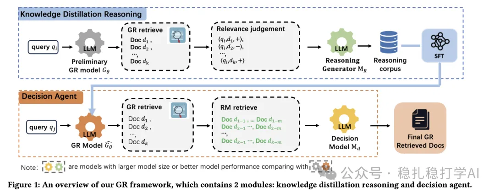

# Recommendation algorithms (2025.3.28): Alibaba sharpens its knife to a shine

> [中文版](2025-03-28-ali-alipay-gr.md)

1 Alleviating LLM-based Generative Retrieval Hallucination in Alipay Search

Link: https://arxiv.org/pdf/2503.21098

Company: Alibaba

Area: generative retrieval

Overview: alleviates the hallucination problem of LLM-based GR (generative retrieval) and improves retrieval precision.

The framework has two core modules: knowledge-distillation reasoning and a decision agent.

Knowledge-distillation reasoning expands the sample set and enriches it with information. The decision agent expands and filters the retrieval results.

(1) Knowledge-distillation reasoning

Use the trained GR LLM, which has the hallucination problem, to retrieve samples for queries, and let LLMs vote on relevance: only documents judged irrelevant unanimously by all LLMs are labeled negatives, to ensure high quality; the rest are positives. This expands the sample set.

For these samples, a stronger LLM (e.g. Qwen2.5-72B) then generates a reasoning process for each query-document pair, explaining why a document is relevant or irrelevant to the query (for example, whether the document content matches the query intent). This enriches the sample set with information.

The new samples from these two steps are added to the old samples, and the GR LLM mentioned above is fine-tuned with SFT.

(2) Decision agent

Use the GR LLM to retrieve docs for a query. For each doc, retrieve related documents again with BM25. A strong LLM (M_d, e.g. Qwen2.5-32B) evaluates the relevance of these expanded documents from multiple perspectives. The perspectives include structured information (such as the product's company, product type, product term, etc.). Only documents judged relevant from every perspective are kept.

This module is used in online inference.

Takeaways: the core of this paper is trying to eliminate hallucination in generative retrieval through data augmentation and a chained filter using the old model. The former aims to train the LLM more; the latter reflects a safety-net mindset.

Credibility: production

Recommendation: worth a look

