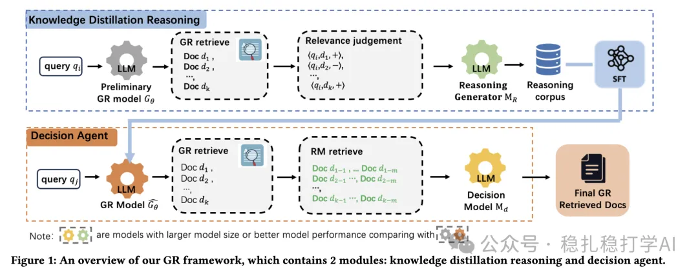

# 推荐算法(2025.3.28)：阿里把刀磨的锃亮

> 原文：https://mp.weixin.qq.com/s?__biz=MzkzNDYyNjM1NA==&mid=2247484367&idx=1&sn=7c13d464e011a462340a2d19ec24ea03&scene=21#wechat_redirect
> 作者：算法工程师刘明星（稳扎稳打学AI）| 发表于 2025-03-28

嘿，记得给“稳扎稳打学AI”添加星标

关注我，每天为你精挑细选最优质、最新鲜的推荐算法paper，陪你一起保持进步、不断精进！

> [English version](2025-03-28-ali-alipay-gr.full.en.md)

📄 [本公众号paper推荐原则](https://mp.weixin.qq.com/s?__biz=MzkzNDYyNjM1NA==&mid=2247484097&idx=1&sn=18322c279290b555eb030e12953b7c7f&scene=21#wechat_redirect)

1 Alleviating LLM-based Generative Retrieval Hallucination in Alipay Search

网址：https://arxiv.org/pdf/2503.21098

公司：阿里

方向：生成式召回

解读：缓解LLM-based GR的幻觉问题并提升检索精度。

框架包含两个核心模块：知识蒸馏推理和决策代理。

知识蒸馏推理实现了对样本集的扩展和信息增强增。决策代理实现了对召回结果的扩展和筛选。

（1）知识蒸馏推理

使用训练过的但是有幻觉问题的GR大模型为query召回样本，大模型投票判断相关性，只有被所有LLM一致判定为无关的文档才被标记为负样本，以确保高质量，其它为正样本。这就实现了对样本集的扩展。

这些样本，再使用一个更强大的LLM（如Qwen2.5-72B）对每个查询-文档对生成推理过程，推理过程解释了为什么某个文档与查询相关或无关（例如，文档内容是否匹配查询意图）。这就实现了对样本集的信息增强。

经过这两步处理的新样本加入到老样本里，并对前面提到的GR大模型sft微调。

（2）决策代理

使用GR大模型，为query召回doc。为每个doc，再用BM25召回相关文档。使用一个强大的LLM（MdM_dMd，如Qwen2.5-32B）从多视角评估这些扩展文档的相关性。多视角包括结构化信息（如产品公司、产品类型、产品期限等）。只有在所有视角下都被判定为相关的文档才会被保留。

这个模块用于线上inference。

心得：本文的核心是通过数据增强和使用老模型串联过滤，尝试消除生成式召回中的幻觉问题。前者是希望更多的训练大模型，后者是一种兜底思想的体现。

可信度：生产

推荐等级：推荐看看

请帮忙点赞、转发，谢谢。您认为哪篇论文最有潜力应用到实际业务中？

## 欢迎干货投稿 \ 论文宣传 \ 合作交流

推荐您继续阅读：

■ [推荐算法(2025.3.26)：Amazon的通用多模态检索方案](https://mp.weixin.qq.com/s?__biz=MzkzNDYyNjM1NA==&mid=2247484361&idx=1&sn=ef14cd71ae96be68b2b0c0268bff11f5&scene=21#wechat_redirect)

■ [推荐算法(2025.3.25)：阿里在搜索推荐中的用户意图拆解](https://mp.weixin.qq.com/s?__biz=MzkzNDYyNjM1NA==&mid=2247484354&idx=1&sn=11dfdfe34964fac5bad347458c0a1427&scene=21#wechat_redirect)

■ [LLM赋能推荐算法：谷歌、百度、快手、小红书的最新多模态实践](https://mp.weixin.qq.com/s?__biz=MzkzNDYyNjM1NA==&mid=2247484347&idx=1&sn=392a5f87dc9864e4c07683dc99dd2dcd&scene=21#wechat_redirect)

历史文章索引：https://docs.qq.com/sheet/DYXZTZ0tseHRyZGtt?tab=BB08J2

由于公众号试行乱序推送，您可能不再准时收到稳扎稳打学AI的推送。为了第一时间收到本号的干货内容， 请将本号设为星标，以及常点文末右下角的“在看”。

喜欢的话点个在看吧 👇

个人观点，仅供参考
