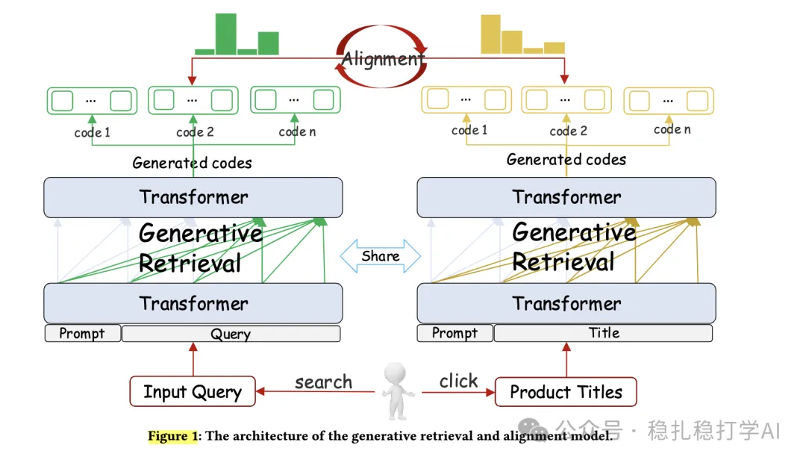

# Recommendation papers (2025.4.3): JD's generative retrieval and alignment model GRAM
> [中文版](2025-04-03-jd-generative-retrieval-alignment.md)

> Source: WeChat post https://mp.weixin.qq.com/s?__biz=MzkzNDYyNjM1NA==&mid=2247484400&idx=1&sn=9097b2a31975d4b210324c72e4d1ff2e&scene=21#wechat_redirect, published 2025-04-03.
> Split from the roundup "Recommendation papers (2025.4.3): intent modeling is an important way for LLMs to empower search, ads and recommendation"; same issue: [Tencent LLM commercial intention ad retrieval](../llm4rec/2025-04-03-tencent-llm-commercial-intention.full.en.md), [JD generative retrieval and alignment GRAM](../generative-recommendation/2025-04-03-jd-generative-retrieval-alignment.full.en.md).

Generative Retrieval and Alignment Model: A New Paradigm for E-commerce Retrieval

Link: https://arxiv.org/pdf/2504.01403

Company: JD

Area: search + intent modeling

Overview:

A twin network generates 16 kinds of codes for the query and for the product separately. The query codes convey user intent, the product codes represent product characteristics, and the two share one "space". One model is trained through SFT and by aligning the two.

Training:

(1) Shared code generation

Codes are built from 16 structured attributes (brand, category, color, etc.) rather than plain substrings or n-grams. NER (named entity recognition) extracts query and product attributes, which are combined with click data to produce the initial codes.

(2) Joint training and alignment

* Supervised fine-tuning (SFT): train the query-code generator and the product-code generator separately, then strengthen the link between them with joint training.

* Code co-alignment: build positive and negative samples from user click data and use Direct Preference Optimization to align query and product codes.

* Query-product alignment: compute relevance scores based on Jensen-Shannon divergence to further improve code quality.

Inference:

The generated codes are used to query the product index. Every product in the index already has codes generated by the Product-Code Generator during training, also built from structured attributes. Retrieval is done by code matching: the codes generated for the query are compared with the codes in the product index to find matching or highly similar items.

Takeaways: again intent modeling, and it shares a space with product characteristics.

Credibility:

Recommendation: worth reading

Figure 1: The architecture of the generative retrieval and alignment model.
