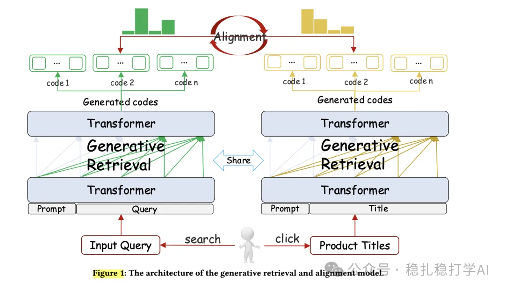

# 推荐算法(2025.4.3)：京东生成式检索与对齐模型GRAM

> 原文：https://mp.weixin.qq.com/s?__biz=MzkzNDYyNjM1NA==&mid=2247484400&idx=1&sn=9097b2a31975d4b210324c72e4d1ff2e&scene=21#wechat_redirect
> 作者：算法工程师刘明星（稳扎稳打学AI）| 发表于 2025-04-03（修改于 2025-04-06）
> 本文拆自《推荐算法(2025.4.3)：意图建模是LLM赋能搜广推的重要方式》，同期 2 篇：[腾讯 LLM 商业意图广告召回](../llm4rec/2025-04-03-tencent-llm-commercial-intention.md)、[京东生成式检索与对齐 GRAM](../generative-recommendation/2025-04-03-jd-generative-retrieval-alignment.md)。

关注我，每天为你精挑细选最优质、最新鲜的推荐算法paper，陪你一起保持进步、不断精进！

> [English version](2025-04-03-jd-generative-retrieval-alignment.full.en.md)

Generative Retrieval and Alignment Model: A New Paradigm for E-commerce Retrieval

网址：https://arxiv.org/pdf/2504.01403

公司：京东

方向：搜索+意图建模

解读：

用一个孪生网络，分别对query和产品，生成16种code，query code传达了用户意图，产品query代表了产品特征，两者共享一个“空间”。通过sft和对齐两者，训练获得一个模型。

训练过程：

（1）共享code生成

使用16种结构化属性（如品牌、类别、颜色等）构建code，而非简单子字符串或n-gram。通过NER（命名实体识别）提取查询和产品属性，结合点击数据生成初始code。

（2）联合训练与对齐

* 监督微调（SFT）：分别训练查询code生成器和产品code生成器，再通过联合训练增强两者联系。

* 代码协同对齐：利用用户点击数据构建正负样本，使用直接偏好优化算法对齐查询和产品code。

* 查询-产品对齐：基于Jensen-Shannon散度计算相关性得分，进一步优化代码质量。

inference：

生成的代码被用于查询产品索引。产品索引中的每个产品在训练阶段已由产品代码生成器（Product-Code Generator）生成了对应的代码，这些代码同样基于结构属性构建。检索过程通过代码匹配完成：查询生成的代码与产品索引中的代码进行比较，找出匹配或高度相似的项。

心得：同样是意图建模，且与产品特征共享空间。

可信度：

推荐等级：推荐看看

Figure 1: The architecture of the generative retrieval and alignment model.
