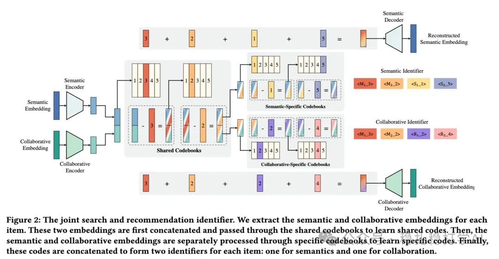

# Recommendation papers (2025.4.12): Kuaishou unifies generative search and recommendation
> [中文版](2025-04-11-kuaishou-unified-search-rec.md)

> Source: WeChat post https://mp.weixin.qq.com/s?__biz=MzkzNDYyNjM1NA==&mid=2247484455&idx=1&sn=e3a5e18fad5984711098d3536b05d326&scene=21#wechat_redirect, published 2025-04-11.
> Split from the roundup "Recommendation papers (2025.4.12): look! A major work from Google"; same issue: [Google user feedback alignment for satisfaction](../multi-task-learning/2025-04-11-google-user-feedback-alignment.full.en.md), [Tencent BI-GNAS multi-task architecture search](../multi-task-learning/2025-04-11-tencent-bi-gnas-mtl.full.en.md), [Kuaishou EXUM watch-time uncertainty modeling](../loss-func/2025-04-11-kuaishou-watch-time-uncertainty.full.en.md), [Kuaishou unified generative search and recommendation](../generative-recommendation/2025-04-11-kuaishou-unified-search-rec.full.en.md).

Unified Generative Search and Recommendation

Link: https://arxiv.org/pdf/2504.05730

Company: Kuaishou

Area: search-recommendation fusion + LLM + codebook

Overview:

Search and recommendation help each other: RQ-VAE is used to train a codebook that fuses semantic information and collaborative information; with this codebook, one LLM is then trained jointly to serve both search and recommendation.

(1) Codebook training

Two RQ-VAEs learn semantic and collaborative information together; the process has both shared and separate parts.

(2) LLM training

Behavior tokens (e.g. search queries, recommendation clicks) and task-specific prompts guide the LLM to tell search needs from recommendation needs. Training tasks include predicting the next recommended item, the search query and the searched item, strengthening the model's understanding of user behavior.

Takeaways: RQ-VAE offers reconstruction fidelity, stable codebook optimization and a low collision rate.

Credibility: offline

Recommendation: read if you have time

Figure 2: The joint search and recommendation identifier. We extract the semantic and collaborative embeddings for each item. These two embeddings are first concatenated and passed through the shared codebooks to learn shared codes. Then, the… (caption truncated in the scraped view)
