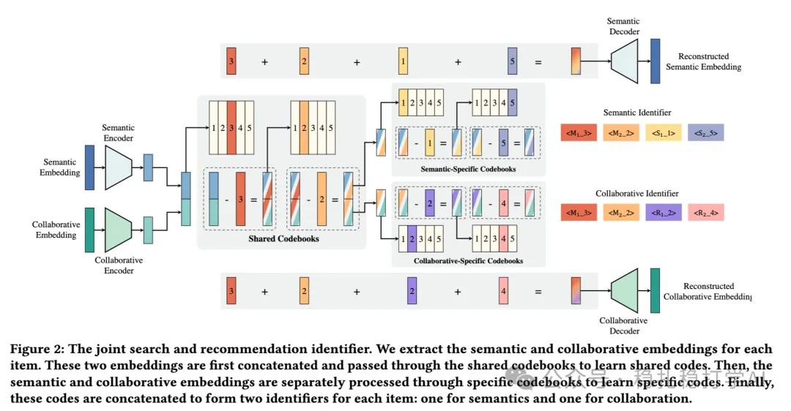

# 推荐算法(2025.4.12)：快手统一生成式搜索与推荐

> 原文：https://mp.weixin.qq.com/s?__biz=MzkzNDYyNjM1NA==&mid=2247484455&idx=1&sn=e3a5e18fad5984711098d3536b05d326&scene=21#wechat_redirect
> 作者：算法工程师刘明星（稳扎稳打学AI）| 发表于 2025-04-11
> 本文拆自《推荐算法(2025.4.12)：看！谷歌的大作》，同期 4 篇：[谷歌用户反馈对齐满意度](../multi-task-learning/2025-04-11-google-user-feedback-alignment.md)、[腾讯 BI-GNAS 多任务架构搜索](../multi-task-learning/2025-04-11-tencent-bi-gnas-mtl.md)、[快手 EXUM 时长预估不确定性建模](../loss-func/2025-04-11-kuaishou-watch-time-uncertainty.md)、[快手统一生成式搜推](../generative-recommendation/2025-04-11-kuaishou-unified-search-rec.md)。

关注我，每天为你精挑细选最优质、最新鲜的推荐算法paper，陪你一起保持进步、不断精进！

> [English version](2025-04-11-kuaishou-unified-search-rec.full.en.md)

Unified Generative Search and Recommendation

网址：https://arxiv.org/pdf/2504.05730

公司：快手

方向：搜索推荐融合+LLM+码本

解读：

搜索推荐互相助力，使用 RQ-VAE 方法融合训练语义信息和协同信息的码本；借助这个码本，再共同训练一个可用于搜索、推荐的LLM。

（1）码本训练

两个RQ-VAE，对语义信息和协同信息共同学习，过程中有合、有分。

（2）LLM训练

通过行为标记（如搜索查询、推荐点击等）和任务特定提示（prompts），引导 LLM 区分搜索与推荐的需求。训练任务包括预测下一个推荐物品、搜索查询和搜索物品等，增强模型对用户行为的理解。

心得：RQ-VAE有重建保真度、码本优化的稳定性、低碰撞率。

可信度：离线

推荐等级：有时间看看

Figure 2: The joint search and recommendation identifier. We extract the semantic and collaborative embeddings for each item. These two embeddings are first concatenated and passed through the shared codebooks to learn shared codes. Then, the…（图注在抓取视图中被截断）
