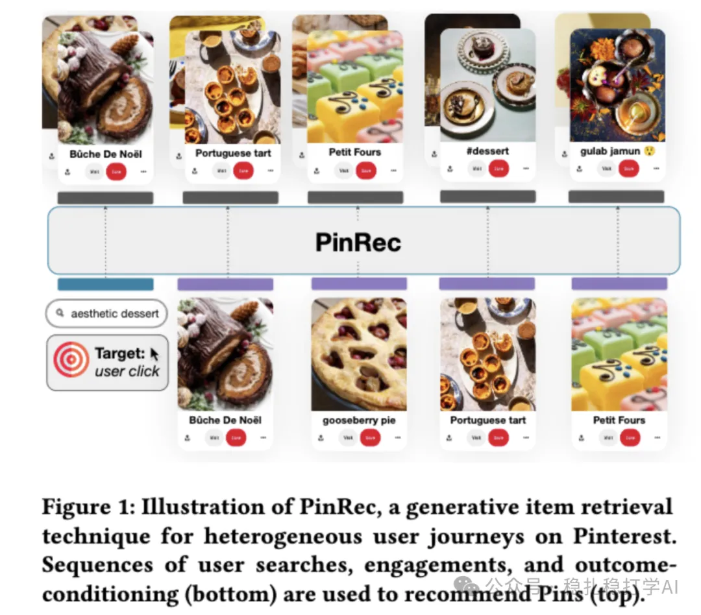

# Recommendation papers (2025.4.16): Pinterest PinRec, end-to-end generative retrieval for the home feed
> [中文版](2025-04-16-pinterest-pinrec.md)

> Source: WeChat post https://mp.weixin.qq.com/s?__biz=MzkzNDYyNjM1NA==&mid=2247484494&idx=1&sn=4765dee4aa47534d3892f6f9b9fdb89c&scene=21#wechat_redirect, published 2025-04-16.
> Split from the roundup "Recommendation papers (2025.4.16): Pinterest & Amazon"; same issue: [Pinterest PinRec generative retrieval](../generative-recommendation/2025-04-16-pinterest-pinrec.full.en.md), [Amazon CSPLADE sparse retrieval](../deep-retrieval/2025-04-16-amazon-csplade.full.en.md).

PinRec: Generative Retrieval for Pinterest's Home Feed

Link: https://arxiv.org/pdf/2504.12590

Company: Pinterest

Area: generative retrieval

Overview:

This is Pinterest's first end-to-end generative retrieval method, aiming to use a generative model to recommend Pins that match the user's interests. Architecture: the input is a user's historical behavior sequence (including actions such as search, engage and condition); these sequences are encoded into a unified representation, and multiple candidate Pins are output. By learning the associations between these behavior sequences and target Pins, the generative model generates Pins that match the user's interests.

Awareness of task importance: an MLP is attached after the sequence of hidden states output by the Transformer to process that sequence. Besides the sequence, a vector such as [0.5,0.3,0.1,0.05,0.05] is also fed in, giving the weights of 5 target actions.

At inference, adjusting the weights in this vector controls the diversity of the generated results. For example, giving save a higher weight makes the generated Pins better match the user's save behavior.

Open problems: generative retrieval is not yet well combined with user interests, and the generative model adapts poorly to new users and new content.

Figure 1: Illustration of PinRec, a generative item retrieval technique for heterogeneous user journeys on Pinterest. Sequences of user searches, engagements, and outcome-conditioning (bottom) are used to recommend Pins (top).
