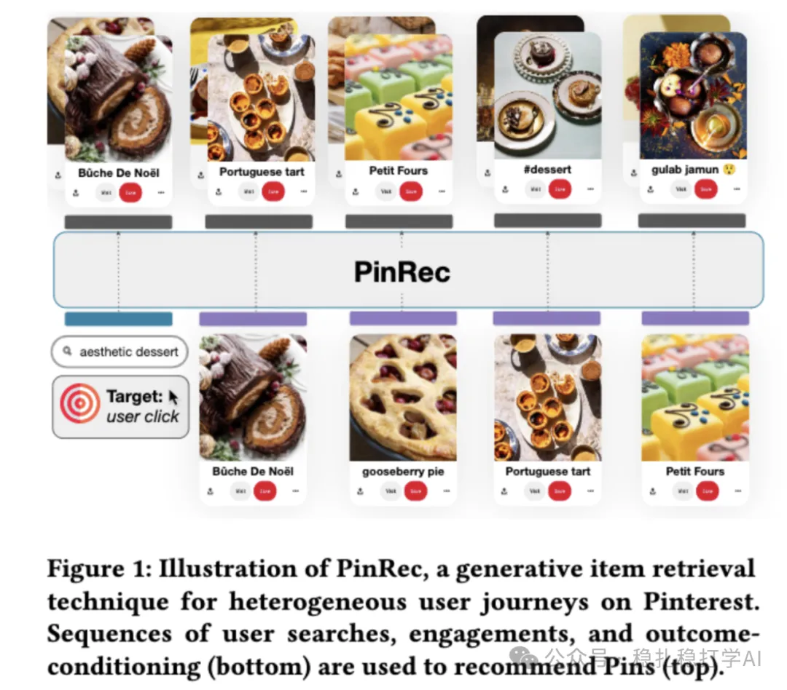

# 推荐算法(2025.4.16)：Pinterest PinRec，首页推荐的端到端生成式检索

> 原文：https://mp.weixin.qq.com/s?__biz=MzkzNDYyNjM1NA==&mid=2247484494&idx=1&sn=4765dee4aa47534d3892f6f9b9fdb89c&scene=21#wechat_redirect
> 作者：算法工程师刘明星（稳扎稳打学AI）| 发表于 2025-04-16
> 本文拆自《推荐算法(2025.4.16)：Pinterest & Amazon》，同期 2 篇：[Pinterest PinRec 生成式检索](../generative-recommendation/2025-04-16-pinterest-pinrec.md)、[Amazon CSPLADE 稀疏检索](../deep-retrieval/2025-04-16-amazon-csplade.md)。

关注我，每天为你精选推荐系统的最新好论文。

> [English version](2025-04-16-pinterest-pinrec.full.en.md)

PinRec: Generative Retrieval for Pinterest's Home Feed

网址：https://arxiv.org/pdf/2504.12590

公司：Pinterest

方向：生成式检索

解读：

这是Pinterest首次提出的端到端生成式检索方法，旨在通过生成模型为用户推荐符合兴趣的Pin。具体架构：输入一个用户的历史行为序列（包含search、engage以及condition等动作），这些序列被编码为统一的表示，输出多个候选Pin。生成模型通过学习这些行为序列与目标Pin之间的关联，生成符合用户兴趣的Pin。

对任务重要度的感知：就是在transformer输出的hidden状态序列后，后面接入一个mlp，处理该序列。除了这个序列外，还要输入一个向量，如[0.5,0.3,0.1,0.05,0.05]，表示5个目标行为的权重。

这个向量在推理过程中，通过调整权重可以控制生成结果的多样性。例如，给save赋予更高的权重，生成的pin将更符合用户的保存行为。

开放问题：目前还没有将生成式检索与用户兴趣结合得很好，且生成模型对新用户和新内容适应性较差。

Figure 1: Illustration of PinRec, a generative item retrieval technique for heterogeneous user journeys on Pinterest. Sequences of user searches, engagements, and outcome-conditioning (bottom) are used to recommend Pins (top).
