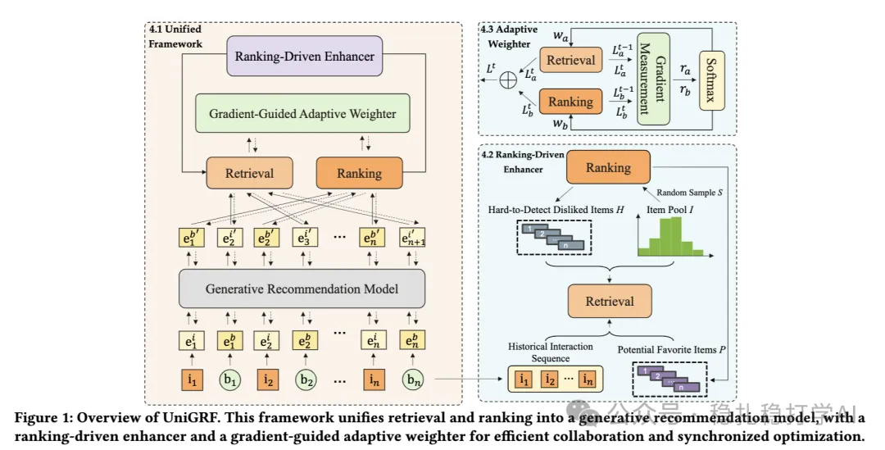

# Recommendation algorithms (2025.4.24): Huawei's work on retrieval-ranking consistency

> [中文版](2025-04-24-huawei-unigrf.md)

1 UniGRF: Unifying Retrieval and Ranking into a Generative Recommendation Framework

Link: https://arxiv.org/pdf/2504.16966

Company: Huawei

Area: retrieval-ranking consistency

Overview: this paper proposes a unified generative recommendation framework (UniGRF) that unifies retrieval and ranking into one generative recommendation model. By putting the retrieval and ranking tasks into one generative model, UniGRF can do both retrieval and ranking in a single forward pass, improving the efficiency of the recommender system.

Core method:

Backbone network: UniGRF uses a generative recommendation model as the backbone, which generates the recommendation list autoregressively. Specifically, the model first generates a candidate item set from the user's history behavior, then ranks the candidates with a ranking model, and finally produces the recommendation list.

This raises a problem: the two tasks converge at different speeds. Retrieval and ranking are two different tasks, and their convergence speeds may differ. To address this, UniGRF introduces two mechanisms:

(1) Ranking-driven Enhancer: uses feedback from the ranking model to dynamically adjust the retrieval model's training objective, keeping it consistent with the ranking model's objective.

(2) Gradient-guided Adaptive Weighter: uses gradient information to dynamically adjust the weights of the retrieval and ranking tasks, keeping the two tasks' convergence speeds in step.

Takeaways:

(1) Retrieval-ranking consistency is a very important problem and worth studying in depth.

(2) Retrieval and ranking working together. Through two means, joint training and feeding ranking samples to retrieval, it tries to improve the consistency between the two. One is at the model level, the other at the data level.

Credibility: offline

Recommendation: worth a look

