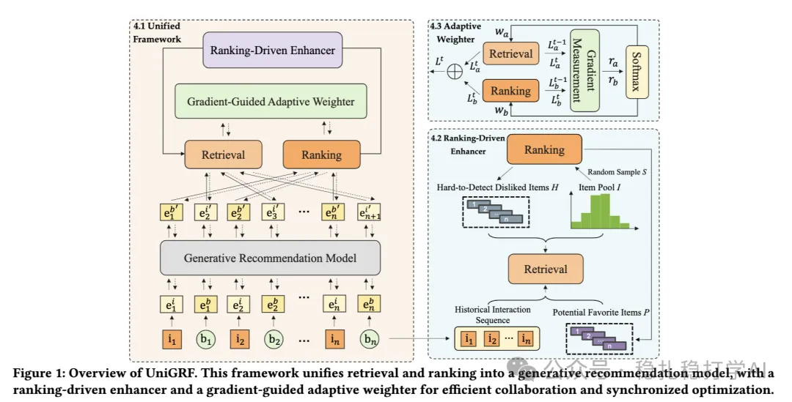

# 推荐算法(2025.4.24)：华为的召回与排序的一致性工作

> 原文：https://mp.weixin.qq.com/s?__biz=MzkzNDYyNjM1NA==&mid=2247484578&idx=1&sn=669b17677b3096be3432ee6b0e53e0fc&scene=21#wechat_redirect
> 作者：算法工程师刘明星（稳扎稳打学AI）| 发表于 2025-04-24

嘿，记得给“稳扎稳打学AI”添加星标

关注我，每天为你精挑细选最优质、最新鲜的推荐算法paper，陪你一起保持进步、不断精进！

📄 [本公众号paper推荐原则](https://mp.weixin.qq.com/s?__biz=MzkzNDYyNjM1NA==&mid=2247484097&idx=1&sn=18322c279290b555eb030e12953b7c7f&scene=21#wechat_redirect)

1 UniGRF: Unifying Retrieval and Ranking into a Generative Recommendation Framework

网址：https://arxiv.org/pdf/2504.16966

公司：华为

方向：召回与排序的一致性

解读：本文提出了一种统一的生成式推荐框架（UniGRF），将召回与排序统一到一个生成式推荐模型中。通过将召回与排序的任务统一到一个生成式模型中，UniGRF 能够在一次前向传递中同时完成召回与排序，从而提高推荐系统的效率。

核心方法：

主体网络：UniGRF 使用一个生成式推荐模型作为主体网络，该模型通过自回归的方式生成推荐列表。具体来说，模型首先根据用户历史行为生成一个候选物品集合，然后通过排序模型对候选物品进行排序，最终生成推荐列表。

这样做会引起一个问题——两个出现了一个就是两个任务收敛速度不一致。召回和排序是两个不同的任务，它们的收敛速度可能不一致。为了解决这个问题，UniGRF 引入了两个机制：

（1）排序驱动增强器（Ranking-driven Enhancer）：通过排序模型的反馈，动态调整召回模型的训练目标，使其与排序模型的目标保持一致。

（2）梯度引导自适应权重（Gradient-guided Adaptive Weighter）：通过梯度信息动态调整召回与排序任务的权重，使两个任务的收敛速度保持一致。

心得：

（1）召回与排序的一致性是一个非常重要的问题，值得深入研究。

（2）召回和排序协同。通过两种方式——联合训练和排序样本提供给召回，尝试提升两者一致性。两者一个是模型从面，一个是数据层面。

可信度：离线

推荐等级：推荐看看

请帮忙点赞、转发，谢谢。您认为哪篇论文最有潜力应用到实际业务中？

## 欢迎干货投稿 \ 论文宣传 \ 合作交流

推荐您继续阅读：

■ [推荐算法(2025.4.23)：快手的集成学习在rerank的创新应用](https://mp.weixin.qq.com/s?__biz=MzkzNDYyNjM1NA==&mid=2247484572&idx=1&sn=6fb64221bfafb2c814147dff5d6b7e34&scene=21#wechat_redirect)

■ [推荐算法(2025.4.22)：Meta 将LLM应用于搜索有用性评估](https://mp.weixin.qq.com/s?__biz=MzkzNDYyNjM1NA==&mid=2247484565&idx=1&sn=068c6a26b1e752d855fcebd54c83288c&scene=21#wechat_redirect)

■ [推荐算法周报(2025.4.21)：有7篇大厂论文值得关注](https://mp.weixin.qq.com/s?__biz=MzkzNDYyNjM1NA==&mid=2247484559&idx=1&sn=c143dccb329dba0d3e214b1d3d4ee146&scene=21#wechat_redirect)

历史文章索引：https://docs.qq.com/sheet/DYXZTZ0tseHRyZGtt?tab=BB08J2

由于公众号试行乱序推送，您可能不再准时收到稳扎稳打学AI的推送。为了第一时间收到本号的干货内容，请将本号设为星标，以及常点文末右下角的“在看”。

喜欢的话点个在看吧👇

个人观点，仅供参考
