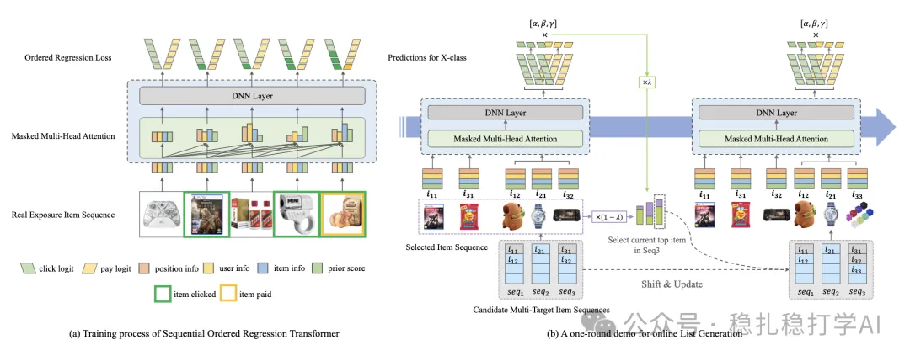

# Recommendation papers (2025.5.13): Taobao SORT-Gen, ranking and generation in a single forward pass
> [中文版](2025-05-13-taobao-sort-gen.md)

> Source: WeChat post https://mp.weixin.qq.com/s?__biz=MzkzNDYyNjM1NA==&mid=2247484648&idx=1&sn=ba92085c8ad14ae822333e6dd23a00b3&scene=21#wechat_redirect, published 2025-05-13.
> Split from the roundup "Recommendation papers (2025.5.13): Taobao and Walmart with strong A/B results"; same issue: [Taobao SORT-Gen generative ranking](../generative-recommendation/2025-05-13-taobao-sort-gen.full.en.md), [Walmart LLM distillation for search relevance](../llm4rec/2025-05-13-walmart-llm-distill-cross-encoder.full.en.md).

SORT-Gen: Sequential Ordered Regression Transformer for Generative Ranking

Link: https://arxiv.org/pdf/2505.05835

Company: Taobao

Area: generative retrieval

Overview: This paper from the Taobao team proposes a recommendation method based on a generative ranking model (Generative Ranking, SORT-Gen for short). It mainly addresses the ranking and generation efficiency problems that traditional generative-ranking-based models have in recommender systems. By combining the generation process and the ranking process of the generative ranking model, SORT-Gen completes ranking and generation in one forward pass, improving the ranking and generation efficiency of the recommender system.

Core method:

(1) Sequential Ordered Regression Transformer: a Transformer architecture models real-time user intent, combined with ordered regression to accurately predict the user's click probability and click order over the candidate set. A temporal decay mechanism dynamically adjusts user interest weights to capture the temporal characteristics of user behavior.

(2) Mask-Driven Fast Generation Algorithm: using multi-objective candidate queues (sorted by click, conversion, GMV and other objectives) and a mask matrix, items are selected efficiently in one forward pass, reducing inference time. It integrates state-of-the-art generative ranking models (such as GPT, T5, etc.) to complete ranking and generation in one forward pass.

The A/B results look striking, so here they are: in the "百亿补贴" (Ten-Billion Subsidy) mini-program on Taobao, SORT-Gen improves CTR by +4.13% and GMV by +8.10% over the baseline (FFT context-aware model + fastDPP), clearly outperforming the baseline overall.

Takeaways:

(1) Generative ranking models have broad prospects in recommender systems and deserve attention.

(2) SORT-Gen's core innovation is combining the generation process and ranking process of a generative ranking model, achieving efficient ranking and generation.

Credibility: production (Taobao homepage)

Recommendation: has practical value

