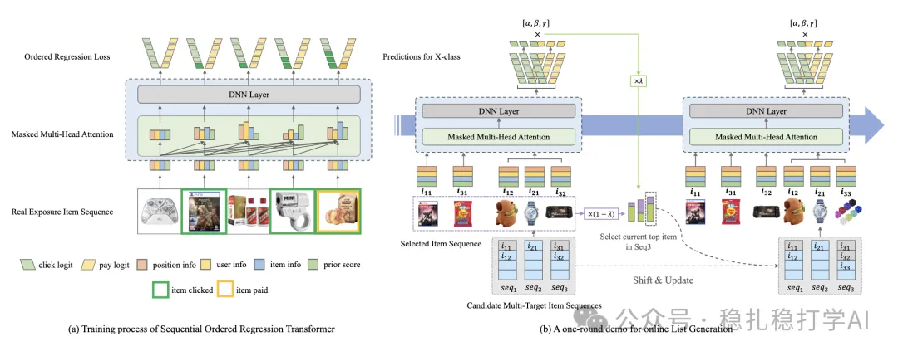

# 推荐算法(2025.5.13)：淘宝SORT-Gen，一次前向完成排序与生成

> 原文：https://mp.weixin.qq.com/s?__biz=MzkzNDYyNjM1NA==&mid=2247484648&idx=1&sn=ba92085c8ad14ae822333e6dd23a00b3&scene=21#wechat_redirect
> 作者：算法工程师刘明星（稳扎稳打学AI）| 发表于 2025-05-13
> 本文拆自《推荐算法(2025.5.13)：淘宝、沃尔玛的AB效果不错》，同期 2 篇：[淘宝 SORT-Gen 生成式排序](../generative-recommendation/2025-05-13-taobao-sort-gen.md)、[沃尔玛 LLM 蒸馏搜索相关性模型](../llm4rec/2025-05-13-walmart-llm-distill-cross-encoder.md)。

关注我，每天为你精挑细选最优质、最新鲜的推荐算法paper，陪你一起保持进步、不断精进！

> [English version](2025-05-13-taobao-sort-gen.full.en.md)

SORT-Gen: Sequential Ordered Regression Transformer for Generative Ranking

网址：https://arxiv.org/pdf/2505.05835

公司：淘宝

方向：生成式召回

解读：本文是淘宝团队提出的一种基于生成式排序模型的推荐方法（Generative Ranking，简称SORT-Gen），主要解决了传统基于生成式排序模型在推荐系统中存在的排序与生成效率问题。通过将生成式排序模型的生成过程与排序过程相结合，SORT-Gen 能够在一次前向传递中同时完成排序与生成，从而提高推荐系统的排序与生成效率。

核心方法：

（1）Sequential Ordered Regression Transformer：使用 Transformer 架构建模实时用户意图，结合有序回归（Ordered Regression）准确预测用户对候选集的点击概率和点击顺序。利用时间衰减机制（temporal decay）动态调整用户兴趣权重，以捕捉用户行为的时序特征。

（2）Mask-Driven Fast Generation Algorithm：通过多目标候选队列（按点击、转化、GMV等目标排序）和掩码矩阵，实现在一次前向传递中高效选择项目，降低推理时间。集成最先进的生成式排序模型（如GPT、T5等），在一次前向传递中同时完成排序与生成。

看到A/B 效果很夸张，所以贴一下：在淘宝小程序"百亿补贴"中，SORT-Gen 相比基线模型（FFT 上下文感知模型 + fastDPP）提升了 +4.13% 点击率和 +8.10% GMV，整体表现显著优于基线模型。

心得：

（1）生成式排序模型在推荐系统中的应用前景广阔，值得关注。

（2）SORT-Gen 的核心创新在于将生成式排序模型的生成过程与排序过程相结合，实现了高效的排序与生成。

可信度：生产——淘宝首页

推荐等级：有实践价值

