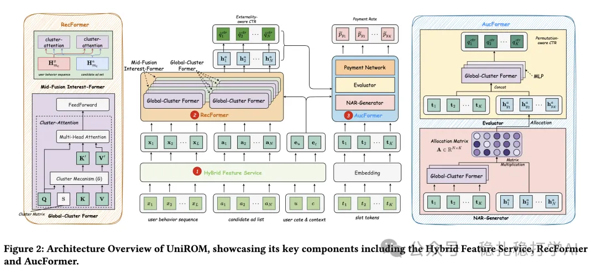

# Recommendation algorithms (2025.5.28): Meituan's one-model recommendation

> [中文版](2025-05-28-meituan-unirom.md)

1 One Model to Rank Them All: Unifying Online Advertising with End-to-End Learning

Link: https://arxiv.org/abs/2505.19755

Company: Meituan

Area: one-model recommendation (a name I made up myself; tell me if you have a better one)

Overview:

It proposes an end-to-end generative architecture that directly generates the ad sequence, trying to remove the inconsistency across the multiple stages of a recommender system. Because it is a generative model, efficiency has to be optimized, and it also does some optimization work on feature aggregation, as follows:

(1) Hybrid Feature Service (HFS): features are split by update frequency: rarely updated ad features (core categorical features) are stored in the Local Feature Service (LFS), and frequently updated user features in the Remote Feature Service (RFS), to optimize storage, transfer and latency.

(2) Clustered attention for sequence modeling

It uses a 2024 approximation method for Transformer self-attention (reference 1) to reduce the time complexity of sequence interest modeling. Simply put, the many items in the sequence are clustered into a small number of clusters, and attention is computed in a simpler way within clusters, which lowers the time complexity. There are two kinds: one global, one intermediate.

1) Global Cluster Former (GCF): uses clustered attention to cluster the keys and values of candidate ads into a small number of proxy representations. 2) Middle-fusion Interest Former (MIF): uses interval fusion and clustered attention to balance granularity and compute cost between the user behavior sequence and ad interactions.

(3) Alignment with ad objectives: I don't understand it and am not interested, so I skipped it.

Because the A/B results are so good, here they are:

Online A/B test (November 18 to 24, 2024): compared with MCA, UniROM significantly improves CTR (+5.2%), RPM (+13.6%) and ROI (+3.1%), with response time up only 2.2% (+5ms).

References

1 Transformer self-attention approximation method https://www.themoonlight.io/zh/review/cast-clustering-self-attention-using-surrogate-tokens-for-efficient-transformers

Takeaways:

(1) This is the second one-model recommendation paper from a Meituan team.

(2) I'm curious whether the gain mainly comes from the one-model design, from the behavior sequence modeling, or from something else.

Credibility: production

Recommendation: worth a look

