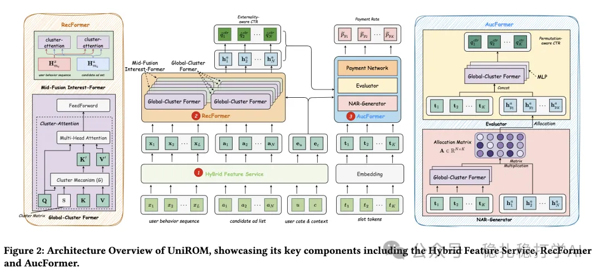

# 推荐算法(2025.5.28)：美团的一体推荐

> 原文：https://mp.weixin.qq.com/s?__biz=MzkzNDYyNjM1NA==&mid=2247484708&idx=1&sn=2383a8dd82e93d20404d1f817a4d788a&scene=21#wechat_redirect
> 作者：算法工程师刘明星（稳扎稳打学AI）| 发表于 2025-05-28

嘿，记得给“稳扎稳打学AI”添加星标

关注我，每天为你精挑细选最优质、最新鲜的推荐算法paper，陪你一起保持进步、不断精进！

> [English version](2025-05-28-meituan-unirom.full.en.md)

👆 [本公众号paper推荐原则](https://mp.weixin.qq.com/s?__biz=MzkzNDYyNjM1NA==&mid=2247484097&idx=1&sn=18322c279290b555eb030e12953b7c7f&scene=21#wechat_redirect)

1 One Model to Rank Them All: Unifying Online Advertising with End-to-End Learning

网址：https://arxiv.org/abs/2505.19755

公司：美团

方向：一体推荐（我自己瞎起的，有高见可以告诉我）

解读：

提出了一个端到端生成架构，直接生成广告序列，尝试消除推荐算法多阶段的不一致性。因为是生成模型，效率上要做优化，还在特征聚合上做了一些优化工作，具体介绍如下：

（1）混合特征服务（HFS）：根据更新频率分类特征：低频更新的广告特征（核心分类特征）存储在本地特征服务（LFS），高频更新的用户特征存储在远程特征服务（RFS），以优化存储、传输和延迟。

（2）聚类注意力机制做序列建模

使用2024年的一个Transformer自注意力近似计算方法（参考1）降低了序列兴趣建模的时间复杂度。简单讲就是，将序列里的大量item聚类成少数的cluster，然后cluster内较为简单的计算attention，从而降低了时间复杂度。两成两种，一个是全局，一个是中间的。

1）全局聚类Former（GCF）：通过聚类注意力机制，将候选广告的键和值聚类为少量代理表示。2）中融合兴趣Former（MIF）：通过间隔融合和聚类注意力，平衡用户行为序列与广告交互的粒度和计算开销。

（3）与广告目标的对齐问题：本人看不懂、不感兴趣，于是忽略。

由于ab效果太过优秀，贴一下：

在线 A/B 测试（2024年11月18日至24日）：相较于 MCA，UniROM 在 CTR (+5.2%)、RPM (+13.6%)、ROI (+3.1%) 上显著提升，响应时间仅增加2.2%（+5ms）。

参考

1Transformer自注意力近似计算方法 https://www.themoonlight.io/zh/review/cast-clustering-self-attention-using-surrogate-tokens-for-efficient-transformers

心得：

（1）这是美团的一个团队的第二篇一体推荐的paper。

（2）好奇，这个效果主要是因为一体推荐，还是在行为序列建模上，还是其它。

可信度：生产

推荐等级：推荐看看

请帮忙点赞、转发，谢谢。您认为哪篇论文最有潜力应用到实际业务中？

## 欢迎干货投稿 \ 论文宣传 \ 合作交流

推荐您继续阅读：

■ [推荐算法(2025.5.27)：ebay的关键词召回很实用](https://mp.weixin.qq.com/s?__biz=MzkzNDYyNjM1NA==&mid=2247484702&idx=1&sn=d5c348c24be320abedabd30da864f1ed&scene=21#wechat_redirect)

■ [推荐算法(2025.5.26)：腾讯、美团的AB效果显著](https://mp.weixin.qq.com/s?__biz=MzkzNDYyNjM1NA==&mid=2247484696&idx=1&sn=52a577d039ccc497941425043935fc25&scene=21#wechat_redirect)

历史文章索引：https://docs.qq.com/sheet/DYXZTZ0tseHRyZGtt?tab=BB08J2

由于公众号试行乱序推送，您可能不再准时收到稳扎稳打学AI的推送。为了第一时间收到本号的干货内容， 请将本号设为星标，以及常点文末右下角的“在看”。

喜欢的话点个在看吧👇

个人观点，仅供参考
