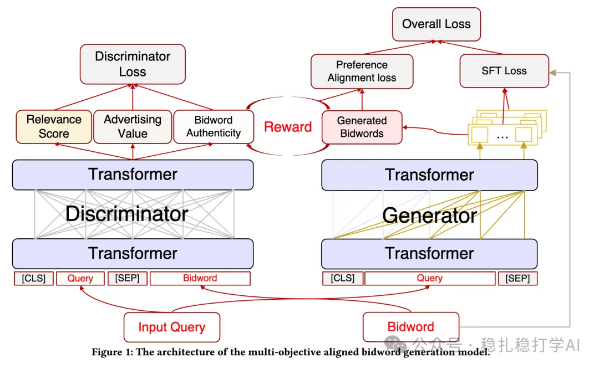

# Recommendation algorithms (2025.6.5): matching search queries to bidwords in JD ads

> [中文版](2025-06-05-jd-bidword-generation.md)

1 Multi-objective Aligned Bidword Generation Model for E-commerce Search Advertising

Link: https://arxiv.org/pdf/2506.02605

Company: JD

Area: ads + search

Overview:

The user's search query and the ad's bidword directly affect ad exposure. The more relevant the bidword is to the query and the more precise the match, the more it attracts user clicks.

The method in this paper has two parts, a generator and a discriminator. For the generator:

(1) Generator

1) The generator is an LLM that takes a search query as input and generates bidwords. 2) The generated bidwords must satisfy two conditions: ① semantic relevance: the generated bidword must be semantically related to the query; ② the bidword must meet the advertiser's needs. 3) To meet these two conditions, the generator is trained with two losses: ① SFT loss: train the generator on paired query-bidword data; ② reward loss: use a Reward Model to evaluate the quality of the generated bidwords. The reward model is a classification model that takes the query and bidword as input and outputs a score for the bidword's quality. The generator optimizes the generated bidwords by maximizing the reward model's score.

(2) Discriminator

1) Relevance

A discriminator judges whether the generated bidword is relevant to the query. The discriminator is a classification model that takes the query and bidword as input and outputs a score for the relevance between them.

2) Keyword authenticity

Positives: query-bidword pairs from online search logs that experts labeled as synonyms or hypernym/hyponym relations; negatives: query-bidword pairs that experts labeled as wrong rewrites, from two sources: substandard ones produced by the generator, and substandard query-keyword pairs from search logs.

A/B results: in JD search ads, online A/B tests show that with this method, ad click-through rate (CTR) rose 1.58%, ad conversion rate (CVR) rose 2.34%, and advertiser revenue (RPM) rose 3.21%.

Takeaways:

(1) Using an LLM to generate bidwords can improve ad matching precision.

(2) The discriminator is the key: you need a good discriminator to judge whether the generated bidwords meet the requirements.

Credibility: production

Recommendation: worth a look

