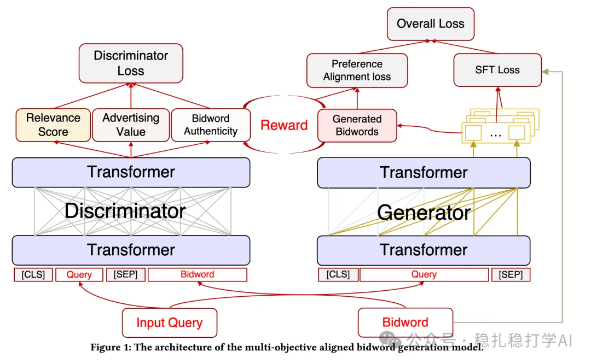

# 推荐算法(2025.6.5)：京东广告的搜索词与竞价词匹配

> 原文：https://mp.weixin.qq.com/s?__biz=MzkzNDYyNjM1NA==&mid=2247484761&idx=1&sn=955cdfc06c7f8647a585fedaa22eef6c&scene=21#wechat_redirect
> 作者：算法工程师刘明星（稳扎稳打学AI）| 发表于 2025-06-05

嘿，记得给“稳扎稳打学AI”添加星标

关注我，每天为你精挑细选最优质、最新鲜的推荐算法paper，陪你一起保持进步、不断精进！

> [English version](2025-06-05-jd-bidword-generation.full.en.md)

👆 [本公众号paper推荐原则](https://mp.weixin.qq.com/s?__biz=MzkzNDYyNjM1NA==&mid=2247484097&idx=1&sn=18322c279290b555eb030e12953b7c7f&scene=21#wechat_redirect)

1 Multi-objective Aligned Bidword Generation Model for E-commerce Search Advertising

网址：https://arxiv.org/pdf/2506.02605

公司：京东

方向：广告+搜索

解读：

用户的搜索词和广告的竞价词直接影响广告的曝光。竞价词和搜索词，越相关，匹配越精准，就越能吸引用户点击。

本文的方法分为生成器和判别器两个部分，针对生成器：

（1）生成器

1）生成器使用一个大模型（LLM），输入搜索词，生成竞价词。2）生成的竞价词要满足两个条件：①语义相关性：生成的竞价词和搜索词要语义相关。②竞价词要符合广告主的需求。3）为了实现这两个条件，生成器在训练的时候，使用了两个loss：①SFT loss：用搜索词和竞价词的配对数据，训练生成器。②奖励loss：用奖励模型（Reward Model）来评估生成的竞价词的质量。奖励模型是一个分类模型，输入搜索词和竞价词，输出一个分数，表示竞价词的质量。生成器通过最大化奖励模型的分数，来优化生成的竞价词。

（2）判别器

1）相关性

用一个判别器来判断生成的竞价词和搜索词是否相关。判别器是一个分类模型，输入搜索词和竞价词，输出一个分数，表示竞价词和搜索词的相关性。

2）关键词真实性

正样本：在线搜索日志中，专家标注为同义或上下位关系的 query-bidword 对；负样本：专家标注为错误改写的 query-bidword 对，有两个来源，一是generator生成的，不符合标准的，二是搜索日志里的、不符合标准的query-keyword对。

AB效果：在京东的搜索广告中，在线AB测试结果显示，使用本文方法后，广告的点击率（CTR）提升了1.58%，广告的转化率（CVR）提升了2.34%，广告主的收益（RPM）提升了3.21%。

心得：

（1）用LLM生成竞价词，可以提高广告的匹配精度。

（2）判别器是关键，需要一个好的判别器来判断生成的竞价词是否符合要求。

可信度：生产

推荐等级：推荐看看

请帮忙点赞、转发，谢谢。您认为哪篇论文最有潜力应用到实际业务中？

## 欢迎干货投稿 \ 论文宣传 \ 合作交流

推荐您继续阅读：

■ [推荐算法(2025.6.4)：Pinterest的长序列建模，效果明显](https://mp.weixin.qq.com/s?__biz=MzkzNDYyNjM1NA==&mid=2247484745&idx=1&sn=4a6b0151837fbd4b9c5367de112f756e&scene=21#wechat_redirect)

■ [推荐算法(2025.6.3)：Spotify的LLM应用，效果明显](https://mp.weixin.qq.com/s?__biz=MzkzNDYyNjM1NA==&mid=2247484739&idx=1&sn=427bd6b06eb2c005e7ce0eac79f30f3d&scene=21#wechat_redirect)

■ [推荐算法(2025.6.1)：快手的长序列建模有趣](https://mp.weixin.qq.com/s?__biz=MzkzNDYyNjM1NA==&mid=2247484733&idx=1&sn=85ffc9a50c38da3f3862e2f8af0269a3&scene=21#wechat_redirect)

历史文章索引：https://docs.qq.com/sheet/DYXZTZ0tseHRyZGtt?tab=BB08J2

由于公众号试行乱序推送，您可能不再准时收到稳扎稳打学AI的推送。为了第一时间收到本号的干货内容， 请将本号设为星标，以及常点文末右下角的“在看”。

喜欢的话点个在看吧👇

个人观点，仅供参考
