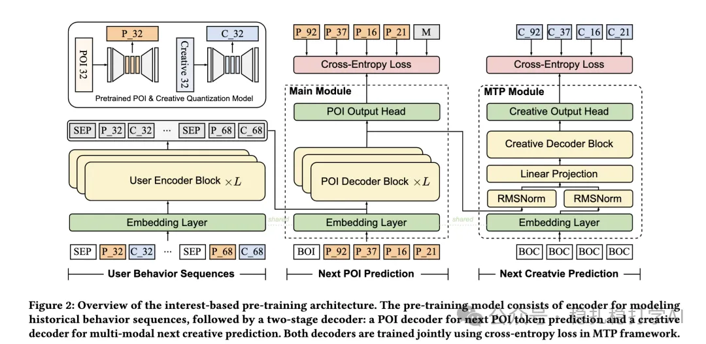

# Recommendation papers (2025.6.1): Meituan EGA, an end-to-end generative advertising system
> [中文版](2025-06-05-meituan-ega.md)

> Source: WeChat post https://mp.weixin.qq.com/s/_esAw4QjZiVvbK8bKdJXmQ, published 2025-06-05.
> Split from the weekly report "Weekly recommendation papers (2025.6.1): a week of blockbuster A/B results", paper 3 of the issue.

EGA: A Unified End-to-End Generative Framework for Industrial Advertising Systems

Link: https://arxiv.org/pdf/2505.17549

Company: Meituan

Area: one-model recommendation + generative recommendation

Overview:

It aims to fix the limitations of the traditional multi-stage cascaded ad system. A single model integrates user interest modeling, point-of-interest (POI) and creative generation, slot allocation, and payment optimization, significantly improving the efficiency and performance of an industrial ad system.

It uses RQ-VAE to encode user behavior and ad features into hierarchical semantic tokens (POIs and creative images). It uses a multi-token prediction (MTP) mechanism to generate POIs and creatives jointly, improving generation efficiency and consistency.

The A/B results are too striking, so here they are: April 2-8, 2025, tested on 2% of production traffic. Result: versus the baseline, RPM +15.2%, CTR +6.4%, ROI +3.1%.

Takeaways: the one-model approach clearly works.

Credibility: production

Recommendation: worth reading

Figure 2: Overview of the interest-based pre-training architecture. The pre-training model consists of encoder for modeling historical behavior sequences, followed by a two-stage decoder: a POI decoder for next POI token prediction and a creative decoder for multi-modal next creative prediction. Both decoders are trained jointly using cross-entropy loss in MTP framework.
