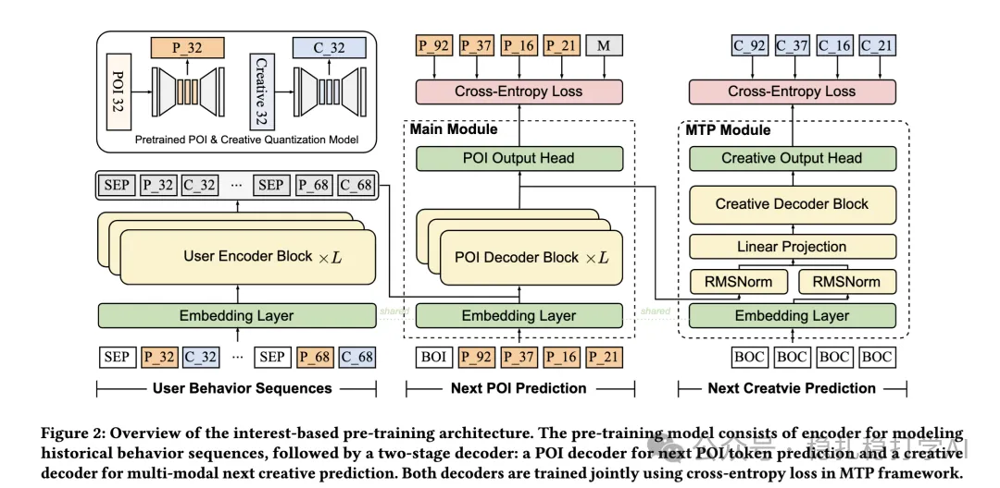

# 推荐算法(2025.6.1)：美团EGA端到端生成式广告系统

> 原文：https://mp.weixin.qq.com/s/_esAw4QjZiVvbK8bKdJXmQ
> 作者：算法工程师刘明星（稳扎稳打学AI）| 发表于 2025-06-05
> 本文拆自《推荐算法周报(2025.6.1)：AB效果炸裂的一周》第 3 篇。

关注我，每天为你精挑细选最优质、最新鲜的推荐算法paper，陪你一起保持进步、不断精进！

> [English version](2025-06-05-meituan-ega.full.en.md)

EGA: A Unified End-to-End Generative Framework for Industrial Advertising Systems

网址：https://arxiv.org/pdf/2505.17549

公司：美团

方向：一站式推荐+生成式推荐

解读：

旨在解决传统多阶段级联广告系统的局限性，通过单一模型整合用户兴趣建模、兴趣点（POI）与创意生成、位置分配和支付优化，显著提升工业广告系统的效率和性能。

使用RQ-VAE将用户行为和广告特征编码为分层语义标记（POI和创意图像）。采用多标记预测（MTP）机制，联合生成POI和创意内容，提高生成效率和一致性。

给的AB效果太突出，所以贴一下：2025年4月2日至8日，2%生产流量测试。结果：相比对标方法：RPM提升15.2%，CTR提升6.4%，ROI提升3.1%。

心得：一体模型效果明显。

可信度：生产

推荐等级：推荐看看

Figure 2: Overview of the interest-based pre-training architecture. The pre-training model consists of encoder for modeling historical behavior sequences, followed by a two-stage decoder: a POI decoder for next POI token prediction and a creative decoder for multi-modal next creative prediction. Both decoders are trained jointly using cross-entropy loss in MTP framework.
