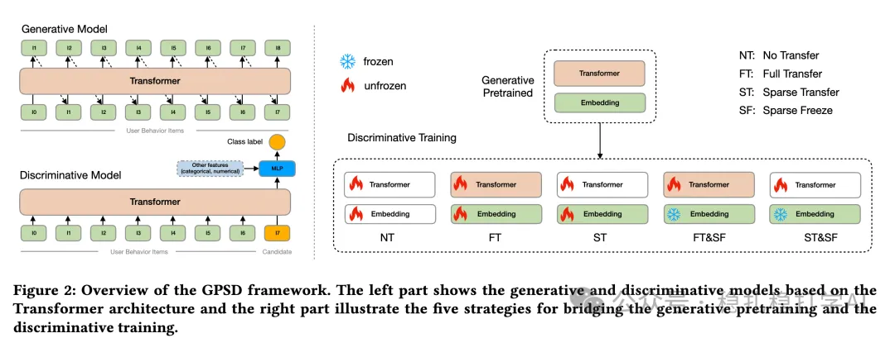

# Recommendation algorithms (2025.6.6): Alibaba's Transformer-based recommender optimization

> [中文版](2025-06-06-ali-scaling-transformers.md)

1 Scaling Transformers for Discriminative Recommendation via Generative Pretraining

Link: https://arxiv.org/pdf/2506.03699

Company: Alibaba

Area: generative recommendation + discriminative recommendation

Overview:

Use generative pretraining to handle the sparse parameters (embedding layer), and focus only on the dense parameters (network weights) in the discriminative training stage.

(1) The current dilemma in recommendation: discriminative recommendation models face severe overfitting during training due to data sparsity, in two forms: one-epoch overfitting and intra-epoch overfitting. As a result, large Transformer models perform worse than small ones, in contrast to the scaling law seen in language models.

(2) Motivation: despite the severe overfitting challenge in training discriminative recommendation models, the authors observe that autoregressive generative models that predict the next item from history behavior items with a sampled softmax loss do not suffer from this problem. The authors conjecture that generative training avoids the sparsity problem through massive random negative sampling, giving more stable and thorough training of the sparse parameters. This difference inspired the method in the paper: use generative pretraining to handle the sparse parameters, and focus only on the dense parameters in the discriminative training stage.

(3) Generative pretraining

Uses the Transformer architecture LLaMA, trained autoregressively on user behavior sequences to predict the next item.

(4) Discriminative training

Uses the Transformer trained above; besides the user behavior sequence and the candidate, the input also includes other features, and the output is a classification probability. An extra segment embedding distinguishes user behaviors from the candidate, and an added MLP head handles the other features. Cross-entropy loss is used. Five parameter transfer strategies are proposed:

No Transfer (NT): train from scratch, as the baseline.

Full Transfer (FT): transfer all parameters (sparse + dense).

Sparse Transfer (ST): transfer only the sparse parameters (e.g. embedding tables).

Full Transfer + Sparse Freeze (FT&SF): transfer all parameters and freeze the sparse ones.

Sparse Transfer + Sparse Freeze (ST&SF): transfer the sparse parameters and freeze them.

A/B results: on AliExpress, the ST&SF strategy raised GMV by 7.97% and the number of buyers by 1.79%.

Takeaways:

(1) As the authors say, the embedding layer obtained from generative recommendation pretraining holds the largest share of parameters and is the most important part to transfer.

(2) A glimmer of hope for the future unification of recommendation model and language model architectures.

Credibility: production

Recommendation: practically useful

