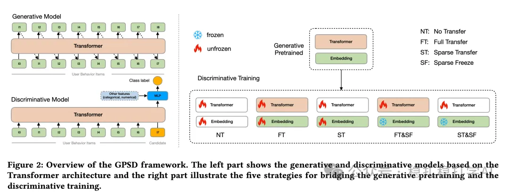

# 推荐算法(2025.6.6)：阿里的基于Transformer的推荐系统优化

> 原文：https://mp.weixin.qq.com/s?__biz=MzkzNDYyNjM1NA==&mid=2247484767&idx=1&sn=6176061ab42a6bd181f669732c24b975&scene=21#wechat_redirect
> 作者：算法工程师刘明星（稳扎稳打学AI）| 发表于 2025-06-06

嘿，记得给“稳扎稳打学AI”添加星标

关注我，每天为你精挑细选最优质、最新鲜的推荐算法paper，陪你一起保持进步、不断精进！

👆 [本公众号paper推荐原则](https://mp.weixin.qq.com/s?__biz=MzkzNDYyNjM1NA==&mid=2247484097&idx=1&sn=18322c279290b555eb030e12953b7c7f&scene=21#wechat_redirect)

1 Scaling Transformers for Discriminative Recommendation via Generative Pretraining

网址：https://arxiv.org/pdf/2506.03699

公司：阿里

方向：生成式推荐+判别式推荐

解读：

利用生成式预训练处理稀疏参数（embedding layer），而在判别式训练阶段仅聚焦于密集参数（网络weights）。

（1）当前的推荐算法困局：判别式推荐模型在训练过程中因数据稀疏性面临严重过拟合问题，表现为两种形式——单轮次过拟合和轮次内过拟合，这导致大型Transformer模型性能不如小型模型，与语言模型中的扩展规律（scaling law）形成对比。

（2）动机：尽管在训练判别式推荐模型时面临严重的过拟合挑战，但作者观察到，使用采样 softmax 损失、基于历史行为物品预测下一个物品的自回归生成式模型并未受此问题困扰。作者推测，生成式训练通过大量随机负采样避免了稀疏性问题，从而实现了对稀疏参数更稳定且充分的训练。这种差异启发我们提出了本文方法—— 利用生成式预训练处理稀疏参数，而在判别式训练阶段仅聚焦于密集参数。

（3）生成式预训练

使用Transformer架构LLama，基于用户行为序列进行自回归生成训练，预测下一项。

（4）判别式训练

使用上面训练的Transformer，输入除了用户行为序列、候选项，还包括其他特征，输出分类概率。通过额外段嵌入区分用户行为与候选项，附加MLP头处理其他特征。使用交叉熵损失。提出五种参数转移策略：

无转移（NT）：从头训练，作为基线。

全转移（FT）：转移所有参数（稀疏+密集）。

稀疏转移（ST）：仅转移稀疏参数（如嵌入表）。

全转移+稀疏冻结（FT&SF）：转移所有参数并冻结稀疏参数。

稀疏转移+稀疏冻结（ST&SF）：转移稀疏参数并冻结。

AB效果：在AliExpress上，ST&SF策略使GMV提升7.97%，买家数增加1.79%，

心得：

（1）如作者所说生成式推荐预训练获得的embedding Layer的参数量占比最大，对迁移是最重要的。

（2）推荐模型与语言模型架构的未来统一看到了曙光。

可信度：生产

推荐等级：有实践价值

请帮忙点赞、转发，谢谢。您认为哪篇论文最有潜力应用到实际业务中？

## 欢迎干货投稿 \ 论文宣传 \ 合作交流

推荐您继续阅读：

■ [推荐算法周报(2025.6.1)：AB效果炸裂的一周](https://mp.weixin.qq.com/s?__biz=MzkzNDYyNjM1NA==&mid=2247484755&idx=1&sn=4110a1a77d2e1b4ad2ebe2a6fe523f44&scene=21#wechat_redirect)

■ [推荐算法(2025.6.5)：京东广告的搜索词与竞价词匹配](https://mp.weixin.qq.com/s?__biz=MzkzNDYyNjM1NA==&mid=2247484761&idx=1&sn=955cdfc06c7f8647a585fedaa22eef6c&scene=21#wechat_redirect)

■ [推荐算法(2025.6.4)：Pinterest的长序列建模，效果明显](https://mp.weixin.qq.com/s?__biz=MzkzNDYyNjM1NA==&mid=2247484745&idx=1&sn=4a6b0151837fbd4b9c5367de112f756e&scene=21#wechat_redirect)

历史文章索引：https://docs.qq.com/sheet/DYXZTZ0tseHRyZGtt?tab=BB08J2

由于公众号试行乱序推送，您可能不再准时收到稳扎稳打学AI的推送。为了第一时间收到本号的干货内容， 请将本号设为星标，以及常点文末右下角的“在看”。

喜欢的话点个在看吧👇

个人观点，仅供参考
