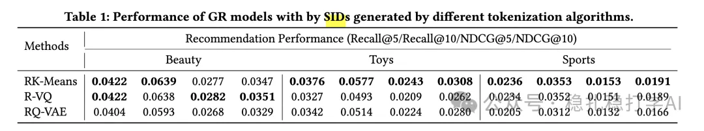

# Recommendation algorithms (2025.7.31): Snap's findings on generative recommendation will surely help you

> [中文版](2025-07-31-snap-generative-recommendation.md)

1 Generative Recommendation: Towards Next-Generation Recommender Paradigm

Link: https://arxiv.org/pdf/2507.10760

Company: Snap

Area: generative recommendation

Overview:

This paper explores generative recommender systems and describes LLM-based sequential recommendation methods, covering data, samples, features, architecture and training. The authors ran a large number of experiments and offer quite a few valuable recommendations.

Generative recommendation uses an LLM to generate a sequence of item IDs, rather than a traditional ranking model outputting scores to sort by.

Specifically:

(1) Tokenizer

There are 3 tokenizer options: item-based (Item IDs), content-based (Title Tokens) and sequence-based (Semantic IDs). Semantic IDs work best.

(2) Augmentation techniques

Mainly through augmentation techniques, of the following 4 kinds:

1) Sliding-window augmentation

How: standard sliding-window augmentation usually uses a fixed window size w (e.g. w=5, or set by sequence length) and slides step by step from the start of the user interaction sequence to generate samples (as in my example). This produces several fixed-length subsequence samples for each long sequence, helping the model learn more local patterns.

2) Sequence augmentation

How: use every prefix of each sequence as a training sample.

3) Token-drop augmentation

How: randomly delete some tokens from the input sequence.

4) Random-sampling augmentation

How: randomly take a contiguous subsequence from a longer sequence.

(3) Training

The generative recommendation model is trained with next token prediction.

Takeaways:

(1) Using LLMs for sequential recommendation still essentially requires, as traditional sequential recommendation models do, mining the user's interest preferences from the behavior sequence. Generative recommendation uses an LLM to generate a sequence of item IDs, rather than a traditional ranking model outputting scores to sort by.

(2) Most Chinese papers in the past six months used RQ-VAE; in future work, everyone can verify this claim.

Credibility: production

Recommendation: practically useful

