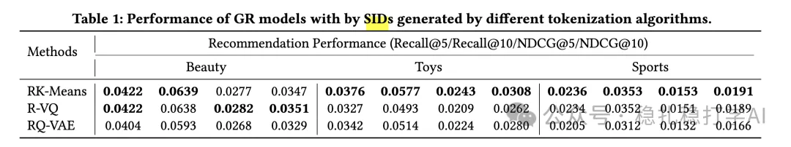

# 推荐算法(2025.7.31)：Snap的关于生成式推荐的发现，肯定可以帮助到您

> 原文：https://mp.weixin.qq.com/s/KbRxrNMUHweQRHuSdlgh6w
> 作者：算法工程师刘明星（稳扎稳打学AI）| 发表于 2025-07-31

嘿，记得给“稳扎稳打学AI”添加星标

关注我，每天为你精挑细选最优质、最新鲜的推荐算法paper，陪你一起保持进步、不断精进！

👆 [本公众号paper推荐原则](https://mp.weixin.qq.com/s?__biz=MzkzNDYyNjM1NA==&mid=2247484097&idx=1&sn=18322c279290b555eb030e12953b7c7f&scene=21#wechat_redirect)

1 Generative Recommendation: Towards Next-Generation Recommender Paradigm

网址：https://arxiv.org/pdf/2507.10760

公司：Snap

方向：生成式推荐

解读：

本文探索生成式推荐系统，介绍了LLM的序列推荐方法，包括数据、样本、特征、架构和训练方式。作者做了大量的实验，并提出了不少有价值的建议。

生成式推荐方法，是用LLM生成一个item ID序列，而不是传统排序模型输出分数排序。

具体的，

（1）tokenizer

有3种可选的tokenizer：基于物品的（Item IDs）、基于内容的（Title Tokens）和基于序列的（Semantic IDs）。Semantic IDs效果最好。

（2）增强技术

主要是通过增强技术，包括以下4种：

1）滑动窗口增强

具体做法：在标准滑动窗口增强中，通常使用固定窗口大小 w（如 w=5 或根据序列长度设定），从用户交互序列的开头逐步滑动生成样本（如我的例子所示）。这会为每个长序列产生多个固定长度的子序列样本，帮助模型学习更多局部模式。

2）序列增强

具体做法：把每个序列的每个前缀作为训练样本。

3）token-drop增强

具体做法：从输入序列中随机删除一些token。

4）随机采样增强

具体做法：从一个较长的序列中随机抽取一个连续子序列。

（3）训练

生成式推荐模型的训练方式是next token prediction。

心得：

（1）把大模型用于序列推荐，本质上还是需要像传统序列推荐模型那样，从行为序列中挖掘用户的兴趣偏好。生成式推荐方法，是用LLM生成一个item ID序列，而不是传统排序模型输出分数排序。

（2）国内过去半年的大部分paper用的多半是RQ-VAE，在以后的工作里，大家可以验证一下的说法。

可信度：生产

推荐等级：有实践价值

请帮忙点赞、转发，谢谢。您认为哪篇论文最有潜力应用到实际业务中？

## 欢迎干货投稿 \ 论文宣传 \ 合作交流

推荐您继续阅读：

■ [推荐算法(2025.7.28)：Google的小方法大价值，AB效果在文中](https://mp.weixin.qq.com/s/TTpzAw3Y5XPkmm9vIGbZ4A)

■ [推荐算法(2025.7.24)：沃尔玛，抠啊抠，抠出GMV大涨10个点](https://mp.weixin.qq.com/s/MiLpTuUlgOXJqbLennVKnA)

■ [推荐算法(2025.7.22)：Meta的解藕实践取得很大成绩](https://mp.weixin.qq.com/s/QSCEtMvrNo8GcDYRRKIGMw)

历史文章索引：https://docs.qq.com/sheet/DYXZTZ0tseHRyZGtt?tab=BB08J2

请入群，群内可讨论技术方案、发招聘广告、内推和交友。

• 铁粉标准：累计10次评论或爱心、投稿1次。

• 入群方法：请您加个人微信lmxhappy，我拉您入群，请备注（只我个人看，不公开）。

由于公众号试行乱序推送，您可能不再准时收到稳扎稳打学AI的推送。为了第一时间收到本号的干货内容， 请将本号设为星标，以及常点文末右下角的“在看”。

喜欢的话点个在看吧👇

个人观点，仅供参考
