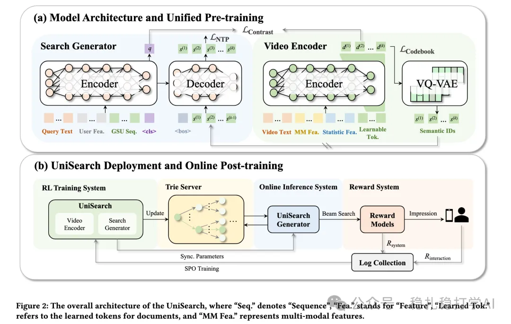

# Recommendation Algorithms (2025.9.9): Kuaishou's generative search, billed as its biggest gain ever

> [中文版](2025-09-09-kuaishou-unisearch.md)

1 UniSearch: Unified Generative Search and Recommendation Framework for Content Search

Link: https://arxiv.org/pdf/2509.06887

Company: Kuaishou

Area: generative search

Overview: The paper first pre-trains a generative recommender, then uses real-time online user feedback to optimize the Decoder parameters of the Search Generator, aligning it with user preferences. I'll first cover the pre-trained encoder-decoder architecture, which consists of a video encoder and a search generator (an encoder-decoder generator), and then the post-training step SPO (Search Preference Optimization).

(1) Video encoder

1) Encoder

A unidirectional Transformer. Its input is the video's text metadata, multimodal content features (visual/audio) and statistical side features, plus k learnable tokens; its output is k latent embeddings D = {d^(1), ..., d^(k)}. These embeddings represent the target item from coarse to fine, which is enforced through the query2item contrastive task.

The k learnable tokens in the input can be thought of as the special tokens we commonly use, such as $, except that here there are k of them, and no list of special tokens can be given. You can picture them as $1, $2, ..., $k. They go through the embedding layer to get their embeddings and are fed into the encoder; their corresponding output embeddings end up representing the target item, or part of its information.

(2) Search generator

Given the query (including the search terms, the user's behavior sequence, etc.), it predicts the next token (here, an item) the user is likely to interact with. It produces two by-products: the encoder encodes the query information, and the decoder outputs the next token. It mainly consists of an encoder and a decoder.

1) Encoder

Produces the embedding of the query (including the query terms and user information). Inputs include the search terms, the user behavior sequence, the special token <cls>, etc.

The query and the target item form a (query, item) pair. The query embedding and the video encoder's embedding sequence are used to optimize the model through residual contrastive learning. Because it predicts residuals, it achieves the coarse-to-fine prediction described above. This is the first task.

2) Decoder

Input:

* The contextualized query representation from the Encoder: including the global query embedding q (the query summary aggregated by the <cls> token) and the hidden states of the whole input sequence (query text + user features such as the GSU sequence, representing personalized historical behavior).
* On the item side, the k latent embeddings D of the target video.

Output: the next token the user is likely to interact with.

(3) SPO

This uses real-time online user feedback to optimize the Decoder parameters of the Search Generator, aligning it with user preferences. Concretely: the Decoder parameters are adjusted dynamically based on users' real-time feedback, improving search quality.

A/B: on Kuaishou search, CTR +5.0% over the baseline.

Takeaways: (1) The idea of this paper is very simple and direct: use generative recommendation methods to do search. The benefit is that search quality improves without adding much compute. (2) The SPO method is also well worth borrowing. SPO uses real-time online user feedback to optimize model parameters and thereby improve search quality.

Credibility: production

Recommendation: practically useful

