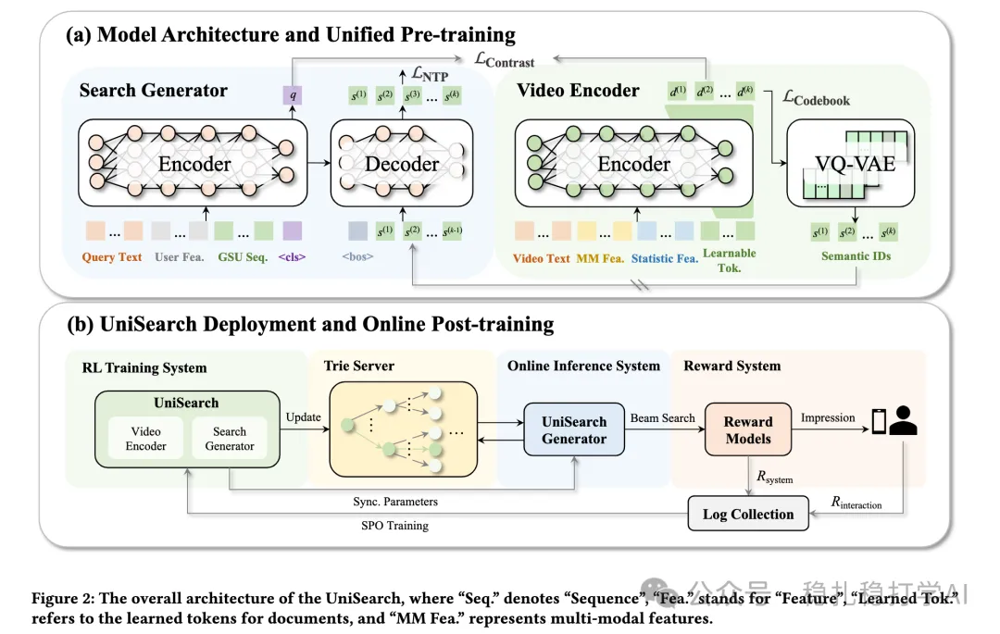

# 推荐算法(2025.9.9)：快手的生成式搜索推荐，号称史上最大提升

> 原文：https://mp.weixin.qq.com/s/i9yHQgxZ4QdK8PsgkJarng
> 作者：算法工程师刘明星（稳扎稳打学AI）| 发表于 2025-09-09

嘿，记得给“稳扎稳打学AI”添加星标

关注我，每天为你精挑细选最优质、最新鲜的推荐算法paper，陪你一起保持进步、不断精进！

👆 [本公众号paper推荐原则](https://mp.weixin.qq.com/s/BhVGu0qH5kTz9N5zpsD3KA)

1 UniSearch: Unified Generative Search and Recommendation Framework for Content Search

网址：https://arxiv.org/pdf/2509.06887

公司：快手

方向：生成式搜索

解读：本文提出了先预训练一个生成式推荐器。再通过线上实时的用户反馈，优化Search Generator的Decoder参数，做到用户偏好对齐。先介绍预训练的encoder-decoder架构，它包括video encoder和搜索生成器（encoder-decoder的generator）。再介绍后训练SPO（Search Preference Optimization）。

（1）video encoder

1）encoder

单向Transformer，输入视频文本元数据、多模态内容特征（视觉/音频）和统计侧边特征+ k 个可学习令牌，输出k个潜在嵌入D = {d^(1), ..., d^(k)}。这些embed是由coarse到fine的代表target item，为了实现这个目的，在query2item的对比任务里会强迫实现。

输入里的k 个可学习令牌，可以类比成我们常用的特殊标记，如$，只不过这里用到k个，无法给出一个特殊标记list。你可以想象成$1,$2,...,$k。它们经过embedding layer获得对应的embed，输入到encoder里，最终它们对应的输出embed，就能代表target item或者其部分信息。

（2）search generator

将query（包括搜索词和user的行为序列等），预测用户下一个可能互动的token（这里是item）。它输出两个副产品，encoder可以encode出query信息，decoder输出next token。主要包括一个encoder和一个decoder。

1）encoder

获得query（包括query词和user信息）的embed。输入包括搜索词，用户行为序列，特殊符号<cls>等。

query与target item形成（query，item）对，query嵌入跟video encoder的嵌入序列，通过残差对比学习，优化模型。通过预测残差，所以能够实现上面说的由coarse到fine的预测。这是第一个任务。

2）decoder

输入：

* 来自Encoder的上下文化query表征：包括全局查询嵌入 q（由<cls> token汇总的查询总结）和整个输入序列的隐藏状态（query text + user features 如GSU序列，代表个性化历史行为）。
* 从item端开始，输入目标视频的k个潜在嵌入D。

输出：下一个用户可能互动的token。

（3）SPO

就是通过线上实时的用户反馈，优化Search Generator的Decoder参数，做到用户偏好对齐。具体的：根据用户的实时反馈，动态调整Decoder参数，从而提升搜索效果。

AB：在快手搜索上，相比基线，CTR +5.0%。

心得：（1）本文的思路非常简单直接：用生成式推荐的方法，来做搜索。这种方法的好处是：可以在不增加太多计算量的情况下，提升搜索的效果。（2）本文的SPO方法也非常值得借鉴。SPO可以通过线上实时的用户反馈，优化模型参数，从而提升搜索效果。

可信度：生产

推荐等级：有实践价值

请帮忙点赞、转发，谢谢。您认为哪篇论文最有潜力应用到实际业务中？

## 欢迎干货投稿 \ 论文宣传 \ 合作交流

推荐您继续阅读：

■ [推荐算法(2025.9.8)：沃尔玛的LLM跨域推荐，加购率提升36%](https://mp.weixin.qq.com/s/mPINikAfsneS7MFu8OmjWQ)

■ [推荐算法(2025.9.7)：Pinterest的跨域表征学习](https://mp.weixin.qq.com/s/hI3B6ZefpBDRnsuuHIiRNw)

历史文章索引：https://docs.qq.com/sheet/DYXZTZ0tseHRyZGtt?tab=BB08J2

请入微信群，群内我会给出更深入的解读，还可以共同讨论技术方案、发招聘广告、内推和交友等。

• 铁粉标准：关注一个月以上，且累计10次互动（评论、爱心、转发）、或投稿1次。

• 入群方法：请您加个人微信lmxhappy，我拉您入群，请备注（只我个人看，不公开）。

喜欢的话点个在看吧👇

个人观点，仅供参考
