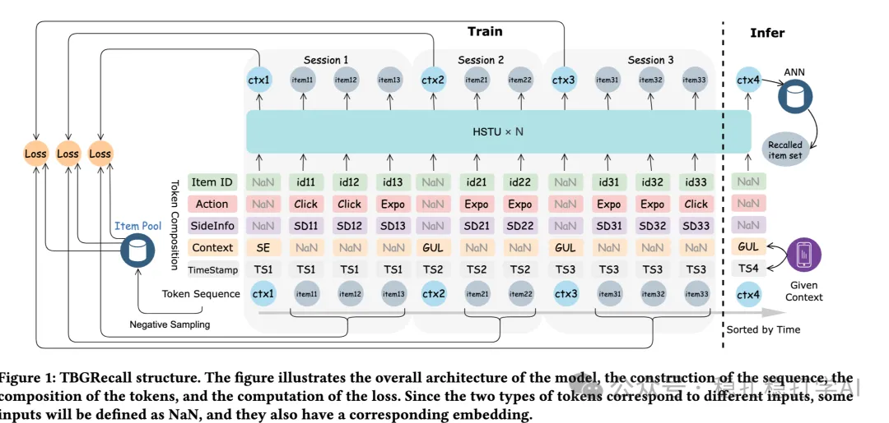

# Recommendation Algorithms (2025.9.10): Alibaba's session-based generative recommendation, with clear retrieval gains

> [中文版](2025-09-10-ali-tbgrecall.md)

1 TBGRecall: Leveraging Token-Level Autoregression for Session-Based Generative Recommendation

Link: https://arxiv.org/pdf/2508.11977

Company: Alibaba

Area: generative recommendation (retrieval)

Overview: The paper proposes a generative recommendation model that works in units of sessions. Main innovations: (1) a ctx token is inserted into each session to mark user intent, e.g. scenario information; (2) at prediction time, items within the current session are not considered; (3) besides the generation task, click, conversion and other tasks are added. Specifically:

(1) Session structure

The user behavior sequence is split by time into multiple sessions, and each session has a ctx token marking user intent, e.g. scenario information.

(2) Tokenization

The items in each session are tokenized into a token sequence. Specifically: each item's features are tokenized into a token.

(3) Generation

An autoregressive model generates the token sequence of the next session. Specifically: based on the previous sessions, it generates the token sequence of the next session.

(4) Multi-task

Besides the generation task, click, conversion and other tasks are added. Specifically: based on the generated token sequence, it predicts click, conversion and other tasks.

A/B: on Alibaba ads, CTR +1.5% over the baseline.

Takeaways: (1) The idea of this paper is very simple and direct: do generative recommendation in units of sessions. The benefit is that generative recommendation quality improves without adding much compute. (2) The ctx token and the multi-task approach are also well worth borrowing. The ctx token can mark user intent, and multi-task learning can improve the model's generalization.

Credibility: production

Recommendation: practically useful

