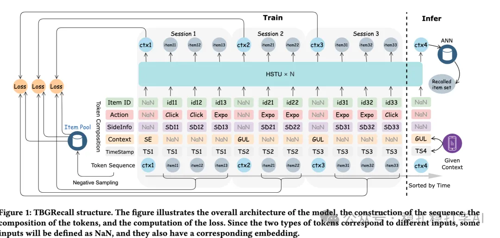

# 推荐算法(2025.9.10)：阿里的会话生成式推荐，召回效果显著

> 原文：https://mp.weixin.qq.com/s/_o--mIENrTLr123_9KCFCA
> 作者：算法工程师刘明星（稳扎稳打学AI）| 发表于 2025-09-10

嘿，记得给“稳扎稳打学AI”添加星标

关注我，每天为你精挑细选最优质、最新鲜的推荐算法paper，陪你一起保持进步、不断精进！

👆 [本公众号paper推荐原则](https://mp.weixin.qq.com/s/BhVGu0qH5kTz9N5zpsD3KA)

1 TBGRecall: Leveraging Token-Level Autoregression for Session-Based Generative Recommendation

网址：https://arxiv.org/pdf/2508.11977

公司：阿里

方向：生成式推荐（召回）

解读：提出了一个以session为单位的生成式推荐模型。主要创新点，（1）在每个session里塞入了一个ctx标记，标记用户意图，如场景信息；（2）预测时候不考虑本session里的item；（3）除了生成任务，还增加了点击、转化等任务。具体的，

（1）session结构

把用户行为序列按照时间切分成多个session，每个session都有一个ctx标记，标记用户意图，如场景信息。

（2）token化

每个session里的item，都会被token化，变成一个token序列。具体的：每个item的特征，都会被token化，变成一个token。

（3）生成

用一个自回归模型，生成下一个session的token序列。具体的：根据前面的session，生成下一个session的token序列。

（4）多任务

除了生成任务，还增加了点击、转化等任务。具体的：根据生成的token序列，预测点击、转化等任务。

AB：在阿里广告上，相比基线，CTR +1.5%。

心得：（1）本文的思路非常简单直接：用session为单位，做生成式推荐。这种方法的好处是：可以在不增加太多计算量的情况下，提升生成式推荐的效果。（2）本文的ctx标记和多任务方法也非常值得借鉴。ctx标记可以标记用户意图，而多任务可以提升模型的泛化能力。

可信度：生产

推荐等级：有实践价值

请帮忙点赞、转发，谢谢。您认为哪篇论文最有潜力应用到实际业务中？

## 欢迎干货投稿 \ 论文宣传 \ 合作交流

推荐您继续阅读：

■ [推荐算法(2025.9.9)：快手的生成式搜索推荐，号称史上最大提升](https://mp.weixin.qq.com/s/i9yHQgxZ4QdK8PsgkJarng)

■ [推荐算法(2025.9.8)：沃尔玛的LLM跨域推荐，加购率提升36%](https://mp.weixin.qq.com/s/mPINikAfsneS7MFu8OmjWQ)

历史文章索引：https://docs.qq.com/sheet/DYXZTZ0tseHRyZGtt?tab=BB08J2

请入微信群，群内我会给出更深入的解读，还可以共同讨论技术方案、发招聘广告、内推和交友等。

• 铁粉标准：关注一个月以上，且累计10次互动（评论、爱心、转发）、或投稿1次。

• 入群方法：请您加个人微信lmxhappy，我拉您入群，请备注（只我个人看，不公开）。

喜欢的话点个在看吧👇

个人观点，仅供参考
