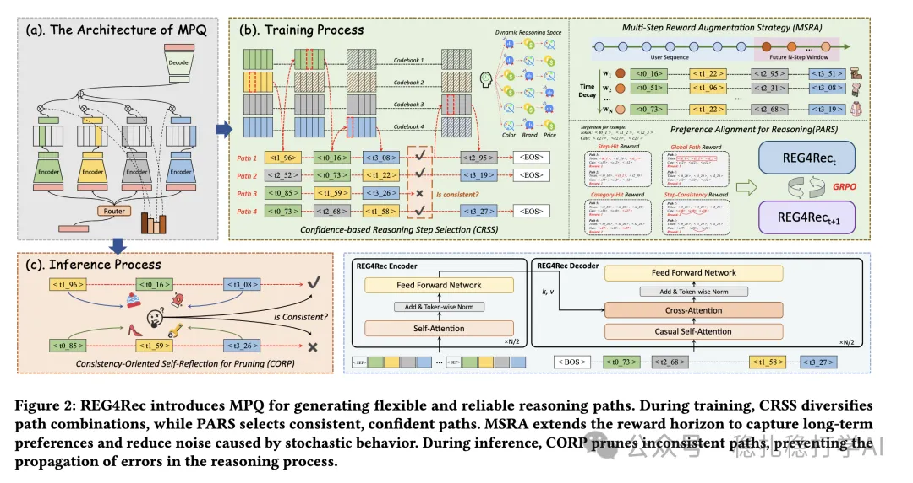

# Recommendation Algorithms (2025.9.17): Alibaba's generative retrieval, an MMoE-style codebook

> [中文版](2025-09-17-ali-reg4rec.md)

1 REG4Rec: Reasoning-Enhanced Generative Recommendation via Preference Alignment and Multi-Step Reward Augmentation

Link: https://arxiv.org/pdf/2508.15308

Company: Alibaba

Area: generative recommendation + reasoning

Overview:

The overall architecture is an encoder-decoder autoregressive generator that predicts the next item from the user behavior sequence. A codebook turns the target item into an ID sequence, so what is predicted autoregressively is this sequence. On top of that, the preference-aligned reasoning (PARS) and multi-step reward augmentation (MSRA) strategies are used to improve reasoning reliability.

REG4Rec:

(1) CRSS

In autoregressive generation, the choice of codebook is not fixed but selected dynamically based on the user's historical behavior sequence. Specifically: the codebook is chosen dynamically from the user's historical behavior sequence, and the ID sequence is generated.

(2) PARS

At reasoning time, a preference-alignment method is used to improve reasoning reliability. Specifically: the reasoning strategy is adjusted dynamically based on the user's historical behavior sequence, improving reasoning reliability.

(3) MPQ

I'll focus on MPQ. It uses M parallel experts with M different codebooks to encode the target item's multimodal content and obtain discrete IDs. At the same time, a gate network (router) selects K active codebooks, and recursively, each step takes the ID from the codebook with the best confidence score, forming an ID sequence called a path.

(4) MSRA

At training time, a multi-step reward augmentation method is used to improve training. Specifically: rewards are adjusted dynamically based on the user's historical behavior sequence, improving training.

(5) CORP

At reasoning time, a consistency-oriented self-reflective pruning method prunes inconsistent reasoning paths. Specifically: inconsistent reasoning paths are pruned dynamically based on the user's historical behavior sequence, improving reasoning reliability.

A/B: on Alibaba ads, CTR +1.2% over the baseline.

Takeaways: (1) The idea of this paper is very simple and direct: use generative recommendation methods to do retrieval. The benefit is that retrieval quality improves without adding much compute. (2) The MPQ, PARS, MSRA and CORP methods are also well worth borrowing. MPQ selects codebooks dynamically, PARS improves reasoning reliability, MSRA improves training, and CORP prunes inconsistent reasoning paths.

Caveats: none

Credibility: production

Recommendation: practically useful

