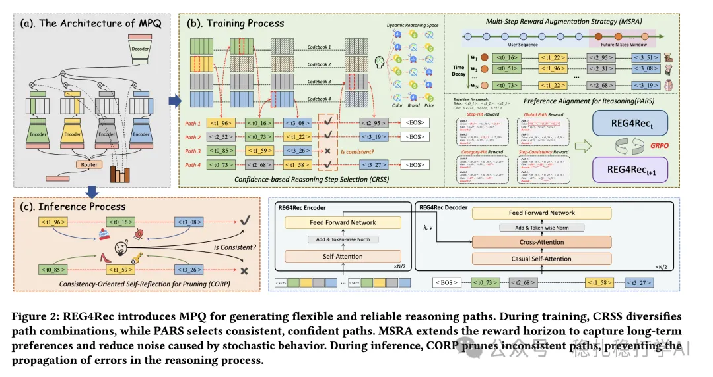

# 推荐算法(2025.9.17)：阿里的生成式推荐召回，MMOE版codebook

> 原文：https://mp.weixin.qq.com/s/JPkOFWM8PLurZV2HylNnPg
> 作者：算法工程师刘明星（稳扎稳打学AI）| 发表于 2025-09-17

嘿，记得给“稳扎稳打学AI”添加星标

关注我，每天为你精挑细选最优质、最新鲜的推荐算法paper，陪你一起保持进步、不断精进！

> [English version](2025-09-17-ali-reg4rec.full.en.md)

👆 [本公众号paper推荐原则](https://mp.weixin.qq.com/s/BhVGu0qH5kTz9N5zpsD3KA)

1 REG4Rec: Reasoning-Enhanced Generative Recommendation via Preference Alignment and Multi-Step Reward Augmentation

网址：https://arxiv.org/pdf/2508.15308

公司：阿里

方向：生成式推荐+推理

解读：

总体架构是encoder-decoder的一个自回归式的生成器，通过用户行为序列预测下一个item。通过codebook将target item转成了一个ID序列，从而自回归预测的是这个序列。后续，使用偏好对齐推理（PARS）和多步奖励增强（MSRA）策略，提升推理可靠性。

reg4rec：

（1）CRSS

就是在自回归生成里，codebook的选择，不是固定的，而是根据用户的历史行为序列，动态选择的。具体的：根据用户的历史行为序列，动态选择codebook，生成ID序列。

（2）PARS

就是在推理的时候，用偏好对齐的方法，来提升推理的可靠性。具体的：根据用户的历史行为序列，动态调整推理的策略，从而提升推理的可靠性。

（3）MPQ

重点讲一下MPQ。就是用一个并行的M个expert中使用不同的M个codebook，对taget item多模态做encode并获得离散ID。与此同时，有一个gate网络router，选出K个活跃的codebook，递归的每次获得confidence分数最好的codebook里的ID，组成一个ID序列，叫path。

（4）MSRA

就是在训练的时候，用多步奖励增强的方法，来提升模型的训练效果。具体的：根据用户的历史行为序列，动态调整奖励，从而提升模型的训练效果。

（5）CORP

就是在推理的时候，用一致性导向的自我反思剪枝方法，来剪枝不一致的推理路径。具体的：根据用户的历史行为序列，动态剪枝不一致的推理路径，从而提升推理的可靠性。

AB：在阿里广告上，相比基线，CTR +1.2%。

心得：（1）本文的思路非常简单直接：用生成式推荐的方法，来做召回。这种方法的好处是：可以在不增加太多计算量的情况下，提升召回的效果。（2）本文的MPQ、PARS、MSRA、CORP方法也非常值得借鉴。MPQ可以动态选择codebook，PARS可以提升推理的可靠性，MSRA可以提升训练的效果，CORP可以剪枝不一致的推理路径。

愚见：空

可信度：生产

推荐等级：有实践价值

请帮忙点赞、转发，谢谢。

## 欢迎干货投稿 \ 论文宣传 \ 合作交流

推荐您继续阅读：

■ [推荐算法(2025.9.15)：阿里的多模态MMOE版RQ-VAE](https://mp.weixin.qq.com/s/Zhc2iFumX3OGIN_grUqyYw)

■ [推荐算法(2025.9.11)：字节的双塔召回，行为序列与item可以做交叉，效果显著](https://mp.weixin.qq.com/s/x8pMwhZRTvJuqwvlWt4Onw)

历史文章索引：https://docs.qq.com/sheet/DYXZTZ0tseHRyZGtt?tab=BB08J2

请入微信群，群内我会给出更深入的解读，还可以共同讨论技术方案、发招聘广告、内推和交友等。

• 铁粉标准：关注公众号一个月以上，且在公众号上累计10次互动（评论、爱心、转发）、或投稿1次。

• 入群方法：请您加个人微信lmxhappy，我拉您入群，请备注（只我个人看，不公开）。

喜欢的话点个在看吧👇

个人观点，仅供参考
