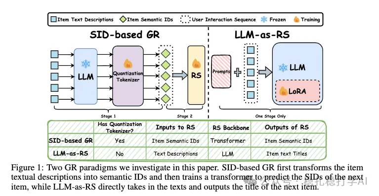

# Recommendation Algorithms (2025.10.9): Snap says: fellow GR practitioners, you're heading in the wrong direction

> [中文版](2025-10-09-snap-gr-wrong-path.md)

1 Are We on the Wrong Path to Generative Recommendation? Dissecting the Underlying Problems

Link: https://arxiv.org/pdf/2509.25522

Company: Snap

Idea: comparison (comparative experiments) + analysis (analyzing the causes)

Area: generative recommendation

Overview:

The paper mainly runs two comparative experiments.

(1) Comparing the two paradigms

Generative recommendation (GR) has two paradigms: SID-based GR and LLM-as-RS.

SID-based GR

Pipeline: item text/images → LLM encoder (frozen) produces semantic embeddings → quantization tokenizer (e.g. RQ-VAE) converts them into discrete SIDs → a sequential recommender (Transformer) autoregressively predicts the next SID from the user's SID sequence.

LLM-as-RS

Pipeline: item text/images → LLM (LoRA fine-tuned) directly generates the title of the next item.

Conclusion: LLM-as-RS outperforms SID-based GR across the board on multiple datasets, especially when compute is ample.

(2) Comparing SID configurations

The paper also compares SID configurations. Specifically:

SID length: the number of tokens in an SID. Longer SIDs reduce quantization error, but the space the sequential recommender has to learn grows, making optimization harder. The paper's experiments (Figs. 4-5) show that beyond the best configuration (3x256), performance drops instead of rising, because the RS's learning burden grows and it cannot benefit from the larger space.

Codebook size: the range of values each token can take. A larger codebook reduces quantization error, but the space the sequential recommender has to learn grows, making optimization harder. The paper's experiments (Figs. 6-7) show that as codebook size increases, performance first rises then falls, because the RS's learning burden grows and it cannot benefit from the larger space.

Takeaways: (1) The paper's conclusion is interesting: LLM-as-RS beats SID-based GR across the board. This suggests that in generative recommendation, having an LLM directly generate the next item's title works better than first converting items into SIDs and then predicting the next SID with a sequential recommender. (2) The SID configuration experiments are also instructive: increasing SID length and codebook size does not necessarily improve performance, because the space the sequential recommender has to learn grows and optimization gets harder.

Caveats: the paper's conclusion is still debatable. LLM-as-RS directly generating the next item's title sounds like a harder task, yet it works better, which is somewhat counterintuitive. A possible reason: LLM-as-RS leverages the LLM's pre-trained knowledge, while the sequential recommender in SID-based GR is trained from scratch and does not use pre-trained knowledge.

Credibility: offline

Recommendation: worth a look if you have time

