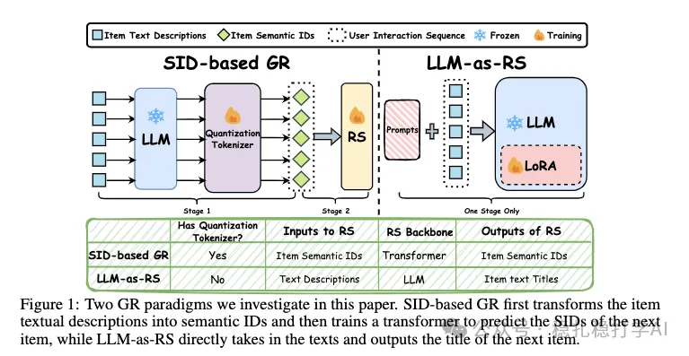

# 推荐算法(2025.10.9)：Snap说：做GR推荐的同行们，你们走错方向了

> 原文：https://mp.weixin.qq.com/s/2G3-Moegkx5x8f0Yt0gCVw
> 作者：算法工程师刘明星（稳扎稳打学AI）| 发表于 2025-10-09（修改于2025年10月9日）

嘿，记得给“稳扎稳打学AI”添加星标

关注我，每天为你精挑细选最优质、最新鲜的推荐算法paper，陪你一起保持进步、不断精进！

> [English version](2025-10-09-snap-gr-wrong-path.full.en.md)

👆 [本公众号paper推荐原则](https://mp.weixin.qq.com/s/BhVGu0qH5kTz9N5zpsD3KA)

1 Are We on the Wrong Path to Generative Recommendation? Dissecting the Underlying Problems

网址：https://arxiv.org/pdf/2509.25522

公司：Snap

思想：对比（对比试验）+分析（分析原因）

方向：生成式推荐

解读：

本文主要做了2个对比实验。

（1）两范式对比

生成式推荐（GR）有2个范式：一个是SID-based GR，一个是LLM-as-RS。

SID-based GR

流程：物品文本/图像 → LLM编码器（frozen）生成语义嵌入 → 量化分词器（Quantization Tokenizer，如RQ-VAE）转换为离散SID → 序列推荐器（Transformer）基于用户SID序列自回归预测下一个SID。

LLM-as-RS

流程：物品文本/图像 → LLM模型（LoRA微调）直接生成下一个物品的标题。

结论：LLM-as-RS在多个数据集上，全面优于SID-based GR，尤其在计算资源充足时。

（2）SID配置对比

本文还做了SID配置的对比实验。具体的：

SID长度：即SID中token的数量，增大SID长度，量化误差变小，但序列推荐器需要学习的空间变大，增大优化难度。论文实验（图4-5）显示，超出最佳配置（3x256）后，性能不升反降，因为RS学习负担加重，无法从更大空间获益。

码本大小：即每个token的取值范围，增大码本大小，量化误差变小，但序列推荐器需要学习的空间变大，增大优化难度。论文实验（图6-7）显示，增大码本大小，性能先升后降，因为RS学习负担加重，无法从更大空间获益。

心得：（1）本文的结论很有意思：LLM-as-RS全面优于SID-based GR。这说明，在生成式推荐中，直接用LLM模型生成下一个物品的标题，比先将物品转换成SID，再用序列推荐器预测下一个SID，效果更好。（2）本文的SID配置实验也很有启发：增大SID长度和码本大小，并不一定能提升性能，因为序列推荐器需要学习的空间变大，优化难度增大。

愚见：文中的结论还是值得商榷，LLM-as-RS直接生成下一个物品的标题，听起来像是一个更难的任务，但是效果却更好，这有点反直觉。可能的原因是：LLM-as-RS利用了LLM的预训练知识，而SID-based GR的序列推荐器是从头训练的，没有利用预训练知识。

可信度：离线

推荐等级：有时间看看

请帮忙点赞、转发，谢谢。

## 欢迎干货投稿 \ 论文宣传 \ 合作交流

推荐您继续阅读：

■ [推荐算法(2025.10.2)：快手的模型驱动的倒排索引，很有效](https://mp.weixin.qq.com/s/IpNlevDyRk-KJs-Q1AmJFw)

■ [推荐算法(2025.10.1)：阿里的模型打标签方法，效果很不错](https://mp.weixin.qq.com/s/csPTTnmGkTxiZ59fEziikg)

历史文章索引：https://docs.qq.com/sheet/DYXZTZ0tseHRyZGtt?tab=BB08J2

请入微信群，群内我会给出更深入的解读，还可以共同讨论技术方案、发招聘广告、内推和交友等。

• 铁粉标准：关注公众号一个月以上，且在公众号上累计15次互动（评论、爱心、转发）、或投稿1次。

• 入群方法：请您加个人微信lmxhappy，我拉您入群，请备注（只我个人看，不公开）。

喜欢的话点个在看吧👇

个人观点，仅供参考

修改于2025年10月9日
