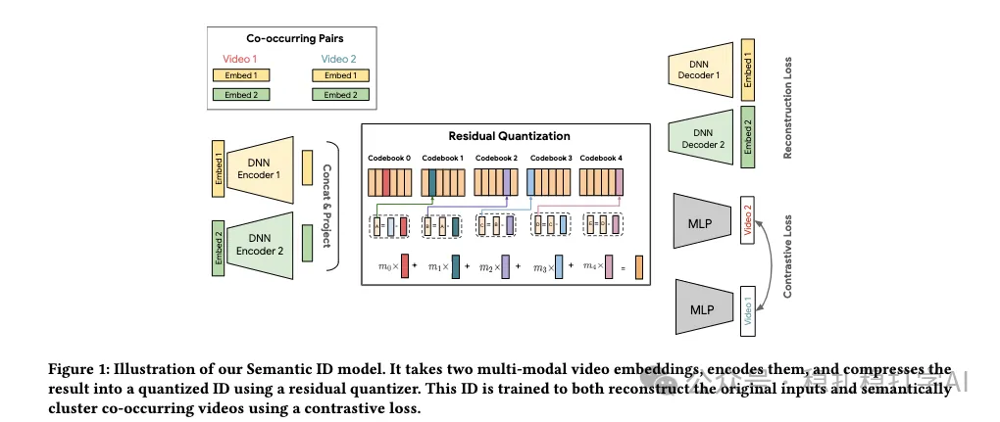

# Recommendation Algorithms (2025.11.12): Google/YouTube's generative retrieval, generating semantic IDs and aligning them with an LLM, CTR +4.96%

> [中文版](2025-11-12-google-plum.md)

1 PLUM: Adapting Pre-trained Language Models for Industrial-scale Generative Recommendations

Link: https://arxiv.org/pdf/2510.07784

Company: Google

Idea: alignment (contrastive learning, modality alignment, coarse-to-fine alignment)

Area: generative recommendation + multimodal retrieval

Overview: The paper mainly uses a pre-trained LLM for generative retrieval. On top of a pre-trained LLM, it generates semantic IDs and fine-tunes for next-video recommendation. There are 3 stages: generate semantic IDs from multiple multimodal representations; then do autoregressive training of the pre-trained LLM on inputs that mix semantic IDs and text; finally fine-tune for next-item prediction. Specifically:

(1) Generating semantic IDs

1) Multiple multimodal encoders encode the video, giving multiple multimodal representations.

2) These representations are trained with contrastive learning so that they are semantically aligned. How: contrastive learning on the representations of two videos pulls them closer semantically; conversely, dissimilar videos' representations are pushed further apart semantically. The benefit: in the later semantic ID generation, semantically similar videos are assigned similar semantic IDs.

3) Residual quantization (RQ) compresses the multimodal representations into semantic IDs. How: the multimodal representation is fed into a residual quantizer to get a quantized ID. This ID is the video's semantic ID.

4) Progressive masking and multi-resolution codebooks: the paper's two innovations here.

Progressive masking: masking is used to gradually occlude parts of the multimodal representation, so the model learns more robust semantic representations.

Multi-resolution codebooks: several codebooks of different resolutions represent the video's semantic information. Coarse codebooks represent the video's rough semantics, and fine codebooks represent its fine-grained semantics. The benefit: in later generation, the model can first generate coarse semantic IDs and then refine step by step to fine-grained semantic IDs.

(2) Autoregressive pre-training of the LLM

Next, semantic IDs and text are mixed together and fed into the pre-trained LLM for autoregressive training. How: the semantic ID sequence of the videos in the user's watch history is mixed with text descriptions as the LLM's input, so the LLM learns the semantic relationships between videos and users' behavior patterns.

The benefit: the LLM can use its strong language understanding to understand video semantics and user behavior patterns, and so recommend better.

(3) Fine-tuning for next-item prediction

Finally, on top of the pre-trained LLM, it is fine-tuned for next-video prediction. How: the semantic ID sequence of the videos in the user's watch history is the input, and the model predicts the semantic ID of the next video.

In the fine-tuning stage, the paper also introduces contrastive learning and multi-task learning to further improve the model. How:

1) Contrastive learning: used so the model learns more accurate semantic representations.

2) Multi-task learning: several tasks are optimized at once, including next-video prediction, video classification, etc., improving the model's generalization.

A/B: on YouTube, compared with LEM+, results for long-form / short-form video: active users +0.07%/0.28%, CTR +0.76%/4.96%, views +0.80%/0.39%.

Takeaways: (1) The paper gives several optimization tricks. Each is small, but all are thought through carefully, for example progressive masking and multi-resolution codebooks.

Caveats: none

Credibility: production

Recommendation: practically useful

