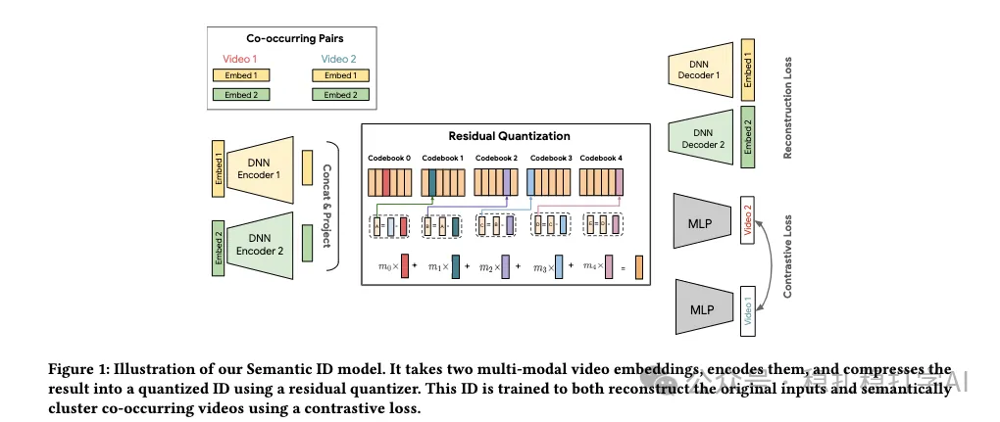

# 推荐算法(2025.11.12)：谷歌油管的生成式推荐召回，生成语义ID并对齐大模型，CTR+4.96%

> 原文：https://mp.weixin.qq.com/s/ylNS194_yBvmS2jKhLdgiA
> 作者：算法工程师刘明星（稳扎稳打学AI）| 发表于 2025-11-12

嘿，记得给“稳扎稳打学AI”添加星标

关注我，每天为你精挑细选最优质、最新鲜的推荐算法paper，陪你一起保持进步、不断精进！

👆 [本公众号paper推荐原则](https://mp.weixin.qq.com/s/BhVGu0qH5kTz9N5zpsD3KA)

1 PLUM: Adapting Pre-trained Language Models for Industrial-scale Generative Recommendations

网址：https://arxiv.org/pdf/2510.07784

公司：谷歌

思想：对齐（对比学习、模态对齐、粗到细的对齐）

方向：生成式推荐+多模态召回

解读：本文主要是用预训练的LLM做生成式推荐的召回。在预训练大模型的基础上，做语义ID生成和微调以用于下一个video的推荐。包括3个stage：将多种多模态表征生成语义ID，再通过预训练的LLM模型对混合语义ID和文本的输入做自回归训练，最后做下一个next预测的微调。具体的，

（1）生成语义ID

1）用多个多模态编码器，对视频进行编码，得到多个多模态表征。

2）用对比学习去训练这些表征，使其具有语义对齐的特性。具体做法：把两个视频的表征通过对比学习，让它们的表征在语义上更接近；反之，不相似的视频，它们的表征在语义上更远。这样的好处是：在后续的语义ID生成中，语义相似的视频会被分配到相似的语义ID上。

3）用残差量化（RQ）方法，将多模态表征压缩成语义ID。具体做法：将多模态表征输入到一个残差量化器中，得到一个量化的ID。这个ID就是视频的语义ID。

4）渐进掩码和多分辨率码本：本文的2个创新。

渐进掩码：用掩码技术，逐步遮挡掉多模态表征中的某些部分，让模型学习到更鲁棒的语义表征。

多分辨率码本：用多个不同分辨率的码本，来表示视频的语义信息。粗粒度的码本表示视频的粗略语义，细粒度的码本表示视频的细粒度语义。这样的好处是：在后续的生成过程中，模型可以先生成粗粒度的语义ID，再逐步细化到细粒度的语义ID。

（2）LLM模型自回归预训练

接下来，将语义ID和文本混合在一起，输入到预训练的LLM模型中，进行自回归训练。具体做法：将用户观看历史中的视频语义ID序列和文本描述混合在一起，作为LLM的输入，让LLM学习到视频之间的语义关系和用户行为模式。

这样做的好处是：LLM可以利用其强大的语言理解能力，来理解视频的语义信息和用户行为模式，从而更好地进行推荐。

（3）下一个next预测的微调

最后，在预训练的LLM模型基础上，进行下一个video预测的微调。具体做法：将用户观看历史中的视频语义ID序列作为输入，让模型预测下一个视频的语义ID。

在微调阶段，本文还引入了对比学习和多任务学习的方法，来进一步提升模型的效果。具体做法：

1）对比学习：用对比学习的方法，让模型学习到更准确的语义表征。

2）多任务学习：同时优化多个任务，包括下一个视频预测、视频分类等，从而提升模型的泛化能力。

AB：在youtube上，相比 LEM+，长视频和短视频的效果：活跃用户 +0.07%/0.28%，CTR +0.76%/4.96%，观看 +0.80%/0.39%。

心得：（1）本文给了好几个优化的trick，每个都很小，但是想的都很周到细致。比如渐进掩码和多分辨率码本。

愚见：空

可信度：生产

推荐等级：有实践价值

请帮忙点赞、转发，谢谢。

## 欢迎干货投稿 \ 论文宣传 \ 合作交流

推荐您继续阅读：

■ [推荐算法(2025.11.5)：阿里的群组信息增强低活用户，做到了极致，GMV+3.10%](https://mp.weixin.qq.com/s/URp-Ars7BTULYmrNDg29CA)

■ [推荐算法(2025.11.3)：阿里的推理特征冷启，CTR+5.3%](https://mp.weixin.qq.com/s/1mHpG3SIf2xMXC4Pp2urSQ)

历史文章索引：https://docs.qq.com/sheet/DYXZTZ0tseHRyZGtt?tab=BB08J2

请入微信群，群内我会给出更深入的解读，还可以共同讨论技术方案、发招聘广告、内推和交友等。

• 铁粉标准：关注公众号一个月以上，且在公众号上累计15次互动（评论、爱心、转发）、或投稿1次，只欢迎技术同学。

• 入群方法：请您加个人微信lmxhappy，我拉您入群，请备注（只我个人看，不公开）。

喜欢的话点个在看吧👇

个人观点，仅供参考
