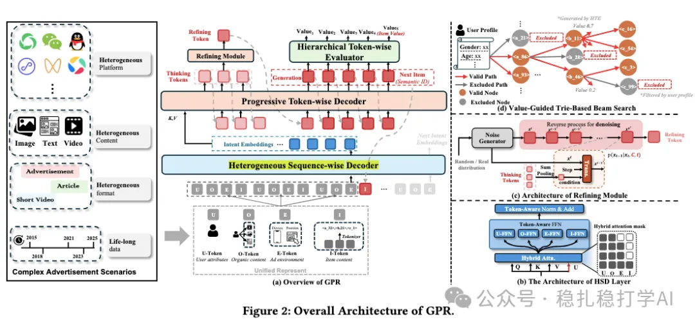

# Recommendation Algorithms (2025.11.17): Tencent's "one model" for ads, called GPR, GMV +2.11%

> [中文版](2025-11-17-tencent-gpr.md)

1 GPR: Towards a Generative Pre-trained One-Model Paradigm for Large-Scale Advertising Recommendation

Link: https://arxiv.org/pdf/2511.10138

Company: Tencent

Idea: decoupling (separating intent from next-item prediction)

Area: generative recommendation + behavior sequence

Overview:

It combines generative recommendation with behavior sequences, using one model for both intent prediction and next-item prediction.

Specifically:

(1) Semantic ID generation

The items in the behavior sequence and the candidate items get semantic IDs through a semantic ID method. This paper uses a method called "RQ-Kmeans".

(2) Intent prediction (intent)

An encoder-decoder structure: the encoder encodes the user behavior sequence, and the decoder generates a sequence of intent embeddings. Concretely, the encoder's input is the semantic IDs of the user behavior sequence, and the decoder's output is the intent embedding sequence.

(3) Think

The decoder's cross-attention uses the decoder hidden states as the query. It generates a fixed number of intent embeddings.

(4) Next-item prediction

The intent embedding sequence and the user behavior sequence together predict the next item. Concretely, the intent embedding sequence and the user behavior sequence are concatenated and fed into a transformer that predicts the semantic ID of the next item.

A/B: in A/B tests on WeChat Channels, successive GPR versions improved GMV by +2.11% to +0.58%, and cost by +3.29% to +0.12%. Stratified analysis shows the biggest gains for low-activity users and new ads.

Takeaways:

(1) Decoupling intent prediction from next-item prediction is a good idea. Intent prediction focuses on the user's long-term interests and next-item prediction on short-term behavior; once decoupled, each can be optimized separately.

(2) Using generative recommendation for ads is a good direction. The ad candidate set is huge, and generative recommendation can generate ads directly, avoiding the funnel loss of traditional retrieval and ranking.

(3) GPR's iterative gains are significant: GMV +2.11%, cost +3.29%. This shows that while GPR improves results, it also brings some extra cost. A balance between effectiveness and cost has to be found.

(4) Stratified analysis shows the biggest gains for low-activity users and new ads, which means GPR works better in cold-start scenarios. This is a good sign, since cold start has always been a hard problem for recommender systems.

Credibility: production

Recommendation: practically useful

