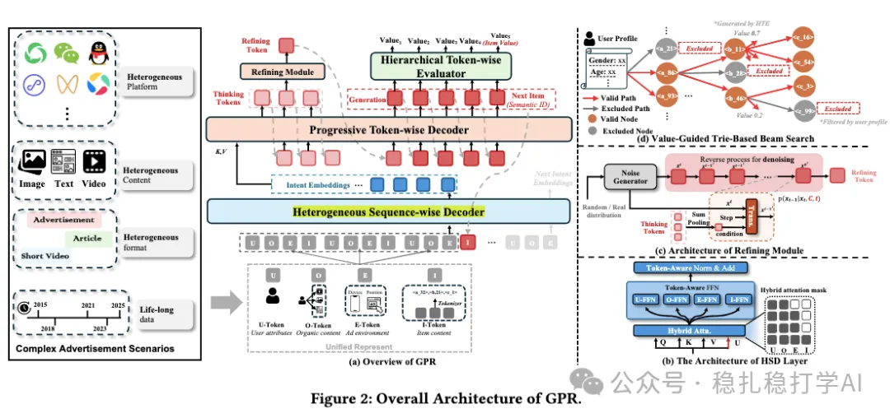

# 推荐算法(2025.11.17)：腾讯的one ad名叫GPR，GMV+2.11%

> 原文：https://mp.weixin.qq.com/s/lWGbZU-XbodX2WgVVdOQkQ
> 作者：算法工程师刘明星（稳扎稳打学AI）| 发表于 2025-11-17

嘿，记得给“稳扎稳打学AI”添加星标

关注我，每天为你精挑细选最优质、最新鲜的推荐算法paper，陪你一起保持进步、不断精进！

> [English version](2025-11-17-tencent-gpr.full.en.md)

👆 [本公众号paper推荐原则](https://mp.weixin.qq.com/s/BhVGu0qH5kTz9N5zpsD3KA)

1 GPR: Towards a Generative Pre-trained One-Model Paradigm for Large-Scale Advertising Recommendation

网址：https://arxiv.org/pdf/2511.10138

公司：腾讯

思想：解耦（意图和next预测分离）

方向：生成式推荐+行为序列

解读：

将生成式推荐和行为序列结合起来，用一个模型同时做意图预测和next item预测。

具体地，

（1）语义ID生成

行为序列里的序列item和candidate item通过一种语义ID方法生成语义ID。本文是名叫“RQ-Kmeans”的方法。

（2）意图预测（intent）

用一个encoder-decoder结构，encoder部分对用户行为序列进行编码，decoder部分生成意图嵌入序列。具体来说，encoder的输入是用户行为序列的语义ID，decoder的输出是意图嵌入序列。

（3）think

decoder 的 cross-attention 使用 decoder hidden states 作为 query。生成固定数量的意图嵌入序列。

（4）next item预测

用意图嵌入序列和用户行为序列，共同预测下一个item。具体来说，将意图嵌入序列和用户行为序列拼接起来，输入到一个transformer中，预测下一个item的语义ID。

AB：在微信视频号A/B测试中，GPR版本迭代提升GMV+2.11%~+0.58%，成本+3.29%~+0.12%。分层分析显示对低活跃用户和新广告提升最大。

心得：

（1）将意图预测和next item预测解耦，是一个很好的思路。意图预测关注用户的长期兴趣，next item预测关注用户的短期行为，两者解耦后可以分别优化。

（2）用生成式推荐做广告，是一个很好的方向。广告的候选集很大，生成式推荐可以直接生成广告，避免了传统召回和排序的漏斗损失。

（3）GPR的迭代提升效果显著，GMV提升2.11%，成本提升3.29%，说明GPR在提升效果的同时，也带来了一定的成本增加。需要在效果和成本之间找到平衡点。

（4）分层分析显示对低活跃用户和新广告提升最大，说明GPR在冷启动场景下效果更好。这是一个很好的现象，因为冷启动一直是推荐系统的一个难题。

可信度：生产

推荐等级：有实践价值

请帮忙点赞、转发，谢谢。

## 欢迎干货投稿 \ 论文宣传 \ 合作交流

推荐您继续阅读：

■ [推荐算法(2025.11.16)：Meta，群组信息增强网络效果，作为label指导](https://mp.weixin.qq.com/s/YYk4HBDoW_sJ86HlAGJEFQ)

■ [推荐算法(2025.11.12)：谷歌油管的生成式推荐召回，生成语义ID并对齐大模型，CTR+4.96%](https://mp.weixin.qq.com/s/ylNS194_yBvmS2jKhLdgiA)

历史文章索引：https://docs.qq.com/sheet/DYXZTZ0tseHRyZGtt?tab=BB08J2

请入微信群，群内我会给出更深入的解读，还可以共同讨论技术方案、发招聘广告、内推和交友等。

• 铁粉标准：关注公众号一个月以上，且在公众号上累计15次互动（评论、爱心、转发）、或投稿1次，只欢迎技术同学。

• 入群方法：请您加个人微信lmxhappy，我拉您入群，请备注（只我个人看，不公开）。

喜欢的话点个在看吧👇

个人观点，仅供参考
