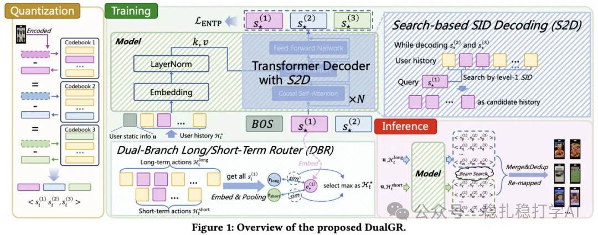
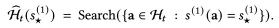
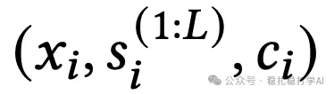
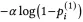
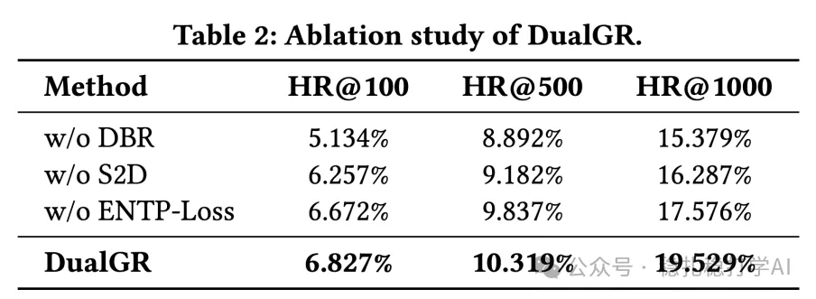

# From Retrieval to Generation: Kuaishou's search-based generative retrieval with long- and short-term interests

> [中文版](2025-11-19-kuaishou-dualgr.md)

> Note: this article is a guest submission by an author from Kuaishou; copyright belongs to the submitting author. Only the structure, summary, image links and experimental data are kept here; see the original post for the full text.

This article is a guest submission from the author (Kuaishou).

Link: https://arxiv.org/pdf/2511.12518

Company: Kuaishou

Idea: generative recommendation

Key points: (1) bring a generative method into search-based retrieval, to address "the search query expresses a single intent, user behavior is complex, and generated results are uncontrollable"; (2) model long- and short-term interests separately, so they don't interfere with each other; (3) use "impressed but not clicked" as coarse-level negatives, to avoid steering the interest direction wrong.

Area: generative retrieval (GR) / search-based generation / long- and short-term interest modeling

## Summary

This article introduces Kuaishou's DualGR: an encoder-free Transformer-decoder generative retrieval method with three core components. DBR (Dual-Branch Routing) splits the user history into a long-term and a short-term branch and models them separately; during training a hard gate routes each sample through only one branch, and only the behaviors sharing the target item's level-1 code are kept as that sample's history, giving a cleaner supervision signal. S2D (Search-based Decoding) first generates the level-1 SID to pin down a candidate bucket, then generates the later levels on the subsequence inside that bucket, using "search" to constrain "generation", which improves controllability and inference efficiency. ENTP-Loss applies a penalty for "impressed but not clicked" samples only at level 1 (coarse-level negatives), using negative feedback without rejecting the fine-grained interest direction.

Experiments (Kuaishou Explore double-column feed, as a new retrieval channel): online HR@K is clearly higher than ComiRec, PDN, KuaiFormer and TIGER (DualGR's HR@50/100/200 are 6.827% / 10.319% / 19.529%); a one-week online A/B test (6% traffic) gives video views +0.527% and watch time +0.432%, with end-to-end latency essentially unchanged; ablations show that removing any of DBR, S2D or ENTP-Loss lowers the metrics.

The author's three takeaways: dual branch + hard gate is "true multi-interest"; constraining Generate with Search is very engineering-minded and pragmatic; coarse-level negatives from impressed-but-not-clicked samples are a good compromise for using negative feedback. Outlook: granularity of long/short-term modeling, depth of long-term interest mining, and combining with end-to-end architectures. Page verdict: recommended.

## Article structure and figures

- Background: generative retrieval in short video (3 deployment difficulties)

- Method: framework overview, the three moves (DBR / S2D / ENTP-Loss)

## Experimental results

- 1) Online HR@K (Table 1, image link below; the image URL the browser returned is the same as for the ablation table, an artifact of lazy loading; the data of both tables has been recorded from the page screenshots in the summary above and in this section)

Table 1 (HR@50 / HR@100 / HR@200): ComiRec 2.539% / 6.134% / 8.249%; PDN 2.343% / 5.483% / 7.249%; KuaiFormer 4.495% / 7.251% / 12.356%; TIGER 4.936% / 8.184% / 14.442%; DualGR 6.827% / 10.319% / 19.529%.

- 2) Online A/B test: video views +0.527%; watch time +0.432%; overall response time essentially unchanged.
- 3) Ablation (Table 2, HR@50 / HR@100 / HR@200): w/o DBR 5.134% / 8.892% / 15.379%; w/o S2D 6.257% / 9.182% / 16.287%; w/o ENTP-Loss 6.672% / 9.837% / 17.576%; DualGR 6.827% / 10.319% / 19.529%.

## Uses

- 1. A new retrieval channel
- Multi-interest + diversity
- 2. Interest units & diagnostics
- 3. Transferring the ideas

## Takeaways

- 1. "Dual branch + hard gate" is true multi-interest
- 2. Constraining Generate with Search is very engineering-minded
- 3. Coarse-level negatives from impressed-but-not-clicked samples are a good compromise

## Outlook

- 1. The "granularity" of long- and short-term interest modeling can be explored further
- 2. Long-term interest mining is still fairly "shallow"
- 3. Combining with end-to-end architectures
