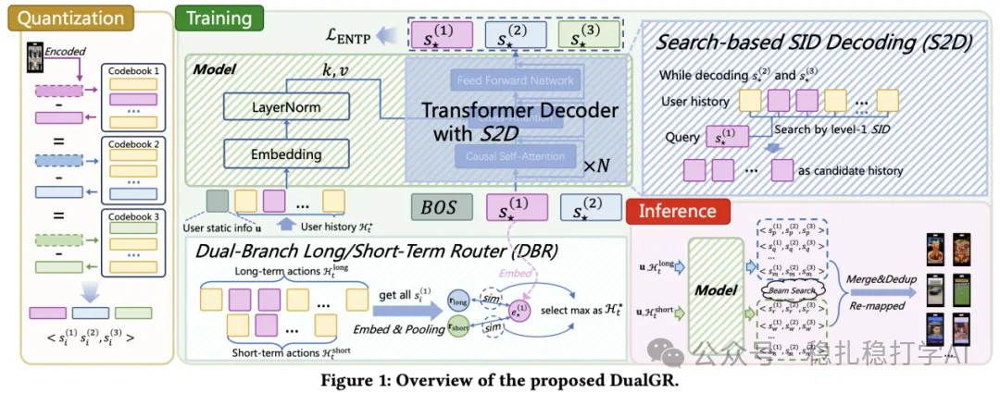
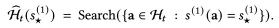
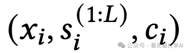
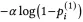
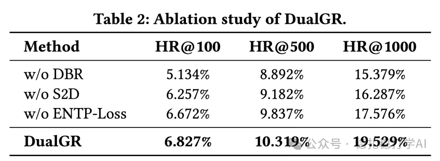

# 从检索到生成：快手的Search-based长短期兴趣生成式召回实践

> 原文：https://mp.weixin.qq.com/s/fh7sW6yYBlNldoWh9v7GIg
> 作者：算法工程师刘明星（稳扎稳打学AI）| 发表于 2025-11-19（第三方投稿；修改于2025年11月19日）
> 注：本文为快手作者投稿，版权归投稿作者；此处仅存结构与摘要、图片链接与实验数据，全文见原文链接。

本文是来自于作者（快手）的投稿

网址：https://arxiv.org/pdf/2511.12518

公司：快手

思想：生成式推荐

要点：（1）搜索召回里引入生成式方法，解决“搜索 query 表意单一、用户行为复杂、生成结果不可控”的问题；（2）长短期兴趣解耦建模，避免长短期兴趣互相干扰；（3）用“曝光未点”作为 coarse-level 负样本，避免把兴趣方向带偏。

方向：生成式召回（GR） / Search-based 生成 / 长短期兴趣建模

## 内容摘要

本文介绍快手 DualGR：一个 encoder-free 的 Transformer decoder 生成式召回方法，含三个核心组件。DBR（双分支路由）按长期/短期把用户历史拆成两路分别建模，训练时用 hard gate 让每个样本只走一条分支，并只保留与目标 item 的 level-1 相同的行为作为该样本的历史，监督信号更干净。S2D（Search-based Decoding）先生成 level-1 SID 圈定候选桶，再在桶内的子序列上生成后续 level，用“搜索”约束“生成”，提高可控性与推理效率。ENTP-Loss 把“曝光未点”样本只在 level-1 上施加惩罚（coarse-level 负样本），利用负反馈又不否定细粒度兴趣方向。

实验（快手 Explore 双列流，新增召回通路）：在线 HR@K 明显高于 ComiRec、PDN、KuaiFormer 与 TIGER（DualGR 的 HR@50/100/200 为 6.827% / 10.319% / 19.529%）；一周线上 A/B（6% 流量）带来视频播放量 +0.527%、播放时长 +0.432%，全链路延迟基本不变；消融显示去掉 DBR、S2D、ENTP-Loss 任一模块指标都下降。

作者心得三点：双分支 + hard gate 是“真·多兴趣”；用 Search 约束 Generate 很工程、务实；曝光未点的 coarse-level 负样本是利用负反馈的好折中。展望：长短期建模粒度、长期兴趣挖掘深度、与端到端架构结合。页面结论：推荐。

## 文章结构与图片

- 问题背景——生成式召回在短视频里的应用（3 个落地难点）

- 本文方法——框架概览：三板斧（DBR / S2D / ENTP-Loss）

## 实验结果

- 1）在线HR@K（Table 1，图片链接如下；浏览器返回的图片地址与消融表相同，为懒加载假象，两表数据已按页面截图记录在上文摘要与本节）

Table 1（HR@50 / HR@100 / HR@200）：ComiRec 2.539% / 6.134% / 8.249%；PDN 2.343% / 5.483% / 7.249%；KuaiFormer 4.495% / 7.251% / 12.356%；TIGER 4.936% / 8.184% / 14.442%；DualGR 6.827% / 10.319% / 19.529%。

- 2）在线A/B Test：视频播放量 +0.527%；播放时长 +0.432%；整体响应时间基本不变。
- 3）消融（Table 2，HR@50 / HR@100 / HR@200）：w/o DBR 5.134% / 8.892% / 15.379%；w/o S2D 6.257% / 9.182% / 16.287%；w/o ENTP-Loss 6.672% / 9.837% / 17.576%；DualGR 6.827% / 10.319% / 19.529%。

## 用途

- 1.新增召回通路
- 多兴趣 + 多样性
- 2.兴趣单元 & 诊断
- 3.思路迁移

## 心得

- 1.“双分支 + hard gate”是真·多兴趣
- 2.用 Search 约束 Generate，很工程
- 3.曝光未点的 coarse-level 负样本，是一个不错的折中

## 展望

- 1.长短期兴趣建模的“粒度”可以继续探索
- 2.长期兴趣挖掘还比较“浅”
- 3.和端到端架构结合

个人观点，仅供参考

修改于2025年11月19日
