# A new generative paradigm reshaping search and recommendation: reasoning works on item ID sequences too!

> [中文版](2026-01-23-onepiece-repost.md)

> Reposted by 稳扎稳打学AI (StepByStepLearningAI) | Published 2026-01-23
> Note: this is a repost; the original author is 傅聪 Cong (Fu Cong), author of OnePiece. It is Fu Cong's long write-up of OnePiece, reposted at his request. The archive keeps only the structure, the images and a summary of the content; for the full text see the original link.

Editor's Note: at Fu Cong's request, and because I also think highly of this work, I am reposting his write-up. I hope you find it useful.

## Structure and summary

The original article introduces OnePiece, a generative recommendation framework built by Fu Cong's team together with the Gaoling School of AI at Renmin University of China (already fully deployed in a personalized search scenario). Its main claim is that generative recommendation cannot beat DLRM through parameter scaling alone; it has to make its case on reasoning (test-time scaling). Structure of the full article:

- Opening: an author card (傅聪 Cong, inventor and team lead of OnePiece, inventor of NSG/MAG) and four pain points in deploying generative recommendation in production (differences in baselines and scenarios make experience hard to transfer; system path dependence means there is no low-cost MVP; missing key details make reproduction low-ROI; the feature and architecture investment accumulated in the old paradigm forces trade-offs).
- Paper links: arXiv https://arxiv.org/abs/2509.18091 ; Hugging Face Daily https://huggingface.co/papers/2509.18091
- 01 From paper to production: why is DLRM so hard to beat? Industrial DLRM is a hodgepodge of feature/model engineering and sample engineering, and it is ROI-driven; switching paradigms means rebuilding the whole training, inference and data pipeline.
- 02 Seen through the development of LLMs: the path to validating generative recommendation. Mapped against the three stages of GPT, generative recommendation has to get the "reasoning" step working.
- 03 Framework breakdown: OnePiece. Two modes (retrieval / ranking) × three parts: context engineering (interaction history IH, preference anchors PA, situational descriptors SD, candidate item set CIS; side info is fused into latent tokens with adapters), implicit reasoning (reasoning in latent space, avoiding the information loss and token cost of decoding), and a progressive multi-task training strategy (different reasoning steps get different supervision signals, denoising step by step). The article includes the framework diagram and several experiment figures.
- 04 Through the lens of attention: how the model thinks. Analysis of two-layer attention heatmaps in retrieval and ranking modes: temporal clustering of the behavior sequence, information flowing from PA to IH, SD tokens focusing attention during the reasoning steps, and candidates becoming the center of attention in the reasoning stage.
- 05 Offline training and online experiments. Slimmed-down side info and time-partitioned features to prevent leakage; InfoNCE + BCE calibration loss, borrowing from GNOLR (https://arxiv.org/pdf/2505.20900 ) to use sigmoid(ax+b) to control the logit range; launching ranking mode was limited by a pointwise serving platform, so pre-ranking launched a version with block size = 1. Results: in the ranking stage, GMV/user +1.12% and ad revenue +2.9%; in the retrieval stage, coverage relative to various retrieval strategies rose significantly, with a high independent contribution and both exploit and explore ability. The article ends with an outlook on three directions: compression, retrieval and generalization.
- End of article: an author introduction card (傅聪 Cong, author of *Business-Driven Recommender Systems: Methods and Practice*, inventor of NSG/SSG/PSP/MAG, based in Singapore; GitHub https://github.com/CongFu92 ) and the WeChat account QR code card.

## Images (in the original order)

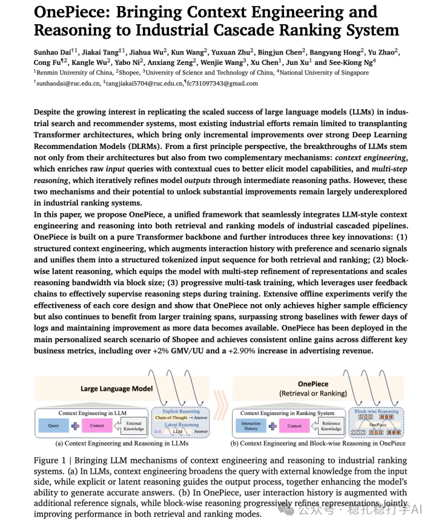

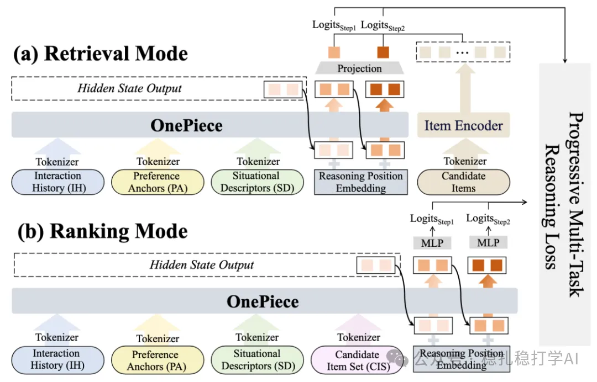

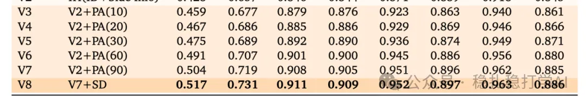

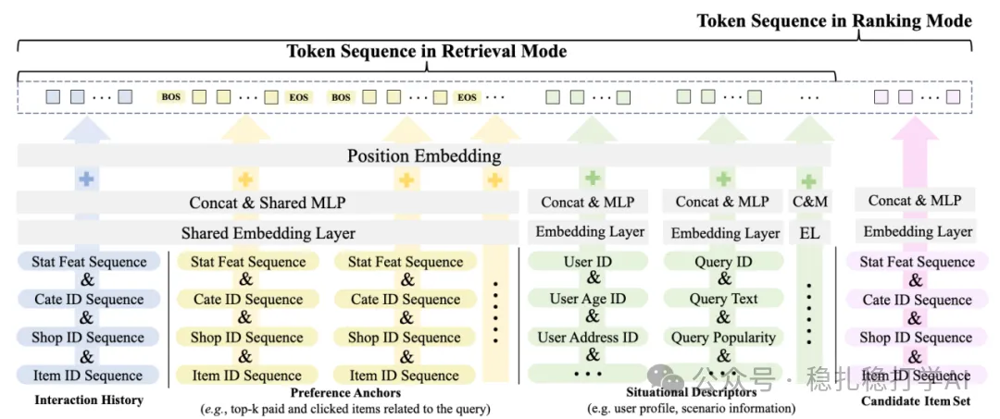

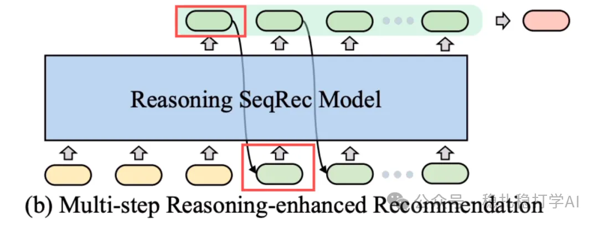

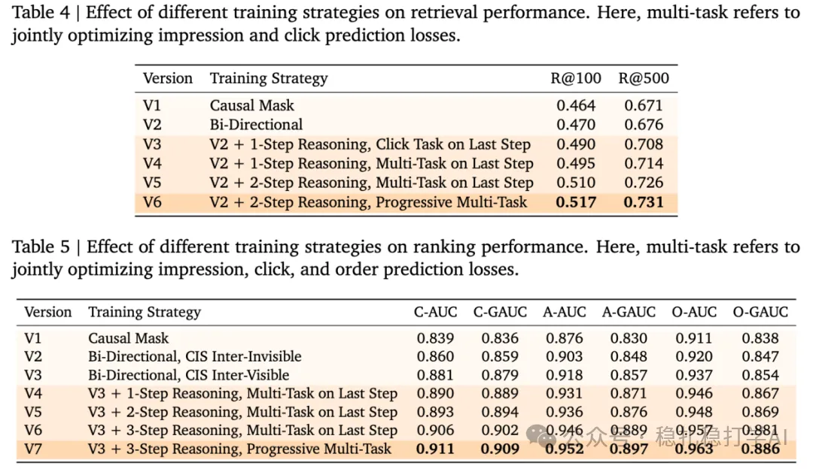

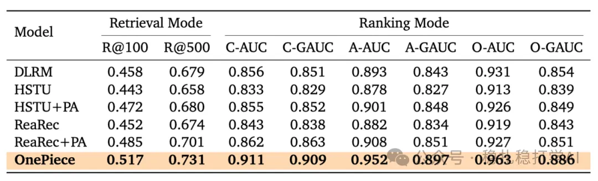

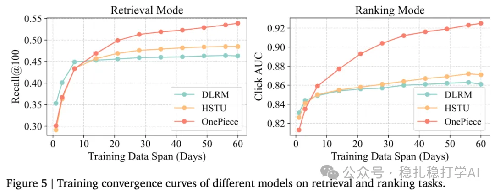

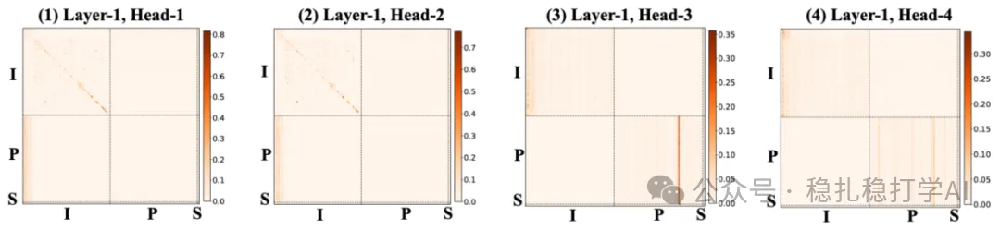

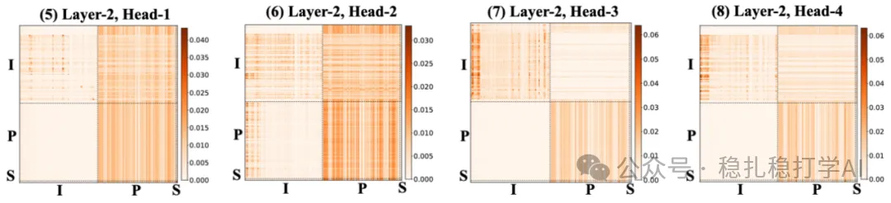

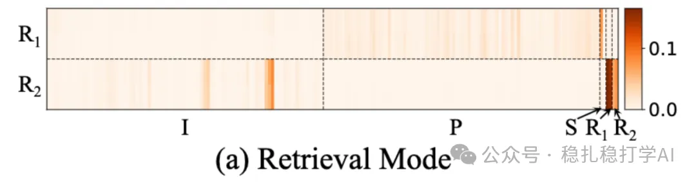

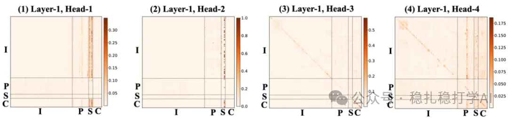

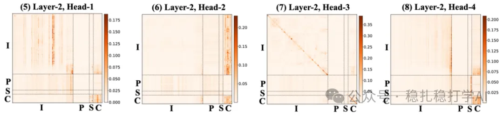

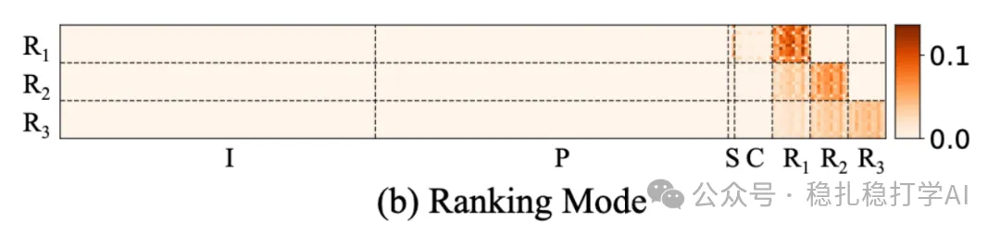

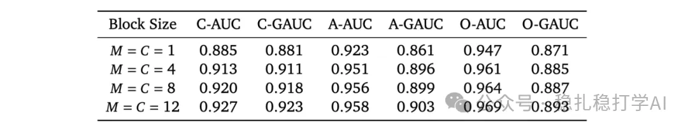

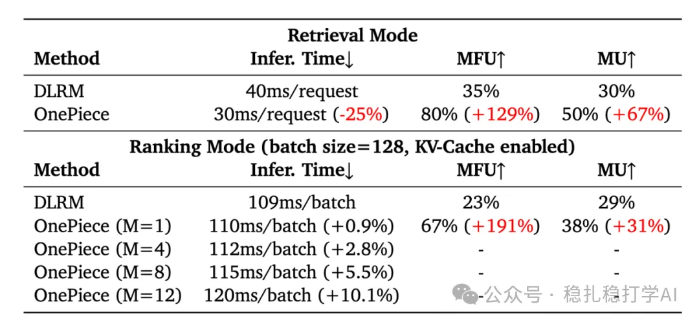

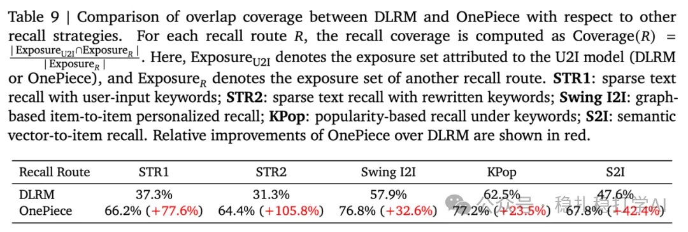

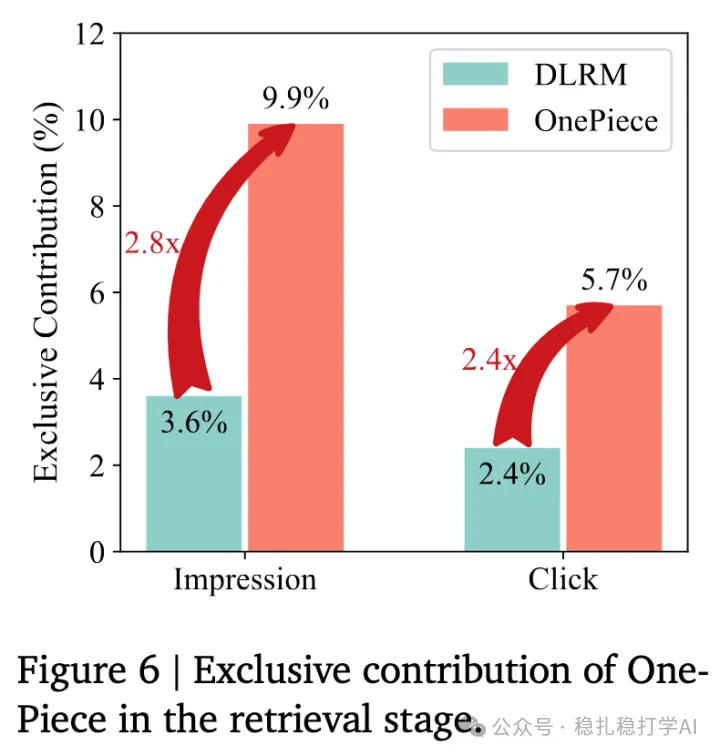

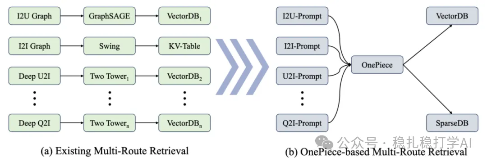

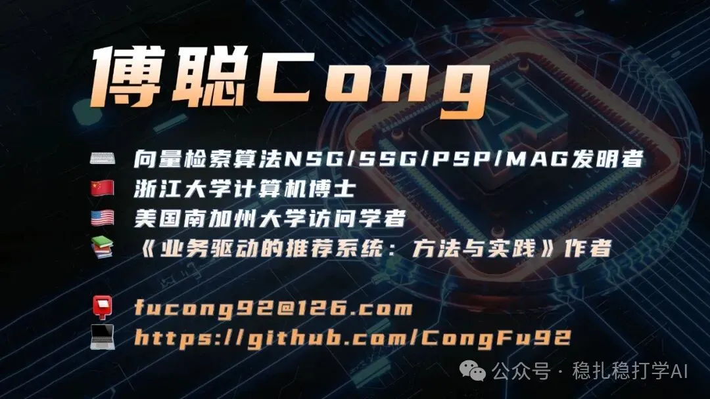
