# 全新生成式范式重塑搜推：物品ID序列上也能做推理！

> 原文：https://mp.weixin.qq.com/s/BEBKjAyYPg3Muf1Xpc2xhw
> 稳扎稳打学AI 转载 | 发表于 2026-01-23
> 备注：转载文章，原作者傅聪Cong（OnePiece 作者）。本文是傅聪老师的 OnePiece 解读长文，经其委托转载；归档时只存结构、图片链接与内容摘要，全文见原文链接。

Editor's Note（本号按语）：受傅聪老师的委托，同时我也认可他的这个工作，特转载他的解读文章，希望朋友们有所收获。

## 文章结构与摘要

原文介绍傅聪团队与人大高瓴学院合作的生成式推荐框架 OnePiece（已在个性化搜索场景推全），主张生成式推荐不能靠参数 scaling 击败 DLRM，必须在推理（test time scaling）上做文章。全文结构：

- 开头：作者卡片（傅聪Cong，OnePiece 发明者/团队负责人，NSG/MAG 发明者）与生成式推荐落地难的四个痛点（基线与场景差异导致经验难迁移、系统路径依赖缺低成本 MVP、关键细节缺失导致复现 ROI 低、旧范式的特征与结构积累面临取舍）。
- 论文链接：arXiv https://arxiv.org/abs/2509.18091 ；Hugging Face Daily https://huggingface.co/papers/2509.18091
- 01 从Paper到落地：DLRM为什么难以超越？——工业 DLRM 是特征/模型工程、样本工程的大杂烩，且 ROI 导向，范式切换涉及训练、推理、数据全链路改造。
- 02 从LLM发展的视角看：生成式推荐的验证之路——对标 GPT 的三个阶段，生成式推荐必须走通"推理"这一步。
- 03 框架解析：OnePiece——两种模式（召回/排序）× 三个部分：上下文工程（交互历史 IH、引导锚点 PA、场景描述词 SD、候选集 CIS；side info 用 adapter 融成 latent token）、隐式推理（latent 空间推理，避免 decoding 的信息损失与 token 消耗）、渐进式多目标训练策略（不同推理步用不同监督信号逐步去噪）。文中含框架图与多张实验图。
- 04 从attention透视：模型的思考过程——召回与排序两种模式下两层 attention 热力图分析：行为序列的时间聚类、PA 向 IH 的信息迁移、SD token 在推理步的聚焦作用、candidate 成为推理阶段的关注中心。
- 05 离线训练和在线实验——side info 精简与特征时间分区防穿越；InfoNCE + BCE calibration loss，并借鉴 GNOLR（https://arxiv.org/pdf/2505.20900 ）用 sigmoid(ax+b) 控制 logits 范围；排序模式上线受 pointwise 服务平台限制，prerank 上线了 block size=1 的版本。结果：排序阶段 GMV/user +1.12%、广告收入 +2.9%；召回阶段对各类召回策略覆盖率显著提升，独立贡献度高，兼具 exploit 与 explore 能力。结尾展望压缩、检索、通用化三个方向。
- 文末：作者介绍卡（傅聪Cong，《业务驱动的推荐系统：方法与实践》作者，NSG/SSG/PSP/MAG 发明者，现居新加坡；GitHub https://github.com/CongFu92 ）与公众号二维码卡。

## 图片（按原文顺序，远程链接）

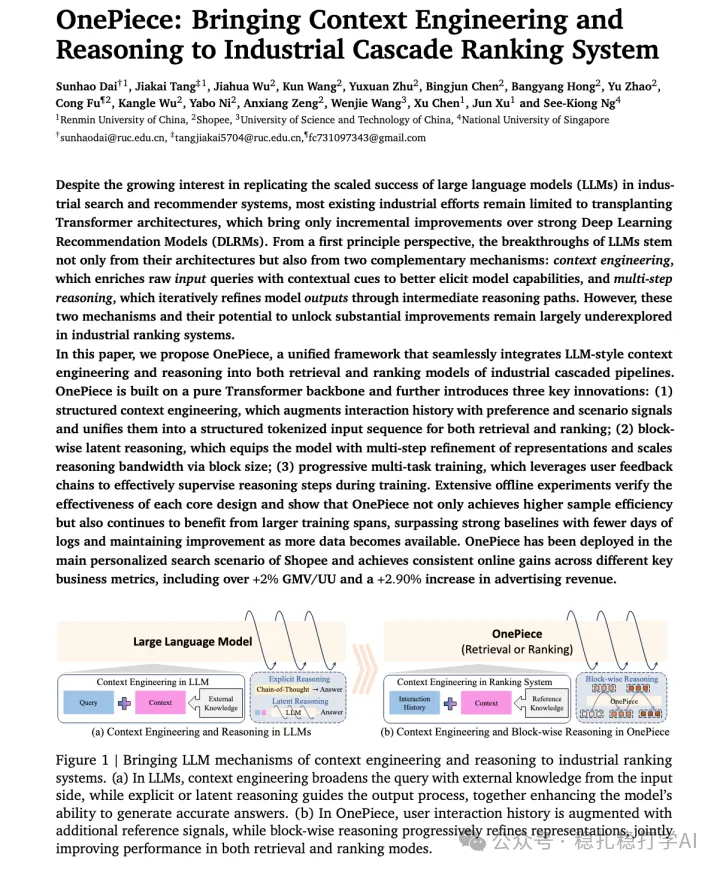

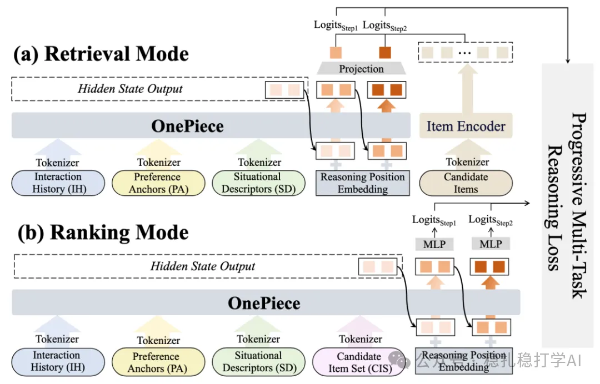

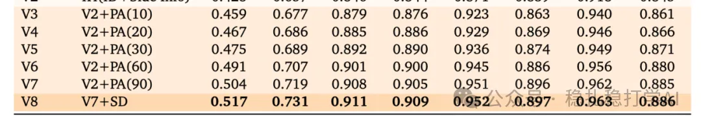

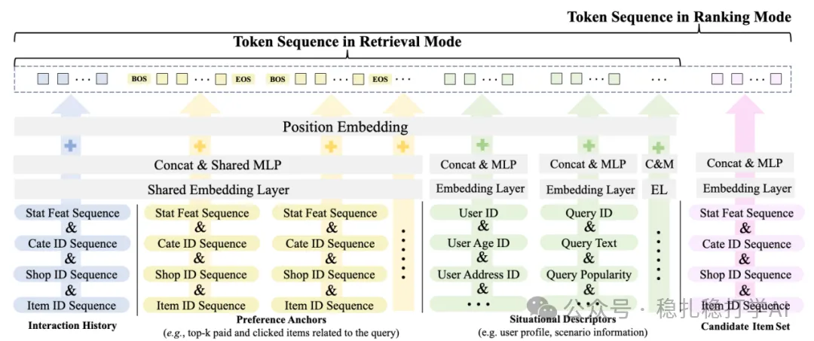

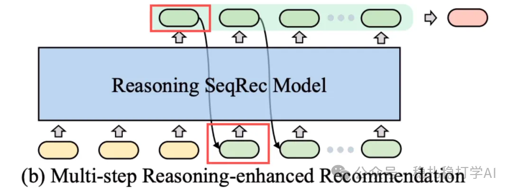

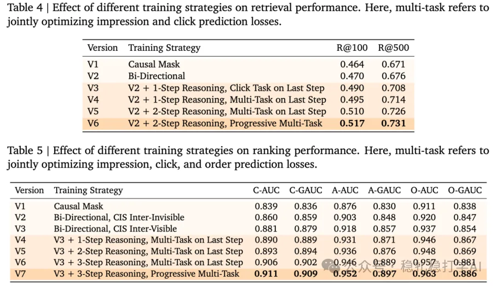

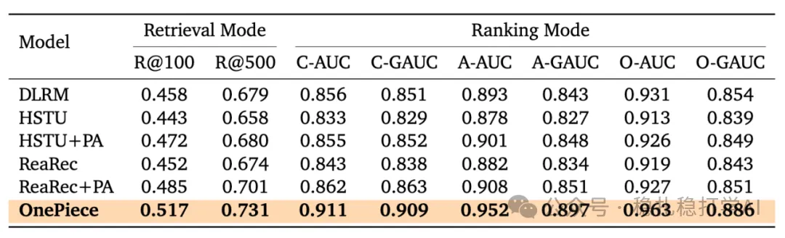

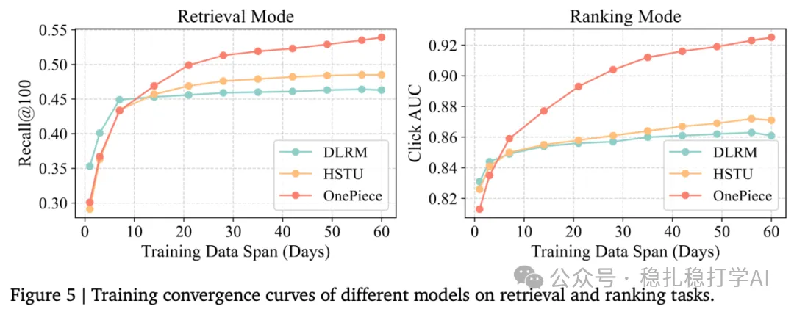

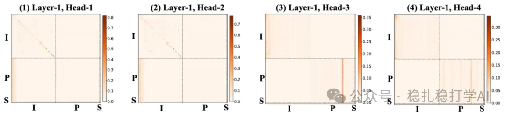

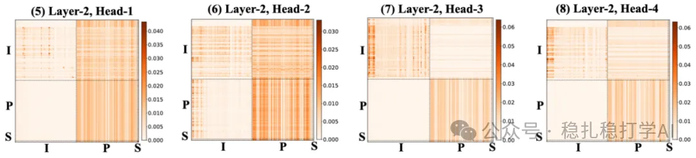

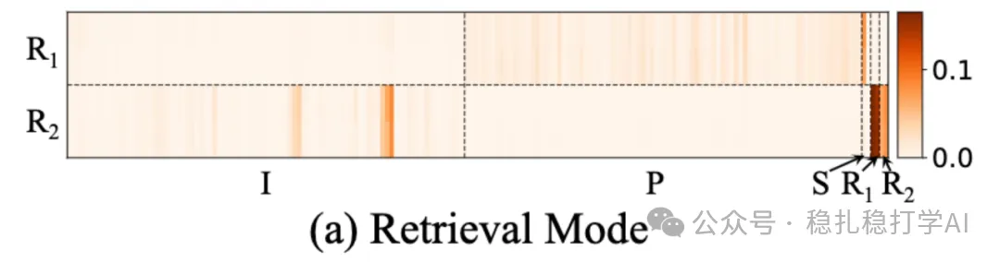

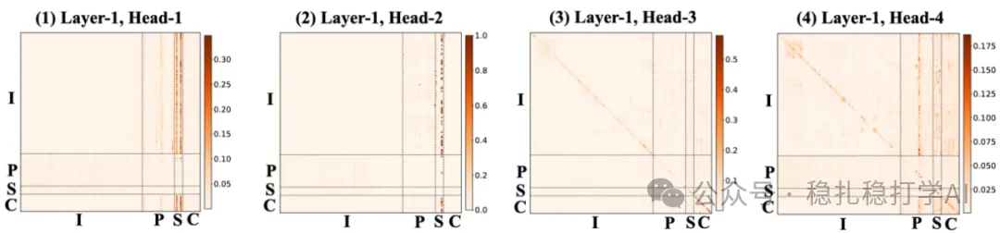

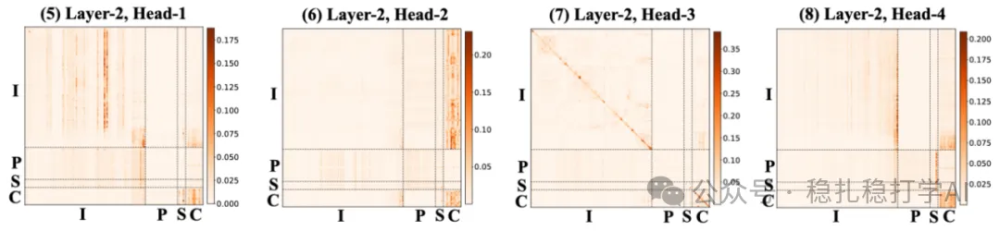

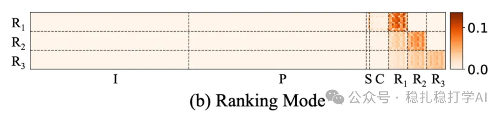

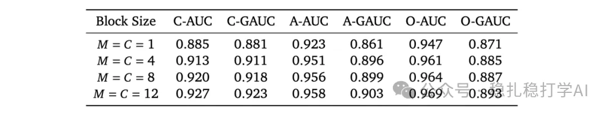

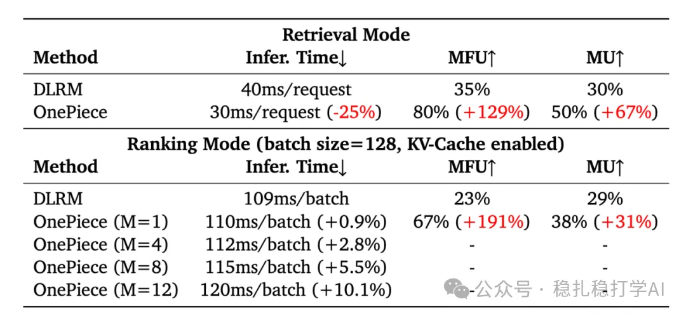

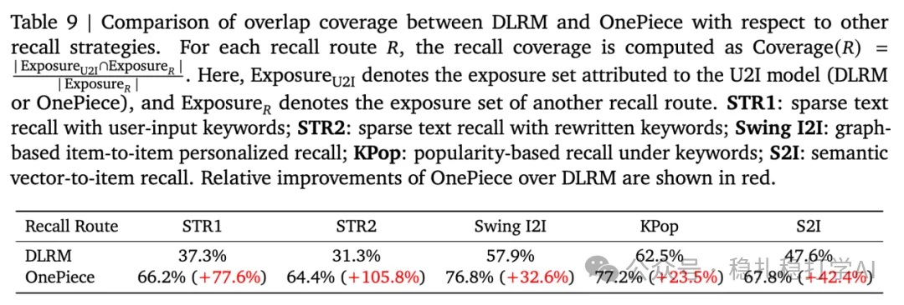

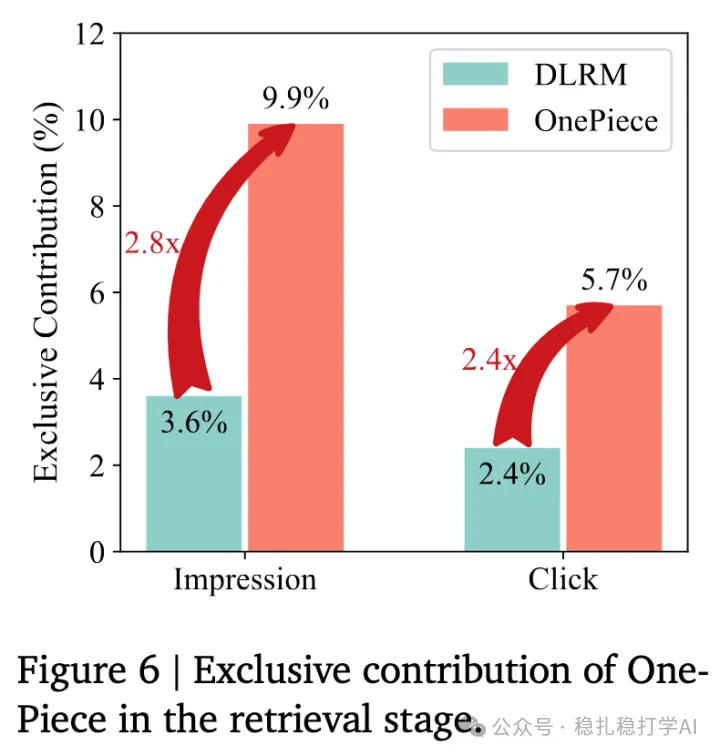

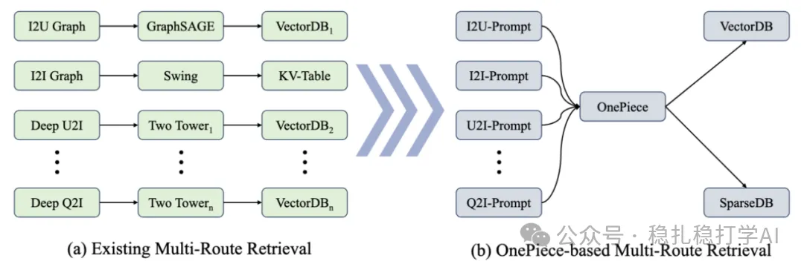

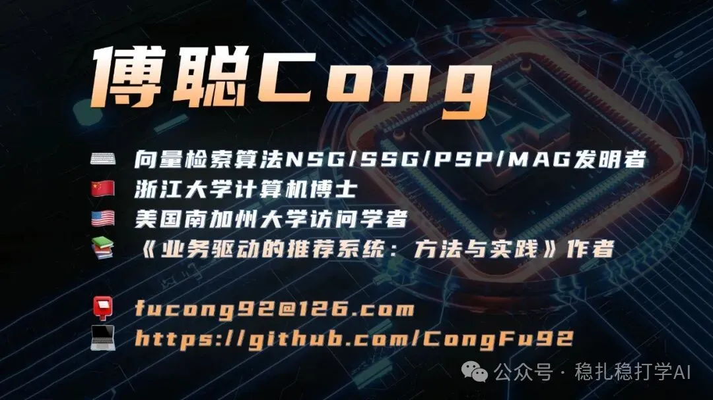

