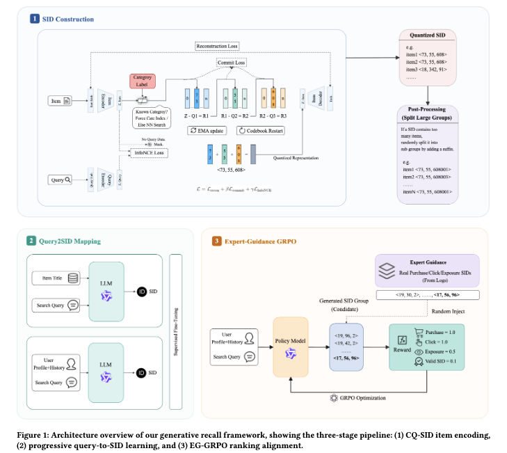

# Alibaba: LLM retrieval for search, GMV +1% and 70% of transactions

> [中文版](ali-cq-sid.md)

### Paper: Efficient Generative Retrieval for E-commerce Search with Semantic Cluster IDs and Expert-Guided RL
### Link: https://arxiv.org/pdf/2605.14434
### Company: Alibaba
### Idea: curriculum learning, clustering, injecting priors
### Area: generative retrieval

## Overview:
This paper proposes a generative retrieval framework for the retrieval stage of e-commerce search. It has two main parts: **item-side semantic cluster ID encoding** and **query-side LLM generative mapping**.

**1. Item-side encoding (CQ-SID)**  
A category-guided Residual Quantized VAE (RQ-VAE) encodes each item into a hierarchical semantic cluster ID (Semantic ID, SID for short).
The difference from a regular RQ-VAE is in the **first quantization level**:
- For items with a known category, **the first level does not do a nearest-neighbor search in the codebook**.
- Instead, the item's **CategoryID is used directly as the index into the first-level codebook**, and the corresponding code vector (embedding) is looked up.
- Then the residual is computed, and residual quantization continues at the second and third levels.
- The result is a three-level hierarchical Semantic ID (SID).

Note: the paper does not say exactly what the input to the item encoder is. The most likely input is the **item title (text)**. Category is not an input feature of the encoder; it is injected during quantization by forcibly binding the first-level code.

The codebook is updated with EMA + restart to prevent collapse.
In addition, Bi-InfoNCE is added during RQ-VAE training to align item embeddings with query embeddings. Very large clusters (more than T_max=50 items) are split, which keeps cluster size under control and preserves retrieval precision and diversity.

**2. Query-side generative model training**  
The model is Qwen2.5-0.5B, trained with **four progressive stages** to map a query to semantic cluster SIDs. The first three stages use SFT to build the basic mapping and then personalization step by step; stage 4 does RL with an improved version of GRPO, so that generative retrieval is explicitly aligned with the downstream ranking objective. Details:

### Stage 1: Item-to-SID Mapping (I2SID): first teach the model to "speak the SID language"
Goal: build a strong correspondence between item text descriptions and SIDs, as the foundation for the later stages.

Concretely, (item_title, SID) pairs are taken from items already encoded by CQ-SID. The SID is represented as a token sequence (e.g. <s1_2048> <s2_1024> <s3_1024> or a similar special-token form; the paper gives no exact tokenization details, but the three-level ID must be serialized and generated autoregressively by the model).
Training: standard Supervised Fine-Tuning (SFT), with cross-entropy loss, so the model autoregressively generates the correct SID sequence.

### Stage 2: Query-to-SID Mapping (Q2SID): learn the mapping from intent to semantic clusters
Goal: teach the model to map the intent of a user query → the corresponding semantic cluster SIDs.

Concretely, for each query, N=3 SIDs are sampled from items that were actually clicked or purchased as positives, forming (query, target_SID) pairs. What the model learns is "which semantic clusters this query should retrieve".
Training: continued SFT, autoregressively generating the target SID sequence.

### Stage 3: Personalized User+Query-to-SID (UQ2SID): adding personalization
Goal: on top of the query, use the user's personal information to generate more precise SIDs.

User features are concatenated before/after the query: basic profile (gender, age, etc.) and behavior features (SIDs the user recently clicked in related categories, as historical context). The target is still the SID of what the user actually clicked or bought.

### Stage 4: Ranking-aligned Refinement via EG-GRPO
The first 3 stages are all supervised fine-tuning. In this stage the authors introduce EG-GRPO, an improved version of GRPO, and use it to fine-tune the model with reinforcement learning. This explicitly aligns generative retrieval with the downstream ranking objective, so that the retrieved semantic clusters better match what ranking prefers in terms of click-through rate, exposure coverage and final transactions, which in the end gives better end-to-end business results.
EG-GRPO is the paper's improvement for the sparse-reward setting of generative retrieval. On top of standard GRPO it adds one key trick: in every rollout group, K "expert samples" (ground-truth SIDs) are forcibly inserted. Forcing real expert samples into each group lets the model still learn a good policy stably even when rewards are almost all 0, and in the end the retrieval results align better with downstream ranking.

Procedure:
For a query x:
1. Sample G SIDs with the current policy model          →  𝒢_sampled
2. Randomly draw K SIDs from real click/exposure data   →  𝒢_expert (expert samples)
3. Merge the two into one big group: 𝒢 = 𝒢_sampled ∪ 𝒢_expert
4. Assign a reward to every SID in 𝒢
5. Normalize advantages within this big group
6. Update the model with GRPO's clipped loss

**3. Online serving**  
At serving time, the query is fed into the LLM together with the user profile and recent behavior features. Beam search generates the top-K candidate SIDs, which are then mapped to a candidate item set through a prebuilt `SID → Items` lookup table, and passed on to the pre-ranking and ranking stages.

### A/B:
GMV +1.15%, UCTCVR +0.40%. In production this retrieval channel ended up contributing more than half of exposures and clicks and more than 70% of transactions, becoming the core retrieval source.

## Takeaways:
* Special tokens such as SIDs, treated as the "vocabulary" of a new language, can be learned, and learned well, by an LLM when it is trained correctly. LLM4Rec has a future, and fellow recsys practitioners should spend more time studying this area.

## Credibility: production

## Recommendation: practically useful

