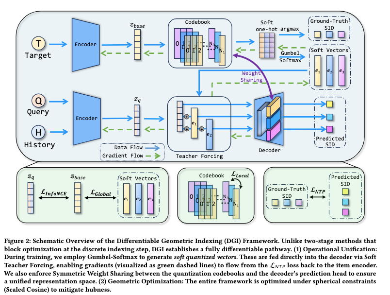

# Alibaba: joint training of SID and GR, RPM +1.11%

> [中文版](ali-dgi.md)

### Paper: Differentiable Geometric Indexing for End-to-End Generative Retrieval
### Link: https://arxiv.org/pdf/2603.10409
### Company: Alibaba
### Idea: end-to-end
### Area: SID + GR + retrieval

## Overview:
This paper trains the RQ-VAE and the GR model jointly, end to end. The codebook trained this way is of higher quality, which in turn makes GR generation better.
That is, during training, a weighted sum of all codebook vectors is used as the GR input; at inference, the SID is still used as the GR input.

### (1) Soft Teacher Forcing
The GR input tokens no longer go through "discrete SID from RQ-VAE → SID embedding layer → token embedding". Instead, a weighted sum of all codebook vectors (called a soft vector) is used directly as the input to the GR decoder.
The soft vector is obtained with Gumbel-Softmax: similarity weights are computed between the VAE's vector h and the code vectors in the codebook, Gumbel-Softmax turns them into weights over all rows, and the weighted sum over the whole codebook is taken.
A soft vector obtained this way has these benefits:
* Compared with a hard argmax, the gradient is not blocked; it can flow back to the codebook and the encoder and update them.
    * The gradient of argmax is zero everywhere, so it cannot pass gradients to the codebook, the encoder and so on. In earlier two-stage implementations, the hard argmax in the quantizer completely blocks the gradient of L_NTP; even the selected codebook vector gets no gradient at all. This is the root reason DGI uses Soft Teacher Forcing + Gumbel-Softmax.
* Compared with a plain softmax, it is unbiased and low-variance, which makes training stable: gradients are smooth and steady, and the loss decreases steadily.
* The codes in the codebook are of higher quality. A single sample pulls every vector in the codebook a little! Popular codes get pulled more, unpopular codes get pulled a bit too; this is called global reshaping. Put simply, it optimizes the global clustering.

### (2) Symmetric Weight Sharing
The GR input and output live in the same space, i.e. the indexing space and the decoding space coincide completely. Traditionally this is the SID embedding layer.
This paper uses the codebook instead: the predicted logits pick the most similar row vector from the codebook as output.

### (3) Scaled Cosine
When the quantizer indexes and when the decoder decodes, the most similar row vector in the codebook is chosen by cosine instead of inner product, with an added learnable scale parameter.
The benefit: the stored vectors keep their original norm (which can be updated by gradients), but the computation ignores the norm entirely and uses only the direction (unit vector).

### Inference:
* Offline: run hard-argmax quantization over all items to get their full SIDs. Split each SID into multi-level prefixes and build a hierarchical inverted index. Also cache each item's normalized embedding.
* Online query: the decoder generates a partial SID (with beam search) → look it up directly in this inverted index → get the candidate item set → then rank the candidates finely with Scaled Cosine.

## Takeaways:
* GR components, especially the SID, have a lot of room for improvement. Many people are working on this, which also shows the direction is widely accepted as effective.
* DGI's core techniques are in principle fairly general and could be extended to other models (including plugging multimodal signals into an ordinary CTR model), but they are not "plug and play"; some adaptation is needed.

**A/B**: AliExpress, CTR +1.27%, RPM +1.11%.

## Caveats

* **The ablations show that the most valuable part has nothing to do with end-to-end training.** Of the three ablations, removing Scaled Cosine drops **33.3%**, while removing Soft Gradient Flow (i.e. letting collaborative gradients flow into the codebook) drops only **8.4%**. In other words, most of the gain comes from **projecting vectors onto the sphere and normalizing their norms**, a purely geometric fix, not from joint training itself. And a spherical constraint can just as well be added to a two-stage pipeline; it does not need end-to-end training.
* **Collaborative information getting into the codebook is a bad thing that needs watching.** The value of a codebook is "same prefix ⇒ similar content". Once collaborative gradients come in, the prefix also encodes "consumed by the same group of people", and that property loosens. On top of that, collaborative gradients are dominated by head items, so codebook capacity gets spent on finely distinguishing popular items. The paper has to add a dedicated diversity regularizer `L_Div` to maximize the entropy of codeword usage. **The very existence of this regularizer is circumstantial evidence**: the task gradient really is distorting the codeword distribution.
* **The long-tail figure only shows qualitative curves, gives no per-bucket numbers, and admits no cost on the head.** The paper itself says the head advantage of the two-stage approach comes from norm inflation (the norms of popular items get pushed up without constraint), and the spherical constraint takes exactly that ill-gotten gain away, so a drop on the head is almost inevitable. But the paper glosses over it with the flattering phrase "uniform profile" and says nothing about a trade-off. An overall RPM of +1.11% only shows that the head did not drop much, not that it did not drop.
* This is a common problem of the whole long-tail optimization line of work: report an overall positive gain plus a big long-tail gain, and say nothing about the head. The question to ask when reading this kind of work is: **how much did the head pay, and who picked up the bill for the long tail?**

## Credibility: production

## Recommendation: practically useful

