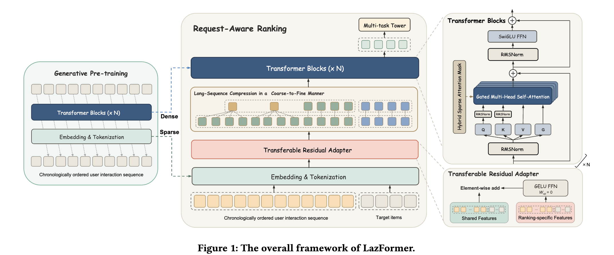

# Alibaba International: generative pre-training for the ranking model, then transfer to ranking, GMV +9.85%

> [中文版](ali-lazformer.md)

### Paper: LazFormer: Scaling Transformers for Industrial Recommendation via Transferable Generative Pre-training
### Link: https://arxiv.org/abs/2609.14978
### Company: Alibaba
### Idea: model transfer
### Area: generative recommendation

## Overview:

Scaling up a ranking model gets stuck on two things. First, the sparse parameters (embeddings of all kinds of IDs) and the dense parameters (the network itself) all have to be trained from scratch: billions of parameters burn compute and converge slowly. Second, if you try to save that cost with pre-training, you run into negative transfer: the features available in pre-training simply don't line up with the features in the ranking stage, and bolting them together makes things worse.

LazFormer splits pre-training and ranking into two phases and stitches them together with an adapter that has no effect at all at initialization. It is deployed in the ranking stage of Lazada's homepage recommendation.

## 1 Pre-training: train both the embeddings and the network first

The pre-training task is next-item prediction: sort the user's interaction sequence by time and have the model predict the next interacted item, matching with temperature-scaled cosine similarity. The data is one year of history: 16 million users, 11 billion tokens.

The key is not the task itself but that **two sets of parameters are transferred**. Both the sparse parameters of the Embedding & Tokenization layer and the dense parameters of the Transformer blocks are used to initialize the ranking model. It is not just feeding a sequence representation in as a feature; the whole base is moved over and training continues on it.

The architecture uses the current LLM recipe directly: RMSNorm, SwiGLU FFN, gated multi-head self-attention, stacked N layers.

## 2 Ranking: three designs that make the transfer actually work

**A zero-initialized residual adapter**, to deal with negative transfer. Features are split into two kinds. Shared features already exist in pre-training: item ID plus category, shop, brand, dwell time, scenario and so on. Ranking-only features are multi-behavior signals such as **add-to-cart, order and time intervals**, which simply don't exist in pre-training. The latter go through a separate GELU FFN, and the result is added element-wise to the shared features.

The crux is that this FFN's up-projection matrix `W_up` is **initialized to 0**. So at the first training step the adapter output is always 0, the whole model is exactly equivalent to the pre-trained one, and the ranking-only features inject nothing at all; after that, the gradients decide how much to add. It is the same idea as LoRA initializing the B matrix to 0: first guarantee existing ability isn't damaged, then talk about increments.

**Coarse-to-fine long-sequence compression**. The most recent 1,024 tokens are kept as they are; older behaviors are sum-pooled in groups of 8 into one token. A 2,048-long sequence comes out at about 1,152 after compression. The reasoning is simple: recent interests need fine granularity, while distant interests are coarse anyway.

**Hybrid sparse attention**. Locally, a causal sliding window with W=128; in addition, a set of global tokens is kept to pass information over long distances. Candidate items can see the whole history, but candidates don't see each other. Sparsity is 88.04%, and with a flex attention CUDA kernel it gets a 3.7x speedup.

## 3 Asymmetric multi-epoch training

The ranking data is trained for 3 epochs, but the two kinds of parameters are handled differently: **at the start of each epoch, the sparse parameters are reset to their pre-trained state, while the dense parameters inherit the result of the previous epoch**.

The reason is that billions of embeddings updated over several epochs on the same data will overfit, and will also wash out the transferable representations learned in pre-training. Dense parameters don't have this problem, so more epochs are pure gain. This change is tiny, and it is the single point in the paper that is easiest to copy straight into your own system.

## Online results

Two-week A/B, with a 3-layer SORT-like ranking model as the control: **GMV +9.85%**, item detail page views (IPV) +5.21%, orders +3.38%, buyers +3.70%.

On latency, QPS on a single A10 machine dropped only 12.1%. The model is clearly bigger yet can still be served, thanks to the compression plus sparse attention above. Offline metrics are not covered in detail here: CTR AUC is 0.74 points above the best baseline and GAUC 1.28 points above.

## Takeaways:
* When pre-training and downstream features don't line up, the usual fixes are either to force the features into alignment or to give up on pre-training. The zero-initialized adapter offers a third way: **let the new features start from "not participating at all", and let training decide how much to inject**. This pattern can be moved to any two-stage transfer scenario.
* Reset the sparse parameters, accumulate the dense parameters: this asymmetric treatment turns the experience everyone has a feel for, "embeddings overfit easily, the network doesn't", into a training procedure you can copy directly.
* Asymmetric multi-epoch training is not something LazFormer invented out of thin air. Behind it is one-epoch overfitting, which industrial CTR has discussed for years: when a large embedding table goes into a 2nd epoch on the same ranking logs, validation AUC often drops right away. The experience first came from the default practice of production lines everywhere (large ID tables are trained for almost exactly 1 epoch), and only later was it written up as a reproducible training strategy.

## Caveats

* Figure 1 is drawn in a way that is somewhat easy to misread. The red bar of the Transferable Residual Adapter spans the whole Embedding & Tokenization layer, so it looks like both history behaviors and candidate items go through this module. But the ranking-only features are add-to-cart, order and time intervals; a candidate item is the one being scored and the user hasn't done anything with it yet, so these features are naturally empty, and **only the history items are actually non-zero**. Whether candidates go through this module doesn't really matter; the output is 0 either way. The paper's text says "applies to each item", lumping both sides together, and the figure is drawn the same way, so readers easily get stuck here.
* Take GMV +9.85% with a discount: the control is a 3-layer model, the baseline itself isn't strong, and the paper doesn't separate how much of the gain comes from "finally making the model big" and how much from pre-training transfer.
* The name "global token" is also misleading. Global usually means bidirectional: it sees everyone and is seen by everyone, like a public blackboard hanging in the middle of the room. Here only the first half holds: these 128 tokens can see the whole history, but because of the causal constraint, the earlier history cannot see them back. Rather than global tokens, think of them as "the most recent 128 queries that have a full-history view". Names like full-history tokens or long-range queries would be more accurate.

## Credibility: production

## Recommendation: practically useful
