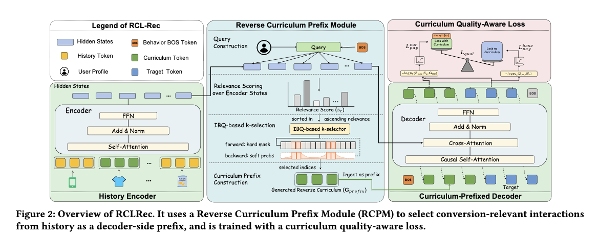

# Alibaba International: generative recommendation for sparse-target tasks, ad revenue +2%

> [中文版](ali-rclrec.md)

### Paper: RCLRec: Reverse Curriculum Learning for Modeling Sparse Conversions in Generative Recommendation
### Link: https://arxiv.org/pdf/2603.28124
### Company: Alibaba International
### Idea: transfer learning
### Area: generative recommendation + behavior sequence modeling

## Overview:
This paper trains a Transformer-based GR model that predicts the target from the user behavior sequence, and is ultimately used to predict items for ad payment behavior. In short: compute the top-k similar items from the user's history and feed them into the decoder to improve prediction quality.

It is used for ranking ads in ad slots, but payment behavior is extremely sparse: few samples, weak signal. The paper's approach is two-stage training: first pre-train on the full multi-behavior data (rich signals such as clicks and add-to-cart) so the model fully understands the semantics of user behavior, then do SFT fine-tuning on the sparse target behavior (payment). This is a transfer learning paradigm going from "broad understanding" to "a precise task".

Concretely,
### (1) Pre-training
The model is trained on the full multi-behavior data. The input is the user behavior sequence and the known behavior of the target; sequence elements are turned into semantic tokens with RQ-VAE. The sequence is the encoder input, and the target behavior is the decoder's input prefix. The encoder can model the long-sequence context bidirectionally and fully; the decoder is only responsible for generating the target's token sequence. Pre-training is done on the full multi-behavior data.

### (2) SFT
The Transformer trained above is used as the backbone, and it is fine-tuned only on samples whose target is a payment behavior, again predicting the target.
The user feature vector goes through an MLP to produce a vector used as the query. Cross-attention is computed between it and the encoder's output sequence; the semantic tokens of the items with the top-k attention values are flattened into a sequence and used as the decoder's input prefix, trained under teacher forcing. Also remember: the fixed target behavior (payment) is put at the very front of the input prefix.

Why use the items' semantic IDs rather than the encoder's output vectors? Because during pre-training the decoder has only ever seen semantic token sequences.

#### Auxiliary task: contrastive learning, using the "difference" as a training signal

Besides the normal next-item prediction loss, an auxiliary task is added to improve results. The motivation behind it is that giving the decoder more material should always do better than not giving it, with a lower loss.
Two networks are maintained. One is a fully frozen backbone acting as the baseline, which only runs inference and computes a reference loss; the other is a trainable network doing normal SFT and computing the next-item loss. For the same sample, the former's decoder does not get the most-similar-item sequence as input, while the latter's does, and each yields a loss. The two losses go through a hinge-style margin loss to give a comparison loss, which is added to the next-item prediction loss. The final gradient only updates the latter, never the former.

Although it does compare the loss values of two models, it is not really contrastive learning. It doesn't compare representation distances between positive and negative samples (traditional contrastive learning); it compares the loss difference between the "augmented input" and the "base input", using a margin loss to force the augmented version to be better than the base version.

#### Architectural motivation
The paper's choice of encoder-decoder rather than decoder-only is deliberate, not arbitrary:
* The encoder handles bidirectional understanding of the history, producing high-quality bidirectional context representations, extracting the top-k items most relevant to the pay target, and injecting them into the decoder as a prefix. This is exactly the key move for solving the conversion sparsity problem.
* The decoder only handles conditional generation.
The two components have a clear division of labor, decoupling "retrieving relevant history" from "generating the prediction"; the architecture itself encodes the business logic.

### **A/B**
Against the strong baseline TIGER, ad revenue +2.09% and orders +1.86%.

## Takeaways:
* The paper's contrastive learning of the form "after a modification it must beat the original setup" is novel and interesting, and worth learning from.
* Through the encoder of the encoder-decoder, the paper understands the history and mines high-quality relevant historical behaviors to improve the decoder's predictions. This shows a deep understanding of the role and value of each component of an encoder-decoder Transformer.
* Reverse Curriculum Learning sounds fancy, but really it is just selecting the top-k similar items from history and feeding them into the decoder to improve prediction quality.

## Caveats

## Credibility: production

## Recommendation: practically useful

