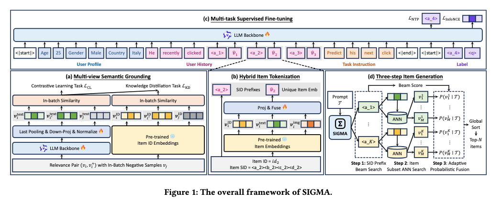

# Alibaba: generative recommendation, GMV +8%

> [中文版](ali-sigma.md)

### Paper: SIGMA: A Semantic-Grounded Instruction-Driven Generative Multi-Task Recommender at AliExpress
### Link: https://arxiv.org/pdf/2602.22913
### Company: Alibaba International
### Idea: contrastive learning, knowledge distillation, generative modeling
### Area: generative recommendation + SID

## Overview:
A generative recommendation model that unifies retrieval and ranking. The LLM is first fine-tuned with contrastive learning and distillation; then a generative recommendation model is trained with an NTP task plus a task that predicts the final item, and it can be used for retrieval. In particular, it takes beam search and normalized SID probabilities into account to do further ranking.

### (1) Fine-tuning the LLM
Four kinds of data are collected: search logs (text and item), visual features of the same style (item and item), holiday/trend data (text and item), and items co-occurring within the same session (item and item). They are mixed, shuffled into batches, and used to fine-tune the LLM Qwen3.5 with contrastive learning and distillation.
* Contrastive learning: all texts in a batch and all items (metadata such as title, category, brand, concatenated into text) are fed into the LLM, asking only for representations, to get representations of texts and items. The model is optimized with InfoNCE loss.
* Distillation: the item ID embeddings from the model running online can measure the relationship of the (item, item) pairs in the two item-item data types; this relationship serves as the teacher. The same relationship measured with embeddings from the LLM is the student. Distilling the former's knowledge into the latter improves the LLM's ability to produce good embeddings.

### (2) Next Token Prediction task
Data from scenarios such as recommendation, search, holiday promotions, themed recommendation, interest exploration and category pages is used for NTP training. All tasks share the same instruction template; switching tasks only requires changing the prompt instruction, which gives real multi-task unification.
Each sample is a concatenation of the following 5 parts (fed into the LLM):
* User static profile (age, gender, location, etc.)
* User behavior history sequence (covered below)
* A task-specific instruction (in natural language!)
    * e.g. recommendation: "Recommend the 10 items this user is most interested in"; holiday promotion: "Recommend suitable holiday gifts with a Christmas theme"
* The SID prefix of the target item (covered below; obtained with RQ-VAE)
* q: a special token, like the [CLS] token in BERT

Notably, the NTP task predicts SIDs, and since an SID is quantized it blurs the item's specific information, so NTP is a fuzzy prediction task. To be more precise, besides the NTP task there is an auxiliary task: predict the final item ID under that SID.

#### Final-item prediction task
When the target item's SID has been generated, the model also outputs the representation of the special token q. This q has seen all the data, including the target item's SID information, and carries the user's fine-grained personalized intent.
It is used to match the target item's fused embedding (covered below), and is optimized jointly with the NTP task above. NTP is coarse-grained; this task is fine-grained.

### (3) Inference
* Retrieval, consisting of coarse retrieval + fine retrieval, which shrinks hundreds of millions of items site-wide to a few thousand candidates in an instant
    * Step 1, coarse retrieval: beam search generates the top-K SID prefixes.
    * Step 2, fine retrieval: ANN retrieves the top-M within each SID subspace. Note that the ANN indexes the fused embeddings of all items under that SID.
* Ranking
    * Finally all candidates are scored and sorted. Each item's score is the beam search score multiplied by a normalized score.
        * Normalized score: the item's SID is found; that SID contains many specific items, possibly thousands; q computes the softmax probability of the selected item over those items. In particular, to distinguish the tasks mentioned above (search, recommendation, etc.), a sigma is also added inside the exp, which is not covered further here.

### Important addition: item tokenization
An RQ-VAE is trained in advance and used to get each item's SID. A fused embedding is also produced. The two are concatenated as the item's token.
* Fused embedding: three representations are concatenated and passed through an MLP. The three are:
    * the item representation from the online model
    * the representation of the item's image from a multimodal model
    * the item representation from the LLM, as in the contrastive learning above.

In NTP prediction, each sequence element is the concatenation of the SID and the fused embedding; in the final-item prediction task, what is matched is the target's fused embedding.

**A/B**: 2 weeks, orders +2.80%, conversion rate +3.84%, GMV +7.84%, breadth of purchased categories +2.47%.

## Takeaways:
* Training one large model on data from multiple domains has a mutually reinforcing effect. The model is steered by the prompt to recommend items in a specific domain.
* Fine-tuning an LLM has replaced the two-tower EBR model approach and become standard practice in the industry.
* Adding a fine-grained prediction on top of the coarse-grained NTP prediction: several works do this coarse-plus-fine approach, and it has also nearly become standard practice in the industry.
* GR projects are now huge projects with innovations across many stages, so learning them takes more time than an ordinary paper.

## Caveats
There is a small error in Equation 11.

## Credibility: production

## Recommendation: practically useful

