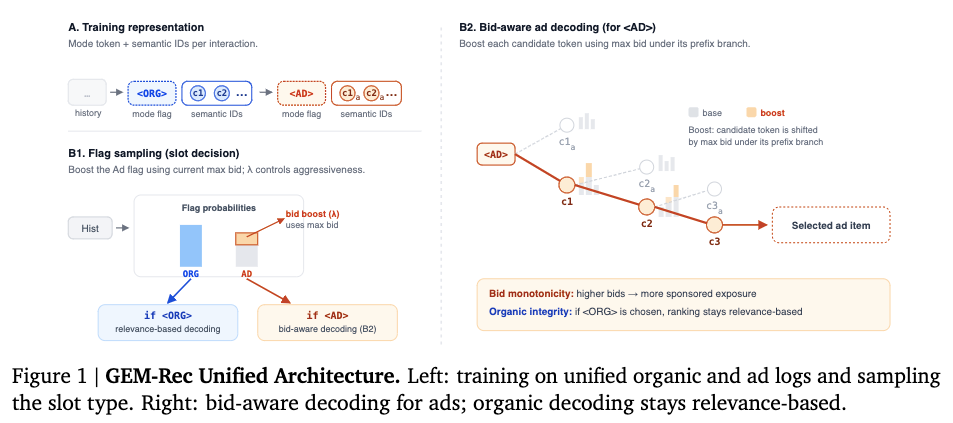

# Google: generative recommendation that unifies organic recommendations and ads

> [中文版](google-gem-rec.md)

### Paper: One Model, Two Markets: Bid-Aware Generative Recommendation
### Link: https://arxiv.org/pdf/2603.22231
### Company: Google
### Idea: unified modeling, generative modeling
### Area: unified recommendation and ads + GR

## Overview:
This paper proposes a generative recommendation model that can recommend both ad items and organic items. In next token prediction, besides predicting the next item, it also predicts whether to insert an organic item or an ad item; at inference it takes the bidding situation into account, tilting toward the ad scenario and toward high-bid ads.

### (1) Sequence construction
Items in the user behavior sequence get SIDs through RQ-VAE, which serve as the GR model's input. The items in the sequence are those the user interacted with positively, including not only organic items but also ad items. Earlier GR work would treat this information as part of the item representation. This paper instead prefixes the item type before its SID, using <AD> and <ORG> for ads and organic recommendations respectively. If an SID has d tokens, there are now d+1 tokens.
In other words, the sequence contains SID tokens and these flag tokens. A flag token is just an ordinary token added to the token set.

### (2) Training
Plain standard NTP: predict tokens, compute the loss and update the network. No distinction is made between kinds of tokens.
This way the GR model learns when to insert an ad and what kind of ad to insert.

### (3) Inference
First predict whether to serve an ad item or an organic item, then predict the specific item SID.

#### 1) Predicting the flag:
The logits for ad and organic in the flag position are computed as usual. To raise the probability of AD, a bias is added to the AD logit: $\lambda \cdot log(1 + b_{\max})$, where $b_{\max}$ is the highest bid, for the current user at the current slot, among all advertisers "eligible to take part in the auction".

Choosing the flag: it does not take the flag with the highest probability; it samples according to the probabilities.

#### 2) Predicting the SID tokens:
If the flag is ORG, the SID is predicted as usual. Otherwise, when predicting each token, a bias is added to each token's logit: $\lambda \cdot log(1 + B(c))$, where $B(c)$ is the current real-time maximum bid among all valid candidate items under prefix c (i.e. the whole subtree of that semantic cluster).
Then beam search generates the Semantic ID.

## Takeaways:
* Flag adjustment → nudge the "overall direction" a little toward ads (when market bids are high, an ad slot opens more easily). Item-level modulation → nudge the "fine direction" a little toward high-bid items (within the same semantic cluster, prefer high-bid branches). The whole process is like temporarily adding a "monetary tailwind booster" on top of the route already learned, with its strength controlled by λ: turn it up as far as you want to earn. The tilt is monotonic, controllable and smooth (it won't suddenly capsize).

## Credibility: offline

## Recommendation: practically useful

