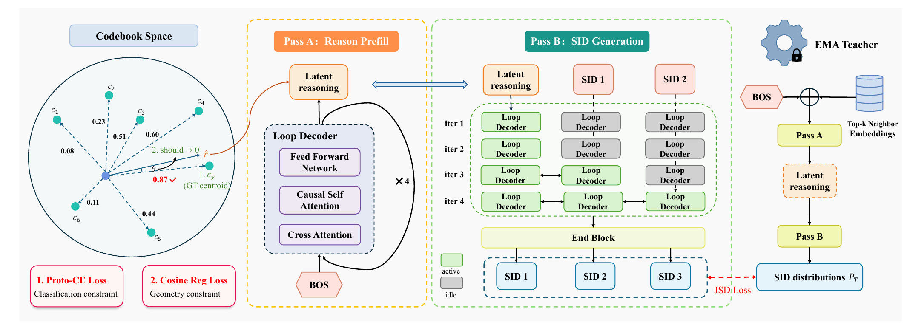

---

Kuaishou, generative ad retrieval: a decoder with less than half the parameters, +20% QPS, and still +0.65% eCPM. Three tricks to guess Semantic IDs better.
BRIDGE: Bridging the Semantic Quantization Gap for Generative Recommendation
arxiv.org/abs/2611.07425

Each ad's Semantic ID is 3 tokens: a coarse class, then two refinements. The decoder only sees code numbers. It knows the answer is code 17, but not where code 17 sits or which codes are its neighbors. BRIDGE, from the GR4AD team, adds three ways for the decoder to help itself.

1. Give the first token a reference
The first token is the hardest (1 of 2048) and has no prefix to lean on. Before predicting it, BRIDGE builds a reasoning vector and trains it to point at the target's coarse prototype (the 2048 level-1 centroids re-clustered into 256). It is refined in 4 passes through the shared decoder and replaces BOS. First-token loss: -3.95% offline, -2 to 3% online.

2. Learn which codes are close, from a privileged teacher
One-hot labels punish a near miss as hard as a wild miss. The teacher is an EMA copy of the student (decay 0.999). During training it also sees the mean embedding of the target's top-3 neighbors, added to its BOS. Its per-token distribution spreads probability over nearby codes, and the student matches it with a symmetric JS divergence. Why neighbors and not the target itself? Give the answer and the teacher collapses to one-hot. The teacher can't serve online, since nobody knows the target at request time, so only the student ships.

3. Train on your own prefix
On the distillation path the student feeds its own argmax tokens, not the true prefix, so it sees the states it will hit at inference, including its own mistakes. The teacher's distribution tells it where to go from there. You need both: without the teacher there's no label after a mistake; without the own prefix there's no mistake to learn from.

4. Spend depth where it's hard
One shared 3-layer block, reused: tokens 1, 2, 3 get 4, 2, 1 passes. The schedule is right-aligned, so when token 2 first runs, token 1 is already on its third pass. Later tokens attend to deeper states of earlier ones, unlike a normal decoder where layer k only sees layer k. Versus GR4AD's decoder: less than half the parameters, about +20% QPS online.

Takeaways
- Under a fixed latency budget, this isn't compression. It moves compute from easy positions to the hard one.
- All three tricks are the model helping itself: prep work before the hardest token, a slower and steadier self as teacher, and more effort where the task is hardest.

One caveat: the online A/B reports a single eCPM number and doesn't name the control group, so the three parts can't be separated online.

#Kuaishou #RecommenderSystems #GenerativeRecommendation #SemanticID #MachineLearning
