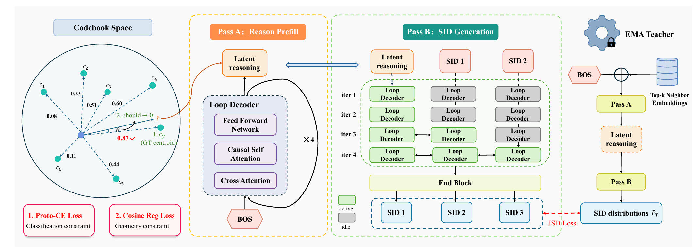

# Kuaishou BRIDGE: three tricks that help generative recommendation guess Semantic IDs better, eCPM +0.65%

> [中文版](kuaishou-bridge.md)

### Paper: BRIDGE: Bridging the Semantic Quantization Gap for Generative Recommendation
### Link: https://arxiv.org/abs/2611.07425
### Company: Kuaishou
### Idea: coarse before fine, distillation, compute allocated by difficulty
### Area: generative recommendation

## Overview:
This is another improvement on GR4AD, Kuaishou's generative recommender for ads. It makes three changes to the decoder, all aimed at predicting Semantic IDs (SIDs) more accurately. Each ad's SID is made of 3 tokens; below, "position 1, 2, 3" means the 1st, 2nd and 3rd token of the SID.
* **Reasoning token**: before guessing the first SID token, compute a reasoning vector and train it to point at the target's coarse class, giving the hardest first position a reference. (Already in [GR4AD-X](./kuaishou-gr4ad-x.full.en.md); this paper runs it for more passes.)
* **EMA self-distillation + the student uses its own prefix**: two tricks working together. First, a teacher that can see the target's neighbors provides soft labels, so the decoder learns which codes are close to each other. Second, the student trains on the prefix it generated itself, and when that prefix is wrong it still has the teacher's distribution to learn from, which mitigates exposure bias.
* **Compute allocated by difficulty**: the early positions are hard and the later ones easy, so positions 1, 2, 3 get 4, 2, 1 passes. Fewer parameters, higher QPS.

The three parts are linked: the reasoning token is the first pass of the loop decoder, and its representation is reused as the alignment target for distillation, at no extra compute.



### 1. Codebook-anchored reasoning token: give the first position a reference (inherited from GR4AD-X)
Why it's needed: to the decoder, a code is just a number. It knows the right answer is code 17, but not where code 17 sits in semantic space or which codes are close to it. The first position is the hardest to guess, an error there ruins everything after it, and it has no previously generated code to refer to. So before guessing the first position, this part builds a "prefix", a reasoning vector, and anchors it to the codebook centroids so it carries "which region of semantic space the target falls in". The first position is then no longer a direct pick among 2048 numbers based only on user behavior; it has a reference first.

This is GR4AD-X's reasoning token: a continuous vector inserted between BOS and the first SID token. The level-1 codebook centroids are clustered again into 256 coarse prototypes, and prototype classification plus cosine regression supervise the vector to point at the target ad's coarse prototype, helping the first position predict better. See the GR4AD-X write-up for details.

This paper differs in two ways:
* **More passes**: in GR4AD-X a small network computes the reasoning token from the BOS hidden state in one step. Here it goes through the shared loop decoder 4 times (each pass cross-attends to user behavior) before it settles. Note this does not generate 4 tokens: the same position's state is revised 4 times and the last result is kept, i.e. 12 layers of depth from 3 layers of parameters.
* **It replaces BOS**: GR4AD-X's input sequence is "BOS → reasoning token → SID", with BOS still there. Here BOS only initializes the reasoning token; during SID generation the input sequence is "reasoning token → SID", and BOS no longer appears.

Effect: the first-position SID loss drops 3.95% offline, meaning the model on average puts more probability on the correct first code, so the first position is predicted better "in the probabilistic sense". Online, it drops a steady 2 to 3% across time windows. There are probably three reasons the loss drops, the first being the main one:
* **The coarse class is set before guessing the first position**: during training the reasoning vector is required to point at the target ad's coarse prototype (one of 256). The 256 prototypes come from clustering the 2048 level-1 codes, so each covers about 8 codes on average. Once the decoder knows roughly which coarse class it is in, the first position goes from "1 of 2048" to "1 of a dozen or so", and the probability on the correct code naturally rises.
* **User behavior is read a few more times**: the reasoning vector passes through the loop decoder 4 times, each time cross-attending to user behavior, adding some computation for understanding the user before the first position is guessed.
* **One more training signal**: prototype classification plus cosine is an easier auxiliary task (256 classes instead of 2048). It gives the decoder extra gradient and helps it learn the coarse structure first.

### 2. Privileged EMA self-distillation + the student uses its own prefix
This part is really **two tricks** used together: the teacher gives soft labels (2.1), and the student trains on its own generated prefix (2.2). The first teaches the decoder which codes are close; the second teaches it how to continue after an earlier mistake.

To mitigate exposure bias, both are needed: with self-distillation alone and the student still fed the true prefix, it never sees a mistaken state; with its own prefix but no teacher, it has no label to learn from after a mistake.

#### (2.1) Privileged EMA self-distillation: teaching the decoder "which codes are close"
Why it's needed: the training labels are too "hard" and lose structure. A one-hot label only knows right and wrong: the true answer is code 17, and the other 2047 codes all count as wrong. But some of those codes correspond to ads very similar to the target and some to completely unrelated ones, and guessing either is penalized the same, so the model can't learn how near or far codes are from each other. The teacher's soft distribution brings in "which codes are also fine".

The teacher is a "slow copy" of the student. During training it sees one extra piece of information the student can't (the target ad's neighbors) and gives a soft distribution at each SID position (how much probability each of the 2048 codes gets). Besides the usual cross-entropy on the true SID, the student also pulls its distribution at each position toward the teacher's: at every SID token, the student's and teacher's output distributions are compared with a symmetric JS divergence, and the reasoning token's representation is aligned too (cosine). After training, only the student goes online.

**Teacher**: an exponential moving average (EMA, decay 0.999) of the student's parameters, with no backpropagation, so it is steadier than the student. The teacher has one **privilege**: during training, the target ad's top-3 semantic neighbors (found by cosine on the frozen item embeddings) are averaged, projected, and added to the teacher's BOS. This makes the teacher's SID predictions more accurate, so its soft distribution is more valuable. Online, nobody knows which ad will be recommended, so its neighbors aren't available either; the teacher can't go online, and **the student is what ships**.

Why neighbors and not the true SID: give the answer directly and the teacher's output becomes nearly one-hot, so distillation degenerates into ordinary cross-entropy. Give neighbors, and the teacher's soft distribution carries "which codes are close, and how close".

Two training-stability details: no distillation when the teacher is too confident (entropy below a threshold); the distillation weight ramps up linearly over the first 2000 steps, letting the student stabilize first. By around epoch 22 the student catches up with the teacher.

#### (2.2) The student uses its own prefix: learning how to continue after a mistake
It trains on its own generated prefix (at each position it takes its own most probable code from the previous step and continues, instead of being fed the true prefix), so training matches inference. Note this applies only to the distillation path: the student runs twice in training, once on the true prefix with cross-entropy against the true SID, and once on its own prefix aligned to the teacher's distribution. Mitigating exposure bias relies on this working together with the teacher:
* **The student uses its own prefix**: in training it already sees the states it will meet at inference, including prefixes after its own mistakes. Ordinary teacher forcing always feeds the correct prefix, so the model never learns "what to do after an earlier mistake".
* **The teacher gives a target in those states**: when the student's prefix is wrong, the true label for position 2 belongs under the true position 1 and may no longer hold. The teacher always uses the true prefix and gives "what the distribution at each position should be on the correct path". The student moves toward it whether its own prefix is right or not, so even after a mistake it has a clear direction to learn.

### 3. Compute allocated by difficulty: more for the first position, less further on
Background first: each ad's SID is 3 tokens; the 1st is a coarse class and the next two refine it step by step, so the 1st is hardest to guess and it gets easier further on. An ordinary decoder nevertheless gives all 3 tokens the same compute.

This paper's approach: the decoder becomes a 3-layer loop block that is reused, with SID tokens 1, 2, 3 getting 4, 2, 1 passes. This saves both parameters and compute: extra passes add no parameters, only extra forward passes, and the later two positions compute less. Compared with GR4AD's decoder, it has less than half the parameters, and online QPS rises about 20%.

"Loop" means parameter sharing, but not sharing among the 3 layers. An ordinary decoder (such as GR4AD's 9 layers) has separate parameters for each of its 9 layers; the input goes from layer 1 to layer 9, each layer once. BRIDGE's loop block has only 3 layers, each with its own parameters, just like an ordinary decoder; the difference is that this 3-layer block is reused, in pass 1 and again in passes 2, 3 and 4. So "sharing" means **the same 3-layer block is used across passes and across SID positions**, not that the 3 layers share parameters.

The passes are "right-aligned": all three positions run until pass 4, but start at different passes. Position 1 occupies passes 1 to 4, position 2 passes 3 to 4, and position 3 only pass 4. Laid out horizontally by pass, the three bars line up on the right, hence "right-aligned". Note that a "pass" here is an index of depth (which repetition), not time: it decides which repetition of an earlier position's state a later position sees.

```
pass:        1  2  3  4
position 1:  ■  ■  ■  ■
position 2:        ■  ■
position 3:           ■
                      ↑ aligned on the right
```

This is very different from an ordinary decoder. In an ordinary decoder, position 2 at layer k can only see position 1's state at layer k, so their depths are aligned. With BRIDGE's right alignment, position 2's first pass sits at pass 3, which corresponds to position 1's third pass, so position 2 directly sees a state deeper than its own. This does not mean position 1's outputs from passes 1 and 2 are concatenated and handed to position 2; each position keeps only its latest state. The earlier position "thinks it through" first, and the later one refines on top of that.

Finally a lightweight output block is applied once to bring all positions' states back into the same space before producing probabilities; there, later positions get one more look at earlier positions after all their passes.

Why iterate more: to tilt compute toward the hard positions. Each online request has a fixed latency budget, so total compute is capped; this part is not blind compression, but moving compute within that cap from easy positions to more useful ones. Position 1 has to pick a coarse class out of 2048 codes, is the hardest, and an error there ruins everything after; position 3 is an almost deterministic refinement. One iteration means passing through the 3-layer block again with the previous result and reading user behavior again, so iterating more amounts to a deeper network: position 1 goes through 4 passes, a compute depth of 12 layers. But it deepens computation without adding parameters, since all 4 passes use the same 3 layers. And precisely because parameters are shared, different positions can have different depths (12 layers for position 1, 3 for position 3). Ordinary stacking can't do that: adding a layer adds it for every position.

### Supplement: no Transformer encoder on the user-behavior side
Each historical item's embedding (in the offline experiments, a 1536-dimensional semantic vector from encoding product text with Qwen2.5-1.5B; the SIDs are quantized from it too, so a single item's representation is already rich) goes through a two-layer MLP on its own, gets a position embedding added, and is used directly as "user memory". Items don't do self-attention and don't interact with each other. The behavior sequence appears only on the queried side of the decoder's cross-attention, and modeling it relies entirely on the decoder reading it over and over, which is also why the parts above all revolve around "computing a few more passes".

### A/B:
Kuaishou e-commerce ads, 5% traffic: eCPM (revenue) +0.65%.

## Takeaways:
* All three tricks come down to "lending a hand": the reasoning token does some prep work before the hardest first token to give it a direction; EMA self-distillation lets a slower, steadier version of the model coach the current one; compute by difficulty puts more effort where it's hardest, spending energy where it's needed most.

## Caveats
* The online A/B gives only one eCPM number and doesn't state the control group clearly. How much each of the three parts contributes online can't be separated; only the compute part reports QPS.

## Credibility: production

## Recommendation: practically useful
